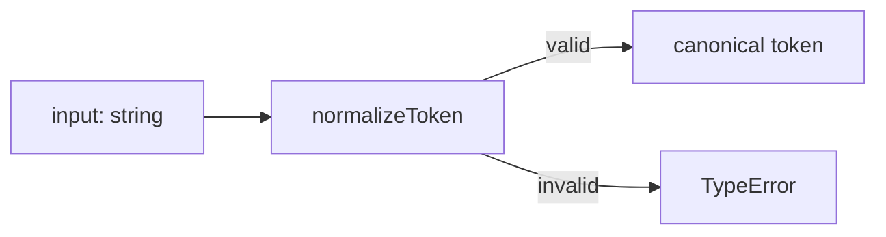
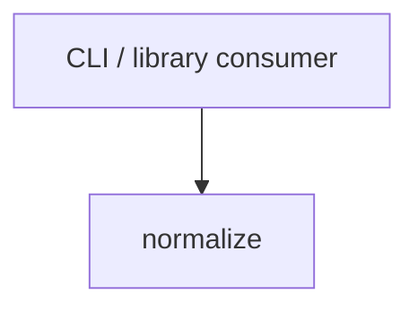

# Module: normalize

<!--SECTION:SPEC_ID-->
TOKEN-NORMALIZE
<!--/SECTION:SPEC_ID-->

<!--SECTION:MODULE_VISION-->
## Module Vision

Модуль владеет единственным поведением: детерминированно превращать одну ASCII-строку в канонический токен. Родительский скоуп — [token](../token.spec.md). Соседних модулей в скоупе нет; дочерних модулей тоже нет, дальнейшая декомпозиция для этой ответственности не требуется.
<!--/SECTION:MODULE_VISION-->

<!--SECTION:OVERVIEW-->
## Overview


_Один детерминированный проход от входной строки к токену или отказу — NOR-REQ-1, NOR-REQ-2._
<!--/SECTION:OVERVIEW-->

<!--SECTION:MODULE_USAGE_EXAMPLE-->
## Module Usage Example

Инициализация не нужна: модуль импортируется и вызывается напрямую.

```ts
import { normalizeToken } from "./normalize";

const token = normalizeToken("  Foo__BAR  ");
console.log(token); // "foo-bar"

try {
  normalizeToken("");
} catch (error) {
  if (error instanceof TypeError) {
    console.error("invalid token");
  }
}
```
<!--/SECTION:MODULE_USAGE_EXAMPLE-->

<!--SECTION:MODULE_REQUIREMENTS-->
## Requirements

### NOR-REQ-1 [должен]
**Когда** передана ASCII-строка, которая содержит хотя бы один символ, отличный от пробела, underscore и hyphen, **нормализатор должен** обрезать крайние ASCII-пробелы, привести ASCII-буквы к lower-case и свернуть каждую серию пробелов, underscore и hyphen в один hyphen.

> Уточняет TOK-REQ-1: модуль владеет единственным наблюдаемым преобразованием токена; без него потребители получают разные написания одного и того же токена.

### NOR-REQ-2 [должен · нештатная]
**Если** строка пустая, состоит только из разделителей или содержит не-ASCII символы, **то нормализатор должен** выбросить TypeError без ввода-вывода и без возврата значения.

> Уточняет TOK-REQ-2: ошибку входа нельзя маскировать пустым корректным токеном; отсутствие ввода-вывода делает отказ локальным и детерминированным.

| Input | Outcome |
|---|---|
| `"  Foo__BAR  "` | `"foo-bar"` |
| `""` | `TypeError` |
<!--/SECTION:MODULE_REQUIREMENTS-->

<!--SECTION:INTER_MODULE_DEPENDENCIES-->
## Inter-Module Dependencies
- **Depends on:** нет модулей внутри скоупа `token`.
- **Scope Reference (cross-scope):** нет; зависимость скоупа от [infra-base](../../infra-base/infra-base.spec.md) относится к среде авторинга, а не к поведению этого модуля.
- **Provides to:** локальные CLI- и библиотечные потребители вне скоупа; внутри скоупа потребителей пока нет.


_Потребители вызывают normalize напрямую; соседних модулей нет._
<!--/SECTION:INTER_MODULE_DEPENDENCIES-->

<!--SECTION:ENTITY_INVENTORY-->
## Entity Inventory

_Это полный список сущностей модуля. Любое введение сущности execution-агентом помимо этого списка считается drift'ом и требует обновления spec._

| Name | Type | Purpose |
|------|------|---------|
| `normalizeToken` | Function | Чистое детерминированное преобразование ASCII-строки в канонический токен |

Ошибки: throw TypeError → `normalizeToken`

ER sketch не рисуется: в инвентаре одна сущность, связывать нечего.
<!--/SECTION:ENTITY_INVENTORY-->

<!--SECTION:ENTITY_SURFACES-->
## Entity Surfaces

Одна публичная функция без состояния; ниже — её полная поверхность.

<details>
<summary>Полные поверхности сущностей</summary>

### `normalizeToken`
- **Type:** Function
- **Purpose:** Возвращает канонический токен для допустимой ASCII-строки и отвергает недопустимый вход.
- **Public Properties:** N/A
- **Public Operations:** `normalizeToken(input)` — вернуть канонический токен или выбросить TypeError.
- **Lifecycle:** Stateless: импортируется потребителем, живёт в процессе, ресурсов не удерживает и не завершается отдельно.
- **Events Emitted:** N/A
- **Errors & Degradation:** TypeError через throw; владелец — `normalizeToken`; обработка и отображение остаются за вызывающим потребителем.
- **Consumers:**
  - Internal: нет внутренних потребителей в модуле
  - External: local CLI и library consumers
- **Usage Waiver (external: local CLI и library consumers):** единственная публичная точка модуля, напрямую используемая двумя типами внешних потребителей.

</details>
<!--/SECTION:ENTITY_SURFACES-->

<!--SECTION:MODULE_CONTRACTS-->
## Module Contracts

Один чистый Function-контракт; Port и Adapter не вводятся, потому что нет подтверждённой вариативности и отдельного тестового шва.

Граф зависимостей не рисуется: в модуле нет Port/Adapter, только Function `normalizeToken`. Call Chain не рисуется: в инвентаре одна абстракция, оркестрировать нечего.

<details>
<summary>Контракты DbC</summary>

### Services

#### Service: `normalizeToken`
- **Purpose:** Детерминированно нормализовать одну ASCII-строку в канонический токен или отвергнуть недопустимый вход.
- **Consumers:** local CLI и library consumers
- **Runtime Backing:** `not-implemented`
- **Verification Levels:** `contract`, `unit`
- **Deferred Runtime Scope:** Вся заявленная реализация отложена; код в этой задаче не запрошен.

**Contract (DbC)**
- `normalizeToken(input)`:
  - Pre: `input` — строка; она непустая, содержит хотя бы один символ, отличный от пробела, `_` и `-`, и состоит только из ASCII-символов.
  - Post: возвращена строка; крайние ASCII-пробелы удалены, ASCII-буквы приведены к lower-case, каждая серия пробелов, `_` и `-` заменена одним `-`.
  - On pre-violation: синхронно выброшен TypeError без ввода-вывода и без возврата значения.

**Invariants:** вызов не читает и не пишет внешнее состояние, не зависит от времени, сети и окружения; одинаковый вход даёт одинаковый результат.
</details>
<!--/SECTION:MODULE_CONTRACTS-->

<!--SECTION:PUBLIC_OPTIONS-->
## Public Options & Policies

Публичных опций нет: единственная функция не принимает настроек и не читает конфигурацию.

<details>
<summary>Опции и политики</summary>

N/A — в этой ограниченной версии опции не потребляются и никакой тикет их не активирует.
</details>
<!--/SECTION:PUBLIC_OPTIONS-->

<!--SECTION:FILE_STRUCTURE-->
## File Structure
```
normalize/
├── normalize.ts
└── normalize.test.ts
```

**File Mapping:**
- `normalize/normalize.ts`: чистая реализация `normalizeToken` и отказ TypeError.
- `normalize/normalize.test.ts`: контрактные и unit-проверки нормализации и отказа.
<!--/SECTION:FILE_STRUCTURE-->

<!--SECTION:RESEARCH-->
## Research

No research documents: модуль полностью определён брифом и [token contract](../../../docs/token-contract.md); каталог `specs/token/research/` отсутствует и ничего в него не зарегистрировано.
<!--/SECTION:RESEARCH-->

<!--SECTION:MODULE_DECISION_LOG-->
## Module Decision Log

Записано одно решение: отказ от Port/Adapter в пользу одного чистого Function-контракта.

<details>
<summary>Полные записи Decision Log</summary>

NOR-DL-1 2026-10-23 — нормализация остаётся одной чистой функцией без Port/Adapter; где: specs/token/normalize/normalize.spec.md#module-contracts (почему: нет вариативности и отдельного тестового шва, требующих абстракции; отвергнуто: Port с единственной реализацией — лишний слой) [verdict: pending-operator]
</details>
<!--/SECTION:MODULE_DECISION_LOG-->

<!--SECTION:HANDOFF-->
## Handoff to Tasks
- **Status:** `pending-operator` — Approval #1 не дан; тикеты и исполнение не авторизованы.
- **Implementation files to be created:** `normalize/normalize.ts`
- **Test files to be created:** `normalize/normalize.test.ts`
- **Stack dependencies:**
  - Language: `typescript` (resolves to `ai/directives/coding/typescript-rules.xml`)
  - Test framework: `node:test` (resolves to `ai/directives/testing/node-test.xml`)
- **Module Rules Additions:** None — no additions beyond the scope-wide baseline.

- **Open risks & validation needs:**
  - Approval #1 отсутствует; этот документ остаётся черновиком без операторского решения.
  - Реализация не запрошена и не существует; TypeScript и тестовые привязки не провижены в этой фикстуре и должны быть подтверждены при scaffold.
  - Проверка ASCII должна выполняться до нормализации; Unicode-транслитерация и Unicode-нормализация явно вне области модуля.
<!--/SECTION:HANDOFF-->

<!--SECTION:IMPLEMENTATION_INSIGHTS-->
## Implementation Insights

Пост-имплементационных наблюдений нет: реализация ещё не начиналась.

<details>
<summary>Заметки по реализации</summary>

N/A — приложение заполняется только после циклов аудита; ни кода, ни аудита в этой задаче авторинга нет.
</details>
<!--/SECTION:IMPLEMENTATION_INSIGHTS-->
