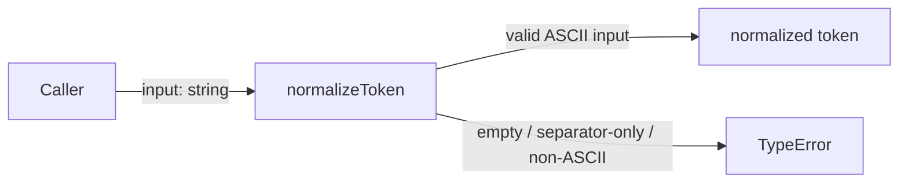
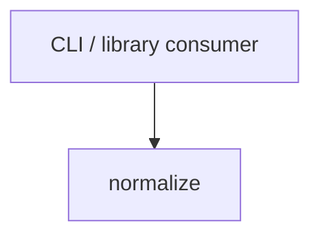

# Module: normalize

<!--SECTION:SPEC_ID-->
TOKEN-NORMALIZE
<!--/SECTION:SPEC_ID-->

<!--SECTION:MODULE_VISION-->
## Module Vision
Own the pure `normalizeToken` function: its deterministic ASCII normalization and its explicit rejection of invalid input. Parent scope: [token](../token.spec.md). The module has no sibling or child modules; the scope's Module Map points here.
<!--/SECTION:MODULE_VISION-->

<!--SECTION:OVERVIEW-->
## Overview

_Нормализация ASCII-токена с явным отказом на недопустимом входе — NOR-REQ-1, NOR-REQ-2._
<!--/SECTION:OVERVIEW-->

<!--SECTION:MODULE_USAGE_EXAMPLE-->
## Module Usage Example
```ts
import { normalizeToken } from './normalize.js';

const slug = normalizeToken('  Foo__BAR  ');
console.log(slug);

try {
  normalizeToken('');
  throw new Error('expected TypeError');
} catch (error) {
  if (!(error instanceof TypeError)) throw error;
}
```
<!--/SECTION:MODULE_USAGE_EXAMPLE-->

<!--SECTION:MODULE_REQUIREMENTS-->
## Requirements
### NOR-REQ-1 [должен]
**Когда** передана ASCII-строка, которая содержит хотя бы один символ, отличный от пробела, underscore и hyphen, **нормализатор должен** обрезать крайние ASCII-пробелы, привести ASCII-буквы к нижнему регистру и свернуть серии пробелов, underscore и hyphen в один hyphen.

> Реализует TOK-REQ-1: модуль владеет единственным детерминированным преобразованием, которое превращает допустимую ASCII-строку в канонический токен.

### NOR-REQ-2 [должен · нештатная]
**Если** входная строка пустая, состоит только из пробелов, underscore или hyphen либо содержит не-ASCII символы, **то нормализатор должен** выбросить `TypeError` без ввода-вывода.

> Реализует TOK-REQ-2: недопустимый вход нельзя маскировать пустым или частично нормализованным токеном, поэтому отказ остаётся наблюдаемым.

| Input | Outcome |
|---|---|
| `"  Foo__BAR  "` | `"foo-bar"` |
| `""` | `TypeError` |
<!--/SECTION:MODULE_REQUIREMENTS-->

<!--SECTION:INTER_MODULE_DEPENDENCIES-->
## Inter-Module Dependencies
- **Depends on:** None within scope `token`.
- **Scope Reference (cross-scope):** None.
- **Provides to:** None within the scope; CLI and library consumers of `token` call this module directly.


_У модуля normalize нет зависимостей от соседних модулей; его вызывает внешний потребитель._
<!--/SECTION:INTER_MODULE_DEPENDENCIES-->

<!--SECTION:ENTITY_INVENTORY-->
## Entity Inventory
_Это полный список сущностей модуля. Любое введение сущности execution-агентом помимо этого списка считается drift'ом и требует обновления spec._

| Name | Type | Purpose |
|------|------|---------|
| `normalizeToken` | Function | Детерминированно нормализует допустимую ASCII-строку в токен |

Ошибки: throw `TypeError` → `normalizeToken`

ER-sketch не рисуется: в инвентаре одна сущность, связывать нечего.
<!--/SECTION:ENTITY_INVENTORY-->

<!--SECTION:ENTITY_SURFACES-->
## Entity Surfaces
Поверхность одна: публичная функция `normalizeToken` с входом-строкой, возвратом-токеном и отказом через `TypeError`.

<details>
<summary>Полные поверхности сущностей</summary>

### `normalizeToken`
- **Type:** Function
- **Purpose:** Преобразует допустимую ASCII-строку в канонический токен с одним hyphen между словами.
- **Public Properties:** N/A
- **Public Operations:** `normalizeToken` — нормализовать допустимую строку; отклонить недопустимый вход через `TypeError`.
- **Lifecycle:** Вызывается потребителем без состояния; завершается возвратом токена или выбросом `TypeError`.
- **Events Emitted:** N/A
- **Errors & Degradation:** `TypeError` через throw, владелец — `normalizeToken`; обработка остаётся у вызывающего кода. Ввод-вывод и fallback-токен отсутствуют.
- **Consumers:**
  - Internal: нет; это входная точка модуля.
  - External: CLI и библиотечные потребители скоупа `token`.
- **Usage Waiver (external: token scope CLI/library consumers):** Единственная публичная операция модуля; внешние потребители скоупа — причина её существования.

</details>
<!--/SECTION:ENTITY_SURFACES-->

<!--SECTION:MODULE_CONTRACTS-->
## Module Contracts
Модуль не определяет Port или Adapter: единственная абстракция — чистый Service/Function `normalizeToken`, который владеет преобразованием и отказом через `TypeError`.

Граф зависимостей не рисуется: в модуле нет Port/Adapter, только Service `normalizeToken`.

Call Chain не строится: в модуле одна абстракция — `normalizeToken`; последовательность вызова описана её контрактом ниже.

<details>
<summary>Контракты DbC</summary>

### Services

#### Service: `normalizeToken`
- **Purpose:** Детерминированно нормализовать допустимую ASCII-строку в канонический токен.
- **Consumers:** Internal: нет; external: CLI и библиотечные потребители скоупа `token`.
- **Runtime Backing:** `not-implemented`
- **Verification Levels:** `contract`, `unit`
- **Deferred Runtime Scope:** None — реализация не входит в этот артефакт.

**Contract (DbC)**
- `normalizeToken`:
  - Pre: `input` — JavaScript-строка, каждый символ которой ASCII, и в ней есть хотя бы один символ, отличный от ASCII-пробела, underscore и hyphen.
  - Post: возвращает вход с удалёнными крайними ASCII-пробелами, ASCII-буквами в нижнем регистре и каждой серией ASCII-пробелов, underscore и hyphen, свёрнутой в один hyphen.
  - On pre-violation: выбрасывает `TypeError`, не выполняет ввод-вывод и не возвращает токен.

**Invariants:** Функция не хранит состояние и не выполняет ввод-вывод; одинаковый допустимый вход даёт одинаковый выход.

</details>
<!--/SECTION:MODULE_CONTRACTS-->

<!--SECTION:PUBLIC_OPTIONS-->
## Public Options & Policies
Публичных опций, флагов и политик нет: функция принимает только аргумент `input`.

<details>
<summary>Опции и политики</summary>

None. Любая будущая опция потребует отдельного требования и контракта.

</details>
<!--/SECTION:PUBLIC_OPTIONS-->

<!--SECTION:FILE_STRUCTURE-->
## File Structure
```
normalize/
├── normalize.ts
└── normalize.test.ts
```

**File Mapping:**
- `normalize/normalize.ts`: чистая функция `normalizeToken` и её ветка `TypeError`.
- `normalize/normalize.test.ts`: контрактные и unit-проверки нормализации и отказа.
<!--/SECTION:FILE_STRUCTURE-->

<!--SECTION:RESEARCH-->
## Research
No research documents for this bounded deterministic module.
<!--/SECTION:RESEARCH-->

<!--SECTION:MODULE_DECISION_LOG-->
## Module Decision Log
Одна запись: чистая функция без Port/Adapter; вердикт ожидает оператора.

<details>
<summary>Полные записи Decision Log</summary>

NOR-DL-1 2026-10-23 — оставить `normalizeToken` чистым Function без Port/Adapter; где: specs/token/normalize/normalize.spec.md#module-contracts (почему: одна детерминированная реализация без подтверждённой вариативности или test seam; отвергнуто: Port+Adapter — не даёт второй реализации) [verdict: pending-operator]

NOR-DL-2 2026-10-23 — module draft complete (почему: sdd-check --spec specs/token/normalize/normalize.spec.md --authoring прошёл без замечаний)

</details>
<!--/SECTION:MODULE_DECISION_LOG-->

<!--SECTION:HANDOFF-->
## Handoff to Tasks
- **Implementation files to be created:** `normalize/normalize.ts`
- **Test files to be created:** `normalize/normalize.test.ts`
- **Stack dependencies:**
  - Language: `typescript` (resolves to `ai/directives/coding/typescript-rules.xml`)
  - Test framework: `node-test` (resolves to `ai/directives/testing/node-test.xml`)
- **Module Rules Additions:** None — scope-wide baseline applies; no module-specific rules.

- **Open risks & validation needs:** Реализация и runtime-проверка не созданы. Единственное текущее свидетельство — authoring check; поведение остаётся проверить в последующих задачах. Операторского одобрения нет, handoff остаётся в состоянии pending-operator.
<!--/SECTION:HANDOFF-->

<!--SECTION:IMPLEMENTATION_INSIGHTS-->
## Implementation Insights
Not applicable: реализация ещё не написана, поэтому post-implementation выводов нет.

<details>
<summary>Заметки по реализации</summary>

No implementation has been authored; this appendix is intentionally empty until a later implementation cycle produces non-trivial learnings.

</details>
<!--/SECTION:IMPLEMENTATION_INSIGHTS-->
