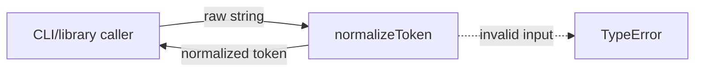
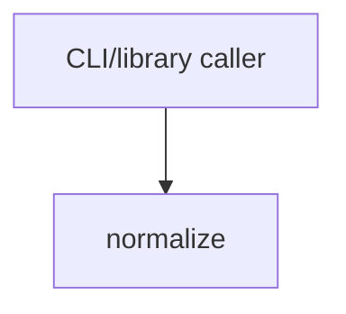

# Module: normalize

<!--SECTION:SPEC_ID-->
TOKEN-NORMALIZE
<!--/SECTION:SPEC_ID-->

<!--SECTION:MODULE_VISION-->
## Module Vision
Owns the stateless token-normalization transformation for the [token](../token.spec.md) scope: trimming, ASCII lowercasing and separator collapsing behind one pure function. The scope has no sibling modules, child modules or parent module; this module is its only detailed owner.
<!--/SECTION:MODULE_VISION-->

<!--SECTION:OVERVIEW-->
## Overview

_Путь нормализации токена — NOR-REQ-1._
<!--/SECTION:OVERVIEW-->

<!--SECTION:MODULE_USAGE_EXAMPLE-->
## Module Usage Example
```ts
import { normalizeToken } from "./normalize";

const token = normalizeToken("  Foo__BAR  ");
console.log(token); // "foo-bar"

try {
  normalizeToken("");
} catch (error) {
  if (error instanceof TypeError) {
    console.error("invalid token input");
  }
}
```
<!--/SECTION:MODULE_USAGE_EXAMPLE-->

<!--SECTION:MODULE_REQUIREMENTS-->
## Requirements
### NOR-REQ-1 [должен]
**Когда** передана ASCII-строка, содержащая хотя бы один символ, отличный от пробела, underscore и hyphen, **нормализатор должен** обрезать крайние пробелы, привести ASCII-буквы к нижнему регистру и свернуть последовательности пробелов, underscore и hyphen в один hyphen.

> Уточняет TOK-REQ-1: модуль фиксирует точный детерминированный результат нормализации для CLI и библиотечных потребителей.

### NOR-REQ-2 [должен · нештатная]
**Если** строка пуста, состоит только из разделителей (пробелов, underscore и hyphen) или содержит не-ASCII символы, **то нормализатор должен** выбросить TypeError, не выполняя ввод-вывод.

> Уточняет TOK-REQ-2: ошибку входа нельзя маскировать пустым корректным токеном.

| Input | Outcome |
|---|---|
| `"  Foo__BAR  "` | `"foo-bar"` |
| `""` | `TypeError` |
<!--/SECTION:MODULE_REQUIREMENTS-->

<!--SECTION:INTER_MODULE_DEPENDENCIES-->
## Inter-Module Dependencies
- **Depends on:** None.
- **Scope Reference (cross-scope):** None — no cross-scope interface is consumed at runtime.
- **Provides to:** None within the scope; the public function is consumed by CLI and library callers outside the scope.


_Зависимостей внутри scope нет; изображён только внешний вызывающий._
<!--/SECTION:INTER_MODULE_DEPENDENCIES-->

<!--SECTION:ENTITY_INVENTORY-->
## Entity Inventory
_Это полный список сущностей модуля. Любое введение сущности execution-агентом помимо этого списка считается drift'ом и требует обновления spec._

| Name | Type | Purpose |
|------|------|---------|
| `normalizeToken` | Service | Чистая нормализация ASCII-токена с отказом на недопустимом входе |

Ошибки: throw → `normalizeToken`

ER sketch не рисуется: инвентарь содержит одну сущность без связей.
<!--/SECTION:ENTITY_INVENTORY-->

<!--SECTION:ENTITY_SURFACES-->
## Entity Surfaces
Одна сущность `normalizeToken`: чистая функция с единственной публичной операцией и ошибкой через throw.

<details>
<summary>Полные поверхности сущностей</summary>

### `normalizeToken`
- **Type:** Service
- **Purpose:** Нормализует ASCII-токен или выбрасывает TypeError на недопустимом входе.
- **Public Properties:** N/A
- **Public Operations:** Нормализовать входную строку; выбросить TypeError на недопустимом входе.
- **Lifecycle:** Stateless; вызывающий не создаёт экземпляр, функция доступна на протяжении жизни модуля и не завершается.
- **Events Emitted:** N/A
- **Errors & Degradation:** `TypeError` через throw, владелец — `normalizeToken`; без I/O и без fallback.
- **Consumers:**
  - Internal: none
  - External: CLI and library callers
- **Usage Waiver (external: CLI and library callers):** Единственная публичная операция модуля и есть его назначение.

</details>
<!--/SECTION:ENTITY_SURFACES-->

<!--SECTION:MODULE_CONTRACTS-->
## Module Contracts
Модуль определяет один Service `normalizeToken`; Port и Adapter отсутствуют. Граф не рисуется: в модуле нет Port/Adapter, только Service `normalizeToken`. Call Chain не рисуется: в инвентаре одна абстракция — Service `normalizeToken`.

<details>
<summary>Контракты DbC</summary>

### Ports
Не применимо: модуль не определяет Port — подтверждённой вариативности или тестового шва нет.

### Adapters
Не применимо: модуль не определяет Adapter — внешнего I/O и платформенной реализации нет.

### Services

#### Service: `normalizeToken`
- **Purpose:** Нормализует ASCII-токен детерминированно или отказывает на недопустимом входе.
- **Consumers:** CLI and library callers
- **Runtime Backing:** `not-implemented`
- **Verification Levels:** `contract`, `unit`
- **Deferred Runtime Scope:** Вся заявленная функциональность не имеет runtime; реализация не входит в эту авторскую задачу.

**Contract (DbC)** — одна операция:
- `normalizeToken`:
  - Pre: вход — строка, все символы которой ASCII, и в ней есть хотя бы один символ, отличный от пробела, underscore и hyphen.
  - Post: возвращена строка с обрезанными крайними пробелами, ASCII-буквами в нижнем регистре и одиночными hyphen вместо последовательностей пробелов, underscore и hyphen.
  - On pre-violation: TypeError через throw; ввод-вывод не выполняется.

**Invariants:** Функция чистая: не читает и не изменяет внешнее состояние и не выполняет ввод-вывод.

</details>
<!--/SECTION:MODULE_CONTRACTS-->

<!--SECTION:PUBLIC_OPTIONS-->
## Public Options & Policies
Публичных опций нет; поведение нормализации фиксировано.

<details>
<summary>Опции и политики</summary>

Публично наблюдаемые флаги, опции и политики отсутствуют. Отложенных опций нет: контракт `normalizeToken` не настраивается и не имеет версионных переключателей.

</details>
<!--/SECTION:PUBLIC_OPTIONS-->

<!--SECTION:FILE_STRUCTURE-->
## File Structure
```text
normalize/
├── normalize.ts
└── normalize.test.ts
```

**File Mapping:**
- `normalize/normalize.ts`: чистая реализация `normalizeToken`
- `normalize/normalize.test.ts`: unit-тесты нормализации и отказа TypeError
<!--/SECTION:FILE_STRUCTURE-->

<!--SECTION:RESEARCH-->
## Research
No research documents for this bounded deterministic module.
<!--/SECTION:RESEARCH-->

<!--SECTION:MODULE_DECISION_LOG-->
## Module Decision Log
Зафиксировано одно решение: модуль остаётся одной чистой функцией без Port/Adapter.

<details>
<summary>Полные записи Decision Log</summary>

NOR-DL-1 2026-10-23 — модуль остаётся одной чистой функцией `normalizeToken` без Port/Adapter; где: specs/token/normalize/normalize.spec.md#module-contracts (почему: нет подтверждённой вариативности или внешнего I/O) [verdict: pending-operator]

</details>
<!--/SECTION:MODULE_DECISION_LOG-->

<!--SECTION:HANDOFF-->
## Handoff to Tasks
- **Implementation files to be created:** `normalize/normalize.ts`
- **Test files to be created:** `normalize/normalize.test.ts`
- **Stack dependencies:**
  - Language: `TypeScript` (resolves to `ai/directives/coding/typescript-rules.xml`)
  - Test framework: `node-test` (resolves to `ai/directives/testing/node-test.xml`)
- **Module Rules Additions:** None.
- **Open risks & validation needs:** Implementation, runtime verification and test-framework binding are not yet in place; owner review remains pending.
<!--/SECTION:HANDOFF-->

<!--SECTION:IMPLEMENTATION_INSIGHTS-->
## Implementation Insights
Не применимо: реализация не выполнялась, post-implementation заметок нет.

<details>
<summary>Заметки по реализации</summary>

Не применимо: секция появляется только после реализации и аудита, которых в этой авторской задаче не было.

</details>
<!--/SECTION:IMPLEMENTATION_INSIGHTS-->
