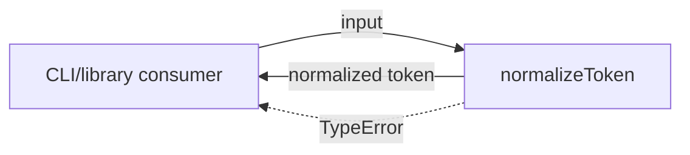
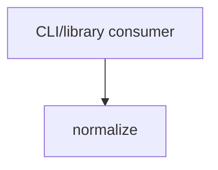

# Module: normalize

<!--SECTION:SPEC_ID-->
TOKEN-NORMALIZE
<!--/SECTION:SPEC_ID-->

<!--SECTION:MODULE_VISION-->
## Module Vision

Модуль `normalize` владеет единственной операцией нормализации токена внутри scope [token](../token.spec.md): чистая функция `normalizeToken`, которая приводит допустимую ASCII-строку к каноническому виду и отклоняет недопустимый вход. Собственных parent или child модулей нет.
<!--/SECTION:MODULE_VISION-->

<!--SECTION:OVERVIEW-->
## Overview


_Путь нормализации токена, включая отказ на недопустимом входе — NOR-REQ-1, NOR-REQ-2._
<!--/SECTION:OVERVIEW-->

<!--SECTION:MODULE_USAGE_EXAMPLE-->
## Module Usage Example

```ts
import { normalizeToken } from "./normalize.js";

const token = normalizeToken("  Foo__BAR  ");
console.log(token);

try {
  normalizeToken("");
} catch (error) {
  if (error instanceof TypeError) {
    console.error(error.message);
  }
}
```
<!--/SECTION:MODULE_USAGE_EXAMPLE-->

<!--SECTION:MODULE_REQUIREMENTS-->
## Requirements

### NOR-REQ-1 [должен]
**Когда** на вход подана непустая ASCII-строка, содержащая хотя бы один символ, отличный от пробела, underscore и hyphen, **нормализатор должен** обрезать крайние ASCII-пробелы, привести ASCII-буквы к lower-case и свернуть серии пробелов, underscore и hyphen в один hyphen.

> Уточняет TOK-REQ-1 для модуля `normalize`: сценарий `normalize-example` фиксирует ожидаемый канонический результат.

### NOR-REQ-2 [должен · нештатная]
**Если** вход пустой, состоит только из разделителей (пробелы, underscore, hyphen) или содержит не-ASCII символы, **то нормализатор должен** выбросить `TypeError` без ввода-вывода.

> Уточняет TOK-REQ-2 для модуля `normalize`: сценарий `empty-input-rejection` не позволяет маскировать ошибку входа пустым корректным токеном.

| Input | Outcome |
|---|---|
| `"  Foo__BAR  "` | `"foo-bar"` |
| `""` | `TypeError` |
<!--/SECTION:MODULE_REQUIREMENTS-->

<!--SECTION:INTER_MODULE_DEPENDENCIES-->
## Inter-Module Dependencies

- **Depends on:** нет модулей внутри scope `token`.
- **Scope Reference (cross-scope):** нет.
- **Provides to:** внешние CLI- и библиотечные потребители scope `token`.


_Внешние потребители вызывают normalize; внутренних междомодульных зависимостей нет._
<!--/SECTION:INTER_MODULE_DEPENDENCIES-->

<!--SECTION:ENTITY_INVENTORY-->
## Entity Inventory

_Это полный список сущностей модуля. Любое введение сущности execution-агентом помимо этого списка считается drift'ом и требует обновления spec._

| Name | Type | Purpose |
|------|------|---------|
| `normalizeToken` | Service | Чистая нормализация ASCII-токена и отказ на недопустимом входе |

Ошибки: throw `TypeError` → `normalizeToken`.

Инвентарь содержит одну сущность, поэтому ER-схема не рисуется: связывать нечего.
<!--/SECTION:ENTITY_INVENTORY-->

<!--SECTION:ENTITY_SURFACES-->
## Entity Surfaces

Одна публичная сущность `normalizeToken` покрывает нормализацию, отказ и наблюдаемую поверхность модуля.

<details>
<summary>Полные поверхности сущностей</summary>

### `normalizeToken`
- **Type:** Service
- **Purpose:** Детерминированно приводит допустимую ASCII-строку к каноническому токену.
- **Public Properties:** N/A
- **Public Operations:** `normalizeToken(input: string): string` — нормализовать допустимый токен; выбросить `TypeError` на недопустимом входе.
- **Lifecycle:** Экспортируется модулем, не хранит состояния; создаётся при загрузке модуля и завершается с каждым вызовом.
- **Events Emitted:** N/A
- **Errors & Degradation:** `TypeError` через throw; владелец и точка показа — `normalizeToken`, ошибка пробрасывается вызывающему потребителю без ввода-вывода.
- **Consumers:**
  - Internal: `normalize.ts`
  - External: local CLI and library consumers
- **Usage Waiver (external: local CLI and library consumers):** Публичная точка входа модуля; без неё у модуля нет наблюдаемой поверхности.

</details>
<!--/SECTION:ENTITY_SURFACES-->

<!--SECTION:MODULE_CONTRACTS-->
## Module Contracts

Модуль определяет один Service `normalizeToken`; Ports и Adapters отсутствуют.

Граф не рисуется: в модуле нет Port/Adapter, только Service `normalizeToken`.

Call Chain не рисуется: в модуле меньше двух абстракций, единственный участник — Service `normalizeToken`.

<details>
<summary>Контракты DbC</summary>

### Services

#### Service: `normalizeToken`

- **Purpose:** Чистая детерминированная нормализация ASCII-токена с явным отказом на недопустимом входе.
- **Consumers:** local CLI and library consumers
- **Runtime Backing:** `not-implemented`
- **Verification Levels:** `contract`, `unit`
- **Deferred Runtime Scope:** Всё поведение объявлено только в спецификации; runtime-реализация не создана.

**Contract (DbC)**

- `normalizeToken(input: string): string`:
  - Pre: `input` — строка; содержит хотя бы один ASCII-символ, отличный от пробела, underscore и hyphen; содержит только ASCII-символы.
  - Post: возвращает вход без крайних ASCII-пробелов, с ASCII-буквами в lower-case и сериями пробелов, underscore и hyphen, свёрнутыми в один hyphen.
  - On pre-violation: выбрасывает `TypeError` без выполнения ввода-вывода.

**Invariants:** результат детерминирован для одного и того же входа; функция не хранит состояния и не выполняет ввод-вывод.

</details>
<!--/SECTION:MODULE_CONTRACTS-->

<!--SECTION:PUBLIC_OPTIONS-->
## Public Options & Policies

Публичных опций, флагов и настраиваемых политик нет.

<details>
<summary>Опции и политики</summary>

Модуль не вводит публично наблюдаемых опций; поведение полностью фиксировано TOK-REQ-1 и TOK-REQ-2. Дополнительные опции не отложены и не потребляются в v1.

</details>
<!--/SECTION:PUBLIC_OPTIONS-->

<!--SECTION:FILE_STRUCTURE-->
## File Structure

```
normalize/
├── normalize.ts
└── normalize.test.ts
```

**File Mapping:**
- `normalize.ts`: чистая функция `normalizeToken(input: string): string`.
- `normalize.test.ts`: контрактные тесты допустимого, пустого, separator-only и не-ASCII входа.
<!--/SECTION:FILE_STRUCTURE-->

<!--SECTION:RESEARCH-->
## Research

Ресёрч-документов нет: модуль полностью определён родительским scope и `docs/token-contract.md`.
<!--/SECTION:RESEARCH-->

<!--SECTION:MODULE_DECISION_LOG-->
## Module Decision Log

Собственных записей модуля нет: границы модуля и выбор чистой функции заданы родительским scope.

<details>
<summary>Полные записи Decision Log</summary>

Записей нет. Модуль не принимает спорных автономных решений сверх уже зафиксированного в [scope token](../token.spec.md) выбора чистой функции без состояния.

</details>
<!--/SECTION:MODULE_DECISION_LOG-->

<!--SECTION:HANDOFF-->
## Handoff to Tasks

- **Implementation files to be created:** `normalize.ts`
- **Test files to be created:** `normalize.test.ts`
- **Stack dependencies:**
  - Language: `typescript` (resolves to `ai/directives/coding/typescript-rules.xml`)
  - Test framework: `node:test` (resolves to `ai/directives/testing/node-test.xml`)
- **Module Rules Additions:** None — scope-wide baseline applies.
- **Open risks & validation needs:** Runtime не реализован; поведение проверено только спецификацией. Operator approval отсутствует, handoff остаётся pending.
<!--/SECTION:HANDOFF-->

<!--SECTION:IMPLEMENTATION_INSIGHTS-->
## Implementation Insights

Не применимо: реализация ещё не создана, поэтому post-implementation наблюдений нет.

<details>
<summary>Заметки по реализации</summary>

Раздел пуст по существу: заполняется только после реализации и audit-cycle compaction.

</details>
<!--/SECTION:IMPLEMENTATION_INSIGHTS-->
