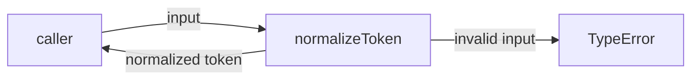
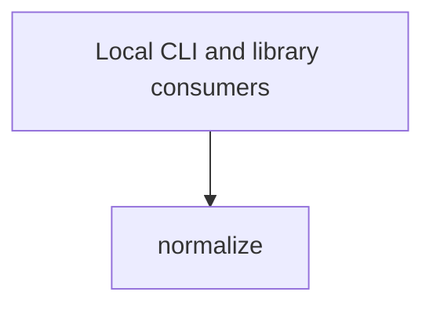

# Module: normalize

<!--SECTION:SPEC_ID-->
TOKEN-NORMALIZE
<!--/SECTION:SPEC_ID-->

<!--SECTION:MODULE_VISION-->
## Module Vision
Owns the deterministic `normalizeToken` transformation for ASCII tokens: trim, lowercase, separator collapse, and invalid-input rejection. Parent scope: [token](../token.spec.md). No sibling, parent, or child modules exist for this flat module. Contract source: [token-contract.md](../../../docs/token-contract.md).
<!--/SECTION:MODULE_VISION-->

<!--SECTION:OVERVIEW-->
## Overview


_Путь нормализации токена и отказ на некорректном входе — NOR-REQ-1, NOR-REQ-2._
<!--/SECTION:OVERVIEW-->

<!--SECTION:MODULE_USAGE_EXAMPLE-->
## Module Usage Example
```ts
import { normalizeToken } from "./normalize.ts";

const token = normalizeToken("  Foo__BAR  ");
console.log(token);

try {
  normalizeToken("");
} catch (error) {
  if (error instanceof TypeError) {
    console.error(error.message);
  }
}
```
<!--/SECTION:MODULE_USAGE_EXAMPLE-->

<!--SECTION:MODULE_REQUIREMENTS-->
## Requirements
### NOR-REQ-1 [должен]
**Когда** `normalizeToken` получает ASCII-строку, содержащую хотя бы один символ, отличный от пробела, underscore и hyphen, **функция должна** обрезать крайние ASCII-пробелы, привести ASCII-буквы к нижнему регистру и свернуть последовательности пробелов, underscore и hyphen в один hyphen.

> Refines TOK-REQ-1: один детерминированный формат токена нужен локальным CLI и библиотечным потребителям.

### NOR-REQ-2 [должен · нештатная]
**Если** входная строка пустая, состоит только из разделителей или содержит не-ASCII символ, **то `normalizeToken` должен** выбросить TypeError без выполнения ввода-вывода.

> Refines TOK-REQ-2: ошибку входа нельзя маскировать пустым корректным токеном.

| Input | Outcome |
|---|---|
| `"  Foo__BAR  "` | `"foo-bar"` |
| `""` | `TypeError` |
<!--/SECTION:MODULE_REQUIREMENTS-->

<!--SECTION:INTER_MODULE_DEPENDENCIES-->
## Inter-Module Dependencies
- **Depends on:** None.
- **Scope Reference (cross-scope):** None; the scope-level tooling dependency on [infra-base](../infra-base/infra-base.spec.md) is not a module runtime dependency.
- **Provides to:** Local CLI and library consumers outside this flat scope; no sibling module.


_Потребители зависят от единственного модуля normalize._
<!--/SECTION:INTER_MODULE_DEPENDENCIES-->

<!--SECTION:ENTITY_INVENTORY-->
## Entity Inventory

_Это полный список сущностей модуля. Любое введение сущности execution-агентом помимо этого списка считается drift'ом и требует обновления spec._

| Name | Type | Purpose |
|------|------|---------|
| `normalizeToken` | Function | Normalizes an ASCII token deterministically or rejects invalid input |

Ошибки: throw (TypeError) → `normalizeToken`

ER sketch omitted: the inventory has a single entity, so there are no relations to draw.
<!--/SECTION:ENTITY_INVENTORY-->

<!--SECTION:ENTITY_SURFACES-->
## Entity Surfaces
One function, `normalizeToken`; it has no Port, Adapter, lifecycle, or emitted events.

<details>
<summary>Полные поверхности сущностей</summary>

### `normalizeToken`
- **Type:** Function
- **Purpose:** Normalize an ASCII token deterministically or reject invalid input.
- **Public Properties:** N/A
- **Public Operations:** Normalize an ASCII token; reject empty, separator-only, or non-ASCII input.
- **Lifecycle:** Stateless pure function; no instances are created and no termination exists.
- **Events Emitted:** N/A
- **Errors & Degradation:** `TypeError` via throw for invalid input; `normalizeToken` owns the throw and the caller owns handling or display.
- **Consumers:**
  - Internal: `src/token/normalize/normalize.ts`
  - External: local CLI and library consumers
- **Usage Waiver (external: local CLI and library consumers):** The function is the public normalization surface for external consumers; there is no in-module production caller.

</details>
<!--/SECTION:ENTITY_SURFACES-->

<!--SECTION:MODULE_CONTRACTS-->
## Module Contracts
Single pure Service `normalizeToken`; no Ports or Adapters are defined.

Граф не рисуется: в модуле нет Port/Adapter, только Service `normalizeToken`.

Call Chain не рисуется: одна абстракция `normalizeToken`, отдельной последовательности вызовов нет.

<details>
<summary>Контракты DbC</summary>

### Services

#### Service: `normalizeToken`
- **Purpose:** Turn a valid ASCII input into one canonical lowercase token or reject it.
- **Consumers:** local CLI and library consumers via `src/token/normalize/normalize.ts`
- **Runtime Backing:** `not-implemented`
- **Verification Levels:** `contract`, `unit`
- **Deferred Runtime Scope:** Entire declared behavior; no implementation exists in this authoring round.

**Contract (DbC)** — one block per operation:
- `normalizeToken`:
  - Pre: input is a string containing at least one ASCII character other than space, underscore, or hyphen.
  - Post: returns the input with leading and trailing ASCII spaces trimmed, ASCII letters lowercased, and every run of spaces, underscores, or hyphens replaced by one hyphen.
  - On pre-violation: throws `TypeError` without performing I/O.

**Invariants:** The operation is pure and deterministic: no global state, network, persistence, or I/O.

</details>
<!--/SECTION:MODULE_CONTRACTS-->

<!--SECTION:PUBLIC_OPTIONS-->
## Public Options & Policies
None; this module has no configurable flags, options, or policies.

<details>
<summary>Опции и политики</summary>

Not applicable: `normalizeToken` exposes no public options or policies in this bounded module.

</details>
<!--/SECTION:PUBLIC_OPTIONS-->

<!--SECTION:FILE_STRUCTURE-->
## File Structure
```text
src/token/normalize/
└── normalize.ts
```

**File Mapping:**
- `src/token/normalize/normalize.ts`: `normalizeToken` implementation and TypeError rejection.
<!--/SECTION:FILE_STRUCTURE-->

<!--SECTION:RESEARCH-->
## Research
Not applicable: no research documents feed this bounded deterministic module.
<!--/SECTION:RESEARCH-->

<!--SECTION:MODULE_DECISION_LOG-->
## Module Decision Log
One boundary decision: a single pure Service without a Port or Adapter.

<details>
<summary>Полные записи Decision Log</summary>

NOR-DL-1 2026-10-24 — оставить `normalizeToken` единственным чистым Service без Port/Adapter; где: `specs/token/normalize/normalize.spec.md#module-contracts` (почему: одна чистая функция без подтверждённой вариативности или тестового шва) [verdict: pending-operator].

</details>
<!--/SECTION:MODULE_DECISION_LOG-->

<!--SECTION:HANDOFF-->
## Handoff to Tasks
- **Implementation files to be created:** `src/token/normalize/normalize.ts`
- **Test files to be created:** `test/token/normalize/normalize.test.ts`
- **Stack dependencies:**
  - Language: `typescript` (resolves to `ai/directives/coding/typescript-rules.xml`)
  - Test framework: `node-test` (resolves to `ai/directives/testing/node-test.xml`)
- **Module Rules Additions:** None; no rules beyond the scope-wide baseline.
- **Open risks & validation needs:** Owner handoff remains `pending-operator`; no operator approval has been given. No implementation or test exists in this round, so TypeError behavior and ASCII-only rejection must be verified at execution.
<!--/SECTION:HANDOFF-->

<!--SECTION:IMPLEMENTATION_INSIGHTS-->
## Implementation Insights
Not applicable: no implementation exists in this authoring round.

<details>
<summary>Заметки по реализации</summary>

Not applicable: this authoring round produces no implementation, so no post-implementation learnings exist yet.

</details>
<!--/SECTION:IMPLEMENTATION_INSIGHTS-->
