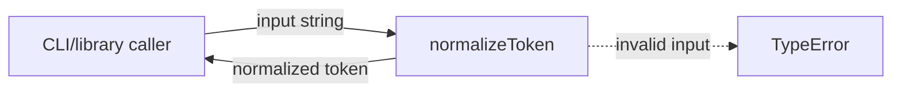
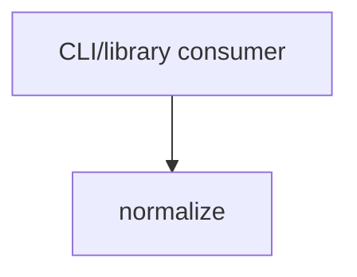

# Module: normalize

<!--SECTION:SPEC_ID-->
TOKEN-NORMALIZE
<!--/SECTION:SPEC_ID-->

<!--SECTION:MODULE_VISION-->
## Module Vision
Owns the deterministic normalization of one ASCII token for local CLI and library consumers. The
parent scope is [token](../token.spec.md); the observable contract comes from
[docs/token-contract.md](../../../docs/token-contract.md). This module is flat: it has no sibling,
parent or child modules inside the scope.
<!--/SECTION:MODULE_VISION-->

<!--SECTION:OVERVIEW-->
## Overview


_Основной путь нормализации и отказ на недопустимом входе — NOR-REQ-1, NOR-REQ-2._
<!--/SECTION:OVERVIEW-->

<!--SECTION:MODULE_USAGE_EXAMPLE-->
## Module Usage Example
```ts
import { normalizeToken } from "./normalize.js";

const token = normalizeToken("  Foo__BAR  ");
console.log(token);

try {
  normalizeToken("");
} catch (error) {
  if (error instanceof TypeError) {
    console.error("invalid token input");
  }
}
```
<!--/SECTION:MODULE_USAGE_EXAMPLE-->

<!--SECTION:MODULE_REQUIREMENTS-->
## Requirements

### NOR-REQ-1 [должен]
**Когда** на вход подана ASCII-строка `"  Foo__BAR  "`, **normalizeToken должен** вернуть `"foo-bar"`, обрезав крайние ASCII-пробелы, приведя ASCII-буквы к нижнему регистру и свернув серии пробелов, underscore и hyphen в один hyphen.

> Уточняет TOK-REQ-1 на каноническом примере: CLI и библиотечным потребителям нужен один детерминированный формат токена.

### NOR-REQ-2 [должен · нештатная]
**Если** на вход подана пустая строка `""`, строка только из разделителей или строка с не-ASCII символами, **то normalizeToken должен** выбросить `TypeError` без ввода-вывода.

> Уточняет TOK-REQ-2: пустой корректный токен замаскировал бы ошибку входа.

| Input | Outcome |
|---|---|
| `"  Foo__BAR  "` | `"foo-bar"` |
| `""` | `TypeError` |
<!--/SECTION:MODULE_REQUIREMENTS-->

<!--SECTION:INTER_MODULE_DEPENDENCIES-->
## Inter-Module Dependencies
- **Depends on:** None.
- **Scope Reference (cross-scope):** None.
- **Provides to:** None; the module is consumed directly by CLI and library callers, not by sibling modules.


_Внешний потребитель вызывает normalize; рёбер к соседним модулям нет._
<!--/SECTION:INTER_MODULE_DEPENDENCIES-->

<!--SECTION:ENTITY_INVENTORY-->
## Entity Inventory

_Это полный список сущностей модуля. Любое введение сущности execution-агентом помимо этого списка считается drift'ом и требует обновления spec._

| Name | Type | Purpose |
|------|------|---------|
| `normalizeToken` | Function | Normalizes one ASCII token and rejects invalid input |

Ошибки: throw TypeError → normalizeToken

ER-скетч не рисуется: в инвентаре одна сущность, связывать нечего.
<!--/SECTION:ENTITY_INVENTORY-->

<!--SECTION:ENTITY_SURFACES-->
## Entity Surfaces
One exported function surface: `normalizeToken`, whose input validation and output shape are fully described below.

<details>
<summary>Полные поверхности сущностей</summary>

### `normalizeToken`
- **Type:** Function
- **Purpose:** Turn one ASCII input string into a canonical lowercase hyphen-separated token.
- **Public Properties:** N/A
- **Public Operations:** Accept a string and return its normalized token; reject empty, separator-only and non-ASCII input.
- **Lifecycle:** Stateless; available when the module is imported and has no termination step.
- **Events Emitted:** N/A
- **Errors & Degradation:** `TypeError` via `throw`; the caller owns handling and presentation.
- **Consumers:**
  - Internal: `src/token/normalize/normalize.ts`
  - External: local CLI consumers and library consumers

</details>
<!--/SECTION:ENTITY_SURFACES-->

<!--SECTION:MODULE_CONTRACTS-->
## Module Contracts
One exported pure function, `normalizeToken`; the module deliberately defines no Port or Adapter.

Граф не рисуется: в модуле нет Port/Adapter, только Service `normalizeToken`.
Call Chain не рисуется: в инвентаре одна абстракция — Service `normalizeToken`; сценарий линеен.

<details>
<summary>Контракты DbC</summary>

### Services

#### Service: `normalizeToken`
- **Purpose:** Normalize one ASCII token and reject invalid input without I/O.
- **Consumers:** External CLI and library callers; internal `src/token/normalize/normalize.ts`.
- **Runtime Backing:** `not-implemented`
- **Verification Levels:** `contract`, `unit`
- **Deferred Runtime Scope:** All runtime behavior; no implementation exists in this authoring round.

**Contract (DbC)**
- `normalize`:
  - Pre: input is a string that contains at least one ASCII character other than space, underscore or hyphen, and contains no non-ASCII characters.
  - Post: returns a lowercase ASCII token in which every run of spaces, underscores and hyphens becomes one hyphen, with no leading or trailing hyphen; `"  Foo__BAR  "` returns `"foo-bar"`.
  - On pre-violation: throws `TypeError` without I/O.

**Invariants:** The function is pure and deterministic: equal input produces an equal result, and no network, filesystem, clock or shared mutable state is read or written.

</details>
<!--/SECTION:MODULE_CONTRACTS-->

<!--SECTION:PUBLIC_OPTIONS-->
## Public Options & Policies
No public options or policies in v1: `normalizeToken` has no flags, configuration or selectable mode.

<details>
<summary>Опции и политики</summary>

No publicly observable flags, options or policies are exposed.

</details>
<!--/SECTION:PUBLIC_OPTIONS-->

<!--SECTION:FILE_STRUCTURE-->
## File Structure
```
src/token/normalize/
├── normalize.ts
└── normalize.test.ts
```

**File Mapping:**
- `src/token/normalize/normalize.ts`: `normalizeToken` implementation
- `src/token/normalize/normalize.test.ts`: unit and error-path tests
<!--/SECTION:FILE_STRUCTURE-->

<!--SECTION:RESEARCH-->
## Research
No research documents feed this module; its behavior comes from [token](../token.spec.md) and
[docs/token-contract.md](../../../docs/token-contract.md).
<!--/SECTION:RESEARCH-->

<!--SECTION:MODULE_DECISION_LOG-->
## Module Decision Log
One decision records the deliberate absence of a Port/Adapter layer for a single pure function.

<details>
<summary>Полные записи Decision Log</summary>

NOR-DL-1 2026-10-24 — одна чистая функция без Port/Adapter (почему: одна реализация и нет подтверждённой вариативности; отвергнуто: Port ради единственного тестового шва — избыточная абстракция для чистой функции; риск: нет).

</details>
<!--/SECTION:MODULE_DECISION_LOG-->

<!--SECTION:HANDOFF-->
## Handoff to Tasks
- **Handoff status:** pending-operator — no operator approval, ticket or execution claim.
- **Implementation files to be created:** `src/token/normalize/normalize.ts`
- **Test files to be created:** `src/token/normalize/normalize.test.ts`
- **Stack dependencies:**
  - Language: `TypeScript` (resolves to `ai/directives/coding/typescript-rules.xml`)
  - Test framework: `node:test` (resolves to `ai/directives/testing/node-test.xml`)
- **Module Rules Additions:** None.

  | Rule | Category | Source |
  |------|----------|--------|
  | None | — | — |

- **Open risks & validation needs:** Operator approval and ticket creation remain pending; no implementation has been executed. The exact non-ASCII boundary inherits the parent scope and needs confirmation during review.
<!--/SECTION:HANDOFF-->

<!--SECTION:IMPLEMENTATION_INSIGHTS-->
## Implementation Insights
Not applicable: the module has no implementation yet, so no post-implementation learnings exist.

<details>
<summary>Заметки по реализации</summary>

No implementation has been performed; this appendix remains empty until an audit cycle produces real learnings.

</details>
<!--/SECTION:IMPLEMENTATION_INSIGHTS-->
