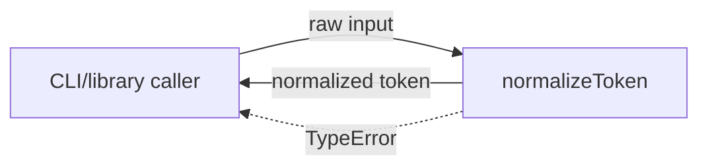
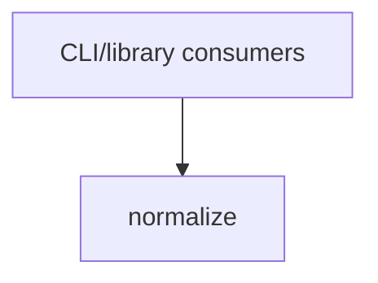

# Module: normalize

<!--SECTION:SPEC_ID-->
TOKEN-NORMALIZE
<!--/SECTION:SPEC_ID-->

<!--SECTION:MODULE_VISION-->
## Module Vision
Модуль `normalize` владеет единственным чистым преобразованием ASCII-токена внутри скоупа [`token`](../token.spec.md): функцией `normalizeToken`. Родительская спека задаёт цель скоупа; здесь живут только наблюдаемые обязательства нормализации. Соседних и дочерних модулей в скоупе нет.
<!--/SECTION:MODULE_VISION-->

<!--SECTION:OVERVIEW-->
## Overview

_Один чистый проход нормализации токена и явный отказ на недопустимом входе — NOR-REQ-1, NOR-REQ-2._
<!--/SECTION:OVERVIEW-->

<!--SECTION:MODULE_USAGE_EXAMPLE-->
## Module Usage Example
```ts
import { normalizeToken } from "./normalize";

const token = normalizeToken("  Foo__BAR  ");
console.log(token);

try {
  normalizeToken("");
} catch (error) {
  if (error instanceof TypeError) {
    console.error("Invalid token input");
  }
}
```
<!--/SECTION:MODULE_USAGE_EXAMPLE-->

<!--SECTION:MODULE_REQUIREMENTS-->
## Requirements
### NOR-REQ-1 [должен]
**Когда** передана непустая ASCII-строка, содержащая хотя бы один символ вне пробела, underscore и hyphen, **нормализатор должен** обрезать крайние ASCII-пробелы, привести ASCII-буквы к нижнему регистру и свернуть каждую серию пробелов, underscore и hyphen в один hyphen.

> Уточняет `TOK-REQ-1` для модуля: один детерминированный формат токена нужен CLI и библиотечным потребителям, а границы преобразования должны быть однозначны.

### NOR-REQ-2 [должен · нештатная]
**Если** вход пустой, состоит только из пробелов, underscore и hyphen или содержит не-ASCII символ, **то нормализатор должен** выбросить `TypeError` без ввода-вывода.

> Уточняет `TOK-REQ-2` для модуля: ошибочный вход нельзя маскировать пустым корректным токеном, а отсутствие I/O делает отказ локальным и детерминированным.

Наблюдаемые исходы:

| Input | Outcome |
|---|---|
| `"  Foo__BAR  "` | `"foo-bar"` |
| `""` | `TypeError` |
<!--/SECTION:MODULE_REQUIREMENTS-->

<!--SECTION:INTER_MODULE_DEPENDENCIES-->
## Inter-Module Dependencies
- **Depends on:** None — в скоупе `token` нет других модулей.
- **Scope Reference (cross-scope):** None; родительский скоуп [`token`](../token.spec.md) не является cross-scope зависимостью.
- **Provides to:** CLI and library consumers (external); sibling modules отсутствуют.


_Единственный модуль скоупа token; внешних зависимостей нет._
<!--/SECTION:INTER_MODULE_DEPENDENCIES-->

<!--SECTION:ENTITY_INVENTORY-->
## Entity Inventory
_Это полный список сущностей модуля. Любое введение сущности execution-агентом помимо этого списка считается drift'ом и требует обновления spec._

| Name | Type | Purpose |
|------|------|---------|
| `normalizeToken` | Function | Чистая нормализация ASCII-токена без состояния и ввода-вывода |

Ошибки: throw `TypeError` → `normalizeToken`.

ER-эскиз не рисуется: в инвентаре одна сущность, связывать нечего.
<!--/SECTION:ENTITY_INVENTORY-->

<!--SECTION:ENTITY_SURFACES-->
## Entity Surfaces
Одна публичная функция; ниже — её полная поверхность.

<details>
<summary>Полные поверхности сущностей</summary>

### `normalizeToken`
- **Type:** Function
- **Purpose:** Возвращает детерминированный ASCII-токен из допустимой входной строки.
- **Public Properties:** N/A
- **Public Operations:** normalizeToken(input: string): string
- **Lifecycle:** Вызывается на каждый запрос; состояние не создаётся, выполнение заканчивается возвратом строки или `TypeError`.
- **Events Emitted:** N/A
- **Errors & Degradation:** `TypeError` через throw; ошибку обрабатывает вызывающий CLI/library consumer.
- **Consumers:**
  - Internal: None — это единственная сущность модуля.
  - External: CLI and library consumers.
- **Usage Waiver (external: CLI and library consumers):** Единственная публичная операция модуля; это внешний контракт, а не внутренний helper.

</details>
<!--/SECTION:ENTITY_SURFACES-->

<!--SECTION:MODULE_CONTRACTS-->
## Module Contracts
Модуль определяет один Service `normalizeToken`; Port и Adapter отсутствуют.

Граф не рисуется: в модуле нет Port/Adapter, только Service `normalizeToken`.

Call Chain не рисуется: в модуле одна абстракция — Service `normalizeToken`.

<details>
<summary>Контракты DbC</summary>

### Services

#### Service: `normalizeToken`
- **Purpose:** Нормализует допустимый ASCII-токен и отклоняет недопустимый вход.
- **Consumers:** CLI and library consumers (`src/normalize.ts`, planned)
- **Runtime Backing:** `not-implemented`
- **Verification Levels:** `contract`, `unit`
- **Deferred Runtime Scope:** Вся реализация отложена; эта спека не содержит кода.

**Contract (DbC)** — one block per operation:
- `normalizeToken`:
  - Pre: вызывающий передаёт строку, непустую, содержащую хотя бы один символ вне ASCII-пробела, underscore и hyphen, и не содержащую не-ASCII символов.
  - Post: возвращённая строка не имеет крайних ASCII-пробелов; ASCII-буквы находятся в нижнем регистре; каждая серия ASCII-пробелов, underscore и hyphen заменена одним hyphen; ввод-вывод не выполняется.
  - On pre-violation: выбрасывается `TypeError` без ввода-вывода.

**Invariants:** функция детерминирована и не сохраняет состояние между вызовами.

</details>
<!--/SECTION:MODULE_CONTRACTS-->

<!--SECTION:PUBLIC_OPTIONS-->
## Public Options & Policies
Нет публично наблюдаемых опций: нормализация фиксирована.

<details>
<summary>Опции и политики</summary>

Модуль не принимает флаги, настройки или политики. Всё наблюдаемое поведение задано контрактом `normalizeToken`.

</details>
<!--/SECTION:PUBLIC_OPTIONS-->

<!--SECTION:FILE_STRUCTURE-->
## File Structure
```text
specs/token/normalize/
└── normalize.spec.md

src/
└── normalize.ts

test/
└── normalize.test.ts
```

**File Mapping:**
- `specs/token/normalize/normalize.spec.md`: этот модульный черновик
- `src/normalize.ts`: функция `normalizeToken` (planned)
- `test/normalize.test.ts`: unit-тесты модуля (planned)
<!--/SECTION:FILE_STRUCTURE-->

<!--SECTION:RESEARCH-->
## Research
No research documents for this bounded deterministic module.
<!--/SECTION:RESEARCH-->

<!--SECTION:MODULE_DECISION_LOG-->
## Module Decision Log
Записан выбор одного Service без Port; операторского вердикта нет.

<details>
<summary>Полные записи Decision Log</summary>

NOR-DL-1 2026-10-24 — оставить одну чистую функцию `normalizeToken` без Port/Adapter (почему: нет подтверждённой вариативности и внешних I/O; отвергнуто: Port ради тестового шва).

</details>
<!--/SECTION:MODULE_DECISION_LOG-->

<!--SECTION:HANDOFF-->
## Handoff to Tasks
- **Status:** pending-operator — authoring draft only; operator approval отсутствует.
- **Implementation files to be created:** `src/normalize.ts`
- **Test files to be created:** `test/normalize.test.ts`
- **Stack dependencies:**
  - Language: `typescript` (resolves to `ai/directives/coding/typescript-rules.xml`)
  - Test framework: `node:test` (resolves to `ai/directives/testing/node-test.xml`)
- **Module Rules Additions:** None.
- **Open risks & validation needs:** Реализация и тесты не созданы; owner handoff остаётся pending, operator decision отсутствует. Тикеты не созданы.

<!--/SECTION:HANDOFF-->

<!--SECTION:IMPLEMENTATION_INSIGHTS-->
## Implementation Insights
Not applicable — реализация не выполнялась, поэтому послемплементационных наблюдений нет.
<!--/SECTION:IMPLEMENTATION_INSIGHTS-->
