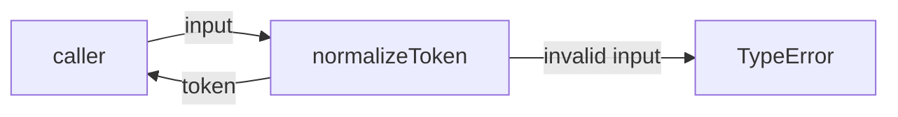
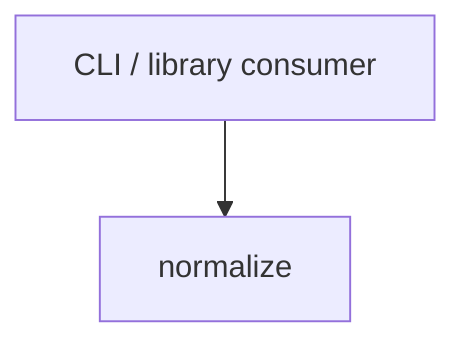

# Module: normalize

<!--SECTION:SPEC_ID-->
TOKEN-NORMALIZE
<!--/SECTION:SPEC_ID-->

<!--SECTION:MODULE_VISION-->
## Module Vision
This module owns the deterministic token normalization inside the `token` scope: it turns one
accepted ASCII string into a single lower-case, hyphen-separated token and rejects invalid
input synchronously. The parent scope is [`token`](../token.spec.md); this module has no parent
or child modules, and its only external consumers are CLI and library callers.
<!--/SECTION:MODULE_VISION-->

<!--SECTION:OVERVIEW-->
## Overview



_Путь одного вызова: принятая строка становится токеном, недопустимая — синхронной ошибкой — NOR-REQ-1, NOR-REQ-2._
<!--/SECTION:OVERVIEW-->

<!--SECTION:MODULE_USAGE_EXAMPLE-->
## Module Usage Example

```ts
import { normalizeToken } from "./normalize";

const token = normalizeToken("  Foo__BAR  ");
console.log(token);

try {
  normalizeToken("");
} catch (error) {
  if (error instanceof TypeError) {
    console.error("invalid token input");
  }
}
```
<!--/SECTION:MODULE_USAGE_EXAMPLE-->

<!--SECTION:MODULE_REQUIREMENTS-->
## Requirements

### NOR-REQ-1 [должен]
**Когда** передана ASCII-строка, содержащая хотя бы один символ, отличный от пробела, underscore и hyphen, **normalizeToken должен** обрезать ведущие и замыкающие ASCII-пробелы, привести ASCII-буквы к нижнему регистру и свернуть любые серии пробелов, underscore и hyphen в один hyphen.

> Уточняет TOK-REQ-1: фиксирует единственную форму детерминированного токена для CLI и библиотечных потребителей.

### NOR-REQ-2 [должен · нештатная]
**Если** входная строка пустая, состоит только из разделителей или содержит не-ASCII символ, **то normalizeToken должен** выбросить TypeError до любого ввода-вывода.

> Уточняет TOK-REQ-2: ошибку входа нельзя маскировать пустым корректным токеном.

| Input | Outcome |
|---|---|
| `"  Foo__BAR  "` | `"foo-bar"` |
| `""` | `TypeError` |
<!--/SECTION:MODULE_REQUIREMENTS-->

<!--SECTION:INTER_MODULE_DEPENDENCIES-->
## Inter-Module Dependencies
- **Depends on:** none — the module has no sibling modules in the `token` scope.
- **Scope Reference (cross-scope):** none.
- **Provides to:** external CLI and library consumers; no sibling module consumes it.



_Потребитель вызывает единственный модуль нормализации, внутренних рёбер нет — NOR-REQ-1._
<!--/SECTION:INTER_MODULE_DEPENDENCIES-->

<!--SECTION:ENTITY_INVENTORY-->
## Entity Inventory

_Это полный список сущностей модуля. Любое введение сущности execution-агентом помимо этого списка считается drift'ом и требует обновления spec._

| Name | Type | Purpose |
|------|------|---------|
| `normalizeToken` | Function | Детерминированно нормализует одну ASCII-строку в токен |

Ошибки: throw (TypeError) → `normalizeToken`

ER-эскиз не рисуется: в инвентаре одна сущность, связывать нечего.
<!--/SECTION:ENTITY_INVENTORY-->

<!--SECTION:ENTITY_SURFACES-->
## Entity Surfaces
Одна чистая функция `normalizeToken` покрывает вход, нормализацию и синхронный отказ.

<details>
<summary>Полные поверхности сущностей</summary>

### `normalizeToken`
- **Type:** Function
- **Purpose:** Преобразует одну принятую ASCII-строку в детерминированный токен или выбрасывает TypeError.
- **Public Properties:** N/A
- **Public Operations:** normalizeToken(input)
- **Lifecycle:** Stateless; вызывается на каждый вход, не хранит состояние и не имеет завершения.
- **Events Emitted:** N/A
- **Errors & Degradation:** `TypeError` via throw, synchronously from `normalizeToken`; the caller handles it.
- **Consumers:**
  - Internal: none yet — the module is a single function.
  - External: CLI / library consumers
- **Usage Waiver (external: CLI / library consumers):** единственная публичная операция модуля.

</details>
<!--/SECTION:ENTITY_SURFACES-->

<!--SECTION:MODULE_CONTRACTS-->
## Module Contracts
The module defines one pure function; no Port or Adapter is introduced because the transformation has no confirmed variability and needs no test seam.

Граф не рисуется: в модуле нет Port/Adapter, только Function `normalizeToken`.

Call Chain не рисуется: в инвентаре одна абстракция — `normalizeToken`.

<details>
<summary>Контракты DbC</summary>

### Services

#### Service: `normalizeToken`
- **Purpose:** Возвращает нормализованный токен для принятой ASCII-строки.
- **Consumers:** CLI / library consumers
- **Runtime Backing:** `not-implemented`
- **Verification Levels:** `contract`, `unit`
- **Deferred Runtime Scope:** Вся функция до появления implementation-тикета; ввода-вывода нет.

**Contract (DbC)** — one block per operation:
- `normalizeToken`:
  - Pre: input is a string containing at least one character other than an ASCII space, underscore, or hyphen, and contains no non-ASCII character.
  - Post: returns a string with leading and trailing ASCII spaces removed, ASCII letters lower-cased, and every run of spaces, underscores, or hyphens replaced by one hyphen.
  - On pre-violation: throws TypeError synchronously, before any I/O.

**Invariants:** the function is pure and deterministic; it performs no I/O and mutates no shared state.

</details>
<!--/SECTION:MODULE_CONTRACTS-->

<!--SECTION:PUBLIC_OPTIONS-->
## Public Options & Policies
Публичных опций и политик нет: сигнатура `normalizeToken(input: string): string` фиксирована.
<!--/SECTION:PUBLIC_OPTIONS-->

<!--SECTION:FILE_STRUCTURE-->
## File Structure
```
normalize/
├── normalize.ts
└── normalize.test.ts
```

**File Mapping:**
- `normalize/normalize.ts`: the `normalizeToken` function
- `normalize/normalize.test.ts`: unit tests for both requirement rows
<!--/SECTION:FILE_STRUCTURE-->

<!--SECTION:RESEARCH-->
## Research
No research documents for this bounded deterministic draft.
<!--/SECTION:RESEARCH-->

<!--SECTION:MODULE_DECISION_LOG-->
## Module Decision Log
One decision is recorded: the module stays a pure function without a Port/Adapter layer.

<details>
<summary>Полные записи Decision Log</summary>

NOR-DL-1 2026-10-24 — pure function with no Port/Adapter (почему: одна детерминированная трансформация без вариативности и без тестового шва; отвергнуто: Port ради симметрии — лишняя абстракция; риск: нет)

</details>
<!--/SECTION:MODULE_DECISION_LOG-->

<!--SECTION:HANDOFF-->
## Handoff to Tasks
- **Implementation files to be created:** `normalize/normalize.ts`
- **Test files to be created:** `normalize/normalize.test.ts`
- **Stack dependencies:**
  - Language: `TypeScript` (resolves to `ai/directives/coding/typescript-rules.xml`)
  - Test framework: `node-test` (resolves to `ai/directives/testing/node-test.xml`)
- **Module Rules Additions:** None

  | Rule | Category | Source |
  |------|----------|--------|
  | None | — | — |

- **Open risks & validation needs:** implementation is not started; operator approval is pending; non-ASCII and separator-only inputs still need executable tests.
- **Status:** pending-operator
<!--/SECTION:HANDOFF-->

<!--SECTION:IMPLEMENTATION_INSIGHTS-->
## Implementation Insights
Not applicable: no implementation exists yet, so there are no post-implementation learnings to record.
<!--/SECTION:IMPLEMENTATION_INSIGHTS-->
