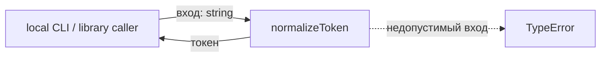
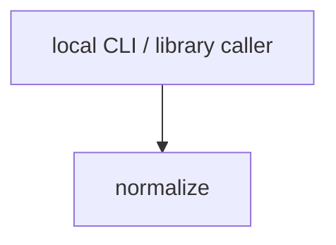

# Module: normalize

<!--SECTION:SPEC_ID-->
TOKEN-NORMALIZE
<!--/SECTION:SPEC_ID-->

<!--SECTION:MODULE_VISION-->
## Module Vision
Модуль `normalize` владеет единственной ответственностью внутри скоупа [`token`](../token.spec.md): детерминированной нормализацией одной ASCII-строки в токен. Он реализует контракт [`docs/token-contract.md`](../../docs/token-contract.md), не имеет parent/child модулей и не выполняет ввод-вывод. Потребители — локальные CLI- и библиотечные вызовы; сетевое взаимодействие и хранение состояния исключены.
<!--/SECTION:MODULE_VISION-->

<!--SECTION:OVERVIEW-->
## Overview

_Путь нормализации и отклонения недопустимого входа — NOR-REQ-1, NOR-REQ-2._
<!--/SECTION:OVERVIEW-->

<!--SECTION:MODULE_USAGE_EXAMPLE-->
## Module Usage Example
```typescript
import { normalizeToken } from "./normalize.js";

const token = normalizeToken("  Foo__BAR  ");
console.log(token);

try {
  normalizeToken("");
} catch (error) {
  if (!(error instanceof TypeError)) {
    throw error;
  }
}
```
Вызов не требует инициализации, конфигурации или сети: `normalizeToken` сразу возвращает нормализованный токен либо выбрасывает `TypeError` на недопустимом входе.
<!--/SECTION:MODULE_USAGE_EXAMPLE-->

<!--SECTION:MODULE_REQUIREMENTS-->
## Requirements
### NOR-REQ-1 [должен]
**Когда** `normalizeToken` получает ASCII-строку, содержащую хотя бы один символ, отличный от ASCII-пробела, underscore и hyphen, **normalizeToken должен** обрезать ведущие и замыкающие ASCII-пробелы, привести ASCII-буквы к нижнему регистру и свернуть каждую серию пробелов, underscore и hyphen в один hyphen.

> Уточняет родительское требование TOK-REQ-1: один детерминированный формат токена нужен локальным CLI- и библиотечным потребителям без настройки и без сети.

### NOR-REQ-2 [должен · нештатная]
**Если** вход пустой, состоит только из разделителей (ASCII-пробел, underscore, hyphen) или содержит не-ASCII символы, **то normalizeToken должен** выбросить `TypeError` без ввода-вывода.

> Уточняет родительское требование TOK-REQ-2: ошибочный вход нельзя маскировать пустым или искажённым корректным токеном.

Наблюдаемые примеры:

| Input | Outcome |
|---|---|
| `"  Foo__BAR  "` | `"foo-bar"` |
| `""` | `TypeError` |
<!--/SECTION:MODULE_REQUIREMENTS-->

<!--SECTION:INTER_MODULE_DEPENDENCIES-->
## Inter-Module Dependencies
- **Depends on:** нет модулей внутри скоупа `token`.
- **Scope Reference (cross-scope):** нет; модуль не зависит от других скоупов.
- **Provides to:** нет модулей внутри скоупа; единственный потребитель — локальный CLI- или библиотечный вызов.


_Модуль вызывается напрямую локальным клиентом, рёбер между модулями нет._
<!--/SECTION:INTER_MODULE_DEPENDENCIES-->

<!--SECTION:ENTITY_INVENTORY-->
## Entity Inventory
| Name | Type | Purpose |
|------|------|---------|
| `normalizeToken` | Function | Нормализует одну ASCII-строку и отклоняет недопустимый вход через TypeError |

Ошибки: throw `TypeError` → `normalizeToken`.

ER-скетч не рисуется: в инвентаре одна сущность, связывать нечего.
<!--/SECTION:ENTITY_INVENTORY-->

<!--SECTION:ENTITY_SURFACES-->
## Entity Surfaces
Одна публичная функция `normalizeToken`: чистая нормализация входа и явное отклонение недопустимых значений.

<details>
<summary>Полные поверхности сущностей</summary>

### `normalizeToken`
- **Type:** Function
- **Purpose:** Детерминированно нормализует одну ASCII-строку в токен или отклоняет недопустимый вход.
- **Public Properties:** N/A
- **Public Operations:** `normalizeToken(input: string): string`
- **Lifecycle:** Загружается вместе с модулем, не хранит состояния и не имеет завершения.
- **Events Emitted:** N/A
- **Errors & Degradation:** `TypeError` через throw; владелец — `normalizeToken`, обработка остаётся вызывающему коду.
- **Consumers:**
  - Internal: нет внутренних потребителей в этом модуле.
  - External: локальные CLI- и библиотечные потребители.
- **Usage Waiver (external: local CLI and library consumers):** Единственная публичная точка входа модуля, ради которой он существует.

</details>
<!--/SECTION:ENTITY_SURFACES-->

<!--SECTION:MODULE_CONTRACTS-->
## Module Contracts
Модуль определяет одну Service-функцию `normalizeToken`; Port и Adapter не вводятся.

Граф зависимостей не рисуется: в модуле нет Port/Adapter, только Service `normalizeToken`.

Call Chain не рисуется: в инвентаре одна абстракция — `normalizeToken`.

<details>
<summary>Контракты DbC</summary>

### Services

#### Service: `normalizeToken`
- **Purpose:** Детерминированно нормализовать одну ASCII-строку в токен или выбросить `TypeError`.
- **Consumers:** локальные CLI- и библиотечные потребители.
- **Runtime Backing:** `not-implemented`
- **Verification Levels:** `contract`, `unit`
- **Deferred Runtime Scope:** Реализация не запрошена в этом раунде; контрактные и unit-тесты остаются будущей работой.

**Contract (DbC)** — one block per operation:
- `normalizeToken`:
  - Pre: `input` — строка, каждый символ которой ASCII, и в ней есть хотя бы один символ, отличный от ASCII-пробела, underscore и hyphen.
  - Post: возвращается `input` с удалёнными ведущими и замыкающими ASCII-пробелами, ASCII-буквами в нижнем регистре и каждой серией ASCII-пробелов, underscore и hyphen, заменённой одним hyphen.
  - On pre-violation: выбрасывается `TypeError` до любого ввода-вывода.

**Invariants:** Функция чистая, детерминированная, не выполняет ввода-вывода и не изменяет разделяемое состояние.

</details>
<!--/SECTION:MODULE_CONTRACTS-->

<!--SECTION:PUBLIC_OPTIONS-->
## Public Options & Policies
Публичных опций нет: сигнатура и поведение полностью зафиксированы контрактом, отложенных опций в v1 не заявлено.

<details>
<summary>Опции и политики</summary>

Не применимо: модуль не предоставляет флагов, опций или политик; единственная точка настройки отсутствует, все решения зафиксированы в Module Contracts.

</details>
<!--/SECTION:PUBLIC_OPTIONS-->

<!--SECTION:FILE_STRUCTURE-->
## File Structure
```
src/token/normalize/
├── normalize.ts
└── normalize.test.ts
```

**File Mapping:**
- `src/token/normalize/normalize.ts`: чистая функция `normalizeToken`.
- `src/token/normalize/normalize.test.ts`: контрактные проверки и проверки отклонения входа.
<!--/SECTION:FILE_STRUCTURE-->

<!--SECTION:RESEARCH-->
## Research
Не применимо: модуль выведен из родительского контракта [`docs/token-contract.md`](../../docs/token-contract.md) и скоупа [`token`](../token.spec.md); отдельных research-документов нет.
<!--/SECTION:RESEARCH-->

<!--SECTION:MODULE_DECISION_LOG-->
## Module Decision Log
Записано одно решение: `normalizeToken` остаётся одной Service-функцией без Port/Adapter.

<details>
<summary>Полные записи Decision Log</summary>

NOR-DL-1 2026-10-24 — `normalizeToken` реализуется как одна Service-функция без Port/Adapter; где: `specs/token/normalize/normalize.spec.md#module-contracts` (почему: единственная реализация без подтверждённой вариативности; отвергнуто: Port ради тестового шва — избыточен для чистой функции; риск: будущее расширение потребует нового контракта) [verdict: pending-operator]

</details>
<!--/SECTION:MODULE_DECISION_LOG-->

<!--SECTION:HANDOFF-->
## Handoff to Tasks
- **Implementation files to be created:** `src/token/normalize/normalize.ts`
- **Test files to be created:** `src/token/normalize/normalize.test.ts`
- **Stack dependencies:**
  - Language: `typescript` (resolves to `ai/directives/coding/typescript-rules.xml`)
  - Test framework: `node-test` (resolves to `ai/directives/testing/node-test.xml`)
- **Module Rules Additions:** None.
- **Open risks & validation needs:** Реализация не запрошена и не выполнена; TypeScript-окружение в фикстуре не настроено; требуется операторское решение по границе.
- **Owner handoff status:** pending-operator; approval, task creation и execution не заявлены.
<!--/SECTION:HANDOFF-->

<!--SECTION:IMPLEMENTATION_INSIGHTS-->
## Implementation Insights
Не применимо: реализация в этом раунде не выполнялась, пост-реализационных заметок нет.

<details>
<summary>Заметки по реализации</summary>

Не применимо: раздел предназначен для выводов после реализации, а текущий артефакт остаётся авторским черновиком без кода.

</details>
<!--/SECTION:IMPLEMENTATION_INSIGHTS-->
