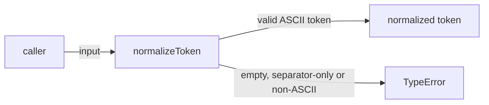
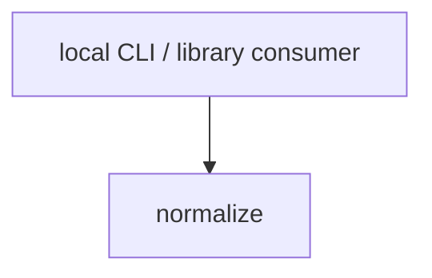

# Module: normalize

<!--SECTION:SPEC_ID-->
TOKEN-NORMALIZE
<!--/SECTION:SPEC_ID-->

<!--SECTION:MODULE_VISION-->
## Module Vision

This module owns deterministic normalization of a single ASCII token for local CLI and library consumers. It refines the scope requirements of [token](../token.spec.md) and adds no behaviour outside the pure transformation and its invalid-input rejection.

It is a flat module: it has no parent or child modules and no siblings inside the scope.
<!--/SECTION:MODULE_VISION-->

<!--SECTION:OVERVIEW-->
## Overview


_Главный путь нормализации одного токена и отказ на недопустимом входе — NOR-REQ-1, NOR-REQ-2._
<!--/SECTION:OVERVIEW-->

<!--SECTION:MODULE_USAGE_EXAMPLE-->
## Module Usage Example

No initialization or configuration is required because the module is a pure function.

```ts
import { normalizeToken } from './normalize.js'

const token = normalizeToken('  Foo__BAR  ')
console.log(token)

try {
  normalizeToken('')
} catch (error) {
  console.log(error instanceof TypeError)
}
```
<!--/SECTION:MODULE_USAGE_EXAMPLE-->

<!--SECTION:MODULE_REQUIREMENTS-->
## Requirements

### NOR-REQ-1 [должен]
**Когда** на вход подана ASCII-строка, содержащая хотя бы один символ, отличный от пробела, underscore и hyphen, **нормализатор должен** обрезать крайние ASCII-пробелы, привести ASCII-буквы к нижнему регистру и свернуть последовательности пробелов, underscore и hyphen в один hyphen.

> Уточняет TOK-REQ-1: один канонический токен нужен CLI и библиотечным потребителям.

### NOR-REQ-2 [должен · нештатная]
**Если** входная строка пустая, состоит только из пробелов, underscore или hyphen либо содержит не-ASCII символ, **то нормализатор должен** выбросить TypeError без ввода-вывода.

> Уточняет TOK-REQ-2: недопустимый вход нельзя маскировать пустым корректным токеном.

| Input | Outcome |
|---|---|
| `"  Foo__BAR  "` | `"foo-bar"` |
| `""` | `TypeError` |
<!--/SECTION:MODULE_REQUIREMENTS-->

<!--SECTION:INTER_MODULE_DEPENDENCIES-->
## Inter-Module Dependencies

- **Depends on:** None — no sibling modules exist in scope `token`.
- **Scope Reference (cross-scope):** None — the module consumes no cross-scope interface.
- **Provides to:** Local CLI and library consumers outside this scope.


_Внешние потребители модуля; зависимостей внутри скоупа нет — NOR-REQ-1, NOR-REQ-2._
<!--/SECTION:INTER_MODULE_DEPENDENCIES-->

<!--SECTION:ENTITY_INVENTORY-->
## Entity Inventory

_Это полный список сущностей модуля. Любое введение сущности execution-агентом помимо этого списка считается drift'ом и требует обновления spec._

| Name | Type | Purpose |
|------|------|---------|
| `normalizeToken` | Function | Normalizes one ASCII token deterministically. |

Ошибки: throw (TypeError) → normalizeToken

ER sketch не рисуется: в инвентаре одна сущность, связывать нечего.
<!--/SECTION:ENTITY_INVENTORY-->

<!--SECTION:ENTITY_SURFACES-->
## Entity Surfaces

The module exposes one public function; its full surface is below.

<details>
<summary>Полные поверхности сущностей</summary>

### `normalizeToken`
- **Type:** Function
- **Purpose:** Transforms one ASCII input string into a canonical lower-case hyphenated token or rejects it.
- **Public Properties:** N/A
- **Public Operations:** Normalize one input string into a canonical token; reject an invalid input with TypeError.
- **Lifecycle:** Stateless; invoked per call, never created, stored or terminated.
- **Events Emitted:** N/A
- **Errors & Degradation:** `TypeError` via throw, owned by `normalizeToken`; no I/O or fallback value.
- **Consumers:**
  - Internal: None
  - External: local CLI and library consumers
- **Usage Waiver (external: local CLI and library consumers):** The module’s single public entry point, intentionally exposed to external consumers.

</details>
<!--/SECTION:ENTITY_SURFACES-->

<!--SECTION:MODULE_CONTRACTS-->
## Module Contracts

The module defines one pure Service, `normalizeToken`; it has no Ports or Adapters.

Граф не рисуется: в модуле нет Port/Adapter, только Service `normalizeToken`.

Цепочка вызовов не рисуется: в модуле одна абстракция — Service `normalizeToken`.

<details>
<summary>Контракты DbC</summary>

### Services

#### Service: `normalizeToken`
- **Purpose:** Returns the canonical form of one ASCII token or throws on invalid input.
- **Consumers:** Local CLI and library consumers.
- **Runtime Backing:** `not-implemented`
- **Verification Levels:** `contract`, `unit`
- **Deferred Runtime Scope:** None

**Contract (DbC)**
- `normalizeToken`:
  - Pre: `input` is a string that contains at least one ASCII character other than space, underscore or hyphen, and contains no non-ASCII character.
  - Post: Returns the canonical token with leading and trailing ASCII spaces removed, ASCII letters lowercased, and every run of spaces, underscores or hyphens replaced by one hyphen; no I/O occurs.
  - On pre-violation: Throws TypeError without I/O and returns no token.

**Invariants:** For every input, the result is deterministic, performs no I/O, and is either one canonical token or a TypeError; the same input always produces the same outcome.

</details>
<!--/SECTION:MODULE_CONTRACTS-->

<!--SECTION:PUBLIC_OPTIONS-->
## Public Options & Policies

No public options or policies; the module has one fixed behaviour.

<details>
<summary>Опции и политики</summary>

None. No flags, environment variables, configuration or runtime switches are consumed.

</details>
<!--/SECTION:PUBLIC_OPTIONS-->

<!--SECTION:FILE_STRUCTURE-->
## File Structure

```
src/token/normalize/
├── normalize.ts
└── normalize.test.ts
```

**File Mapping:**
- `src/token/normalize/normalize.ts`: `normalizeToken` service implementation.
- `src/token/normalize/normalize.test.ts`: unit and contract tests for normalization and invalid-input rejection.
<!--/SECTION:FILE_STRUCTURE-->

<!--SECTION:RESEARCH-->
## Research

No research documents feed this module; the behaviour is fixed by [token](../token.spec.md) and [the token contract](../../../docs/token-contract.md).
<!--/SECTION:RESEARCH-->

<!--SECTION:MODULE_DECISION_LOG-->
## Module Decision Log

NOR-DL-1 records the choice to keep one pure function without a Port or Adapter; its verdict remains pending operator review.

<details>
<summary>Полные записи Decision Log</summary>

NOR-DL-1 2026-10-24 — оставить нормализацию одной чистой функцией без Port/Adapter; где: specs/token/normalize/normalize.spec.md#module-contracts (почему: одна реализация, вариативность и тестовый шов не подтверждены) [verdict: pending-operator]

</details>
<!--/SECTION:MODULE_DECISION_LOG-->

<!--SECTION:HANDOFF-->
## Handoff to Tasks

- **Status:** pending-operator — no implementation, ticket or execution is claimed.
- **Implementation files to be created:** `src/token/normalize/normalize.ts`
- **Test files to be created:** `src/token/normalize/normalize.test.ts`
- **Stack dependencies:**
  - Language: `typescript` (resolves to `ai/directives/coding/typescript-rules.xml`)
  - Test framework: `node-test` (resolves to `ai/directives/testing/node-test.xml`)
- **Module Rules Additions:** None
- **Open risks & validation needs:** Operator approval is pending; the `normalizeToken` contract, error path and the TypeScript / `node:test` stack selection still need operator review before implementation.
<!--/SECTION:HANDOFF-->

<!--SECTION:IMPLEMENTATION_INSIGHTS-->
## Implementation Insights

Not applicable: no implementation exists, so there are no post-implementation learnings to record.

<details>
<summary>Заметки по реализации</summary>

Not applicable: this authoring pass creates no runtime code.

</details>
<!--/SECTION:IMPLEMENTATION_INSIGHTS-->
