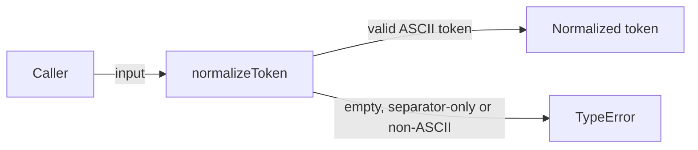
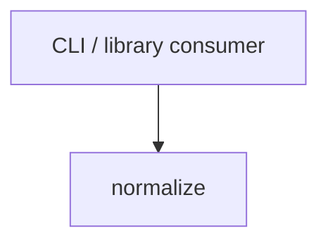

# Module: normalize

<!--SECTION:SPEC_ID-->
TOKEN-NORMALIZE
<!--/SECTION:SPEC_ID-->

<!--SECTION:MODULE_VISION-->
## Module Vision
Owns the single deterministic token-normalization function of the `token` scope: `normalizeToken(input: string): string`. The function trims ASCII spaces, lowercases ASCII letters, collapses runs of spaces, underscores and hyphens into one hyphen, and throws `TypeError` for empty, separator-only or non-ASCII input without performing I/O.

Parent scope: [token](../token.spec.md). This flat module has no parent or child modules inside the scope.
<!--/SECTION:MODULE_VISION-->

<!--SECTION:OVERVIEW-->
## Overview


_Главный путь нормализации и единственный путь ошибки — NOR-REQ-1, NOR-REQ-2._
<!--/SECTION:OVERVIEW-->

<!--SECTION:MODULE_USAGE_EXAMPLE-->
## Module Usage Example
```typescript
import { normalizeToken } from "./src/normalize-token.js";

const token = normalizeToken("  Foo__BAR  ");
console.log(token);

try {
  normalizeToken("");
} catch (error) {
  if (error instanceof TypeError) {
    console.error(error.message);
  }
}
```
<!--/SECTION:MODULE_USAGE_EXAMPLE-->

<!--SECTION:MODULE_REQUIREMENTS-->
## Requirements
### NOR-REQ-1 [должен]
**Когда** передана ASCII-строка, содержащая хотя бы один символ, отличный от пробела, underscore и hyphen, **normalizeToken должен** обрезать крайние ASCII-пробелы, привести ASCII-буквы к нижнему регистру и свернуть каждую последовательность пробелов, underscore и hyphen в один hyphen.

> Уточняет TOK-REQ-1: модуль фиксирует единственный детерминированный формат токена для CLI и библиотечных потребителей.

### NOR-REQ-2 [должен · нештатная]
**Если** строка пустая, состоит только из разделителей (пробел, underscore, hyphen) или содержит не-ASCII символ, **то normalizeToken должен** выбросить `TypeError` без ввода-вывода.

> Уточняет TOK-REQ-2: ошибочный вход нельзя маскировать пустым или частично нормализованным токеном.

| Input | Outcome |
|---|---|
| `"  Foo__BAR  "` | `"foo-bar"` |
| `""` | `TypeError` |
<!--/SECTION:MODULE_REQUIREMENTS-->

<!--SECTION:INTER_MODULE_DEPENDENCIES-->
## Inter-Module Dependencies
- **Depends on:** None — no sibling modules exist inside the `token` scope.
- **Scope Reference (cross-scope):** None.
- **Provides to:** CLI and library consumers of the `token` scope; no sibling module consumes this module.


_Модуль вызывается напрямую потребителем скоупа; sibling-зависимостей нет._
<!--/SECTION:INTER_MODULE_DEPENDENCIES-->

<!--SECTION:ENTITY_INVENTORY-->
## Entity Inventory

_Это полный список сущностей модуля. Любое введение сущности execution-агентом помимо этого списка считается drift'ом и требует обновления spec._

| Name | Type | Purpose |
|------|------|---------|
| `normalizeToken` | Function | Чистая нормализация ASCII-токена |

Ошибки: throw `TypeError` → `normalizeToken`

ER-набросок не рисуется: в инвентаре одна сущность, связывать нечего.
<!--/SECTION:ENTITY_INVENTORY-->

<!--SECTION:ENTITY_SURFACES-->
## Entity Surfaces
Одна публичная функция `normalizeToken`; её полная поверхность приведена ниже.

<details>
<summary>Полные поверхности сущностей</summary>

### `normalizeToken`
- **Type:** Function
- **Purpose:** Возвращает детерминированную нормализованную форму ASCII-токена или выбрасывает `TypeError`.
- **Public Properties:** N/A
- **Public Operations:** `normalizeToken(input)` — обрезает крайние ASCII-пробелы, приводит ASCII-буквы к нижнему регистру, сворачивает последовательности разделителей в один hyphen; не выполняет ввод-вывод.
- **Lifecycle:** Чистая функция без состояния; доступна на уровне модуля и не имеет завершения жизненного цикла.
- **Events Emitted:** N/A
- **Errors & Degradation:** `TypeError` выбрасывается синхронно при пустом, separator-only или не-ASCII входе; владелец и источник ошибки — `normalizeToken`, ошибка передаётся вызывающему коду.
- **Consumers:**
  - Internal: `normalize/src/normalize-token.ts`
  - External: CLI и библиотечные потребители скоупа `token`
- **Usage Waiver (external: CLI and library consumers of token):** Единственная публичная операция модуля; её существование оправдано внешним контрактом, а не числом внутренних вызовов.

</details>
<!--/SECTION:ENTITY_SURFACES-->

<!--SECTION:MODULE_CONTRACTS-->
## Module Contracts
Модуль определяет один Service `normalizeToken`; Port и Adapter отсутствуют, потому что у чистого преобразования нет подтверждённой вариативности и внешних эффектов.

Граф не рисуется: в модуле нет Port/Adapter, только Service `normalizeToken`.

Call Chain не рисуется: в модуле одна абстракция — `normalizeToken`; вызов идёт напрямую от потребителя.

<details>
<summary>Контракты DbC</summary>

### Services

#### Service: `normalizeToken`
- **Purpose:** Нормализует ASCII-токен в один детерминированный формат.
- **Consumers:** CLI и библиотечные потребители скоупа `token`
- **Runtime Backing:** `not-implemented`
- **Verification Levels:** `contract`, `unit`
- **Deferred Runtime Scope:** Всё объявленное поведение не имеет реального runtime: реализация не запрошена.
- **Usage Waiver (external: CLI and library consumers of token):** Единственная публичная функция модуля; внешний контракт оправдывает её существование.

**Contract (DbC)**
- `normalizeToken`:
  - Pre: вход — строка, содержащая хотя бы один ASCII-символ, отличный от пробела, underscore и hyphen; других символов нет.
  - Post: возвращает строку с удалёнными крайними ASCII-пробелами, ASCII-буквами в нижнем регистре и каждой последовательностью пробелов, underscore и hyphen, заменённой одним hyphen; ввод-вывод не выполняется.
  - On pre-violation: синхронно выбрасывает `TypeError`, не выполняя ввод-вывод.

**Invariants:** Функция чистая и детерминированная: одинаковый вход всегда даёт одинаковый результат или `TypeError`; внешних эффектов нет.

</details>
<!--/SECTION:MODULE_CONTRACTS-->

<!--SECTION:PUBLIC_OPTIONS-->
## Public Options & Policies
Публичных опций и политик нет: модуль предоставляет единственную функцию без параметров конфигурации.
<!--/SECTION:PUBLIC_OPTIONS-->

<!--SECTION:FILE_STRUCTURE-->
## File Structure
```
normalize/
└── src/
    └── normalize-token.ts
```

**File Mapping:**
- `normalize/src/normalize-token.ts`: реализация функции `normalizeToken`
<!--/SECTION:FILE_STRUCTURE-->

<!--SECTION:RESEARCH-->
## Research
No research documents for this bounded deterministic module.
<!--/SECTION:RESEARCH-->

<!--SECTION:MODULE_DECISION_LOG-->
## Module Decision Log
Записан один выбор — Service без Port/Adapter; операторский вердикт не получен.

<details>
<summary>Полные записи Decision Log</summary>

NOR-DL-1 2026-10-24 — для нормализации выбран один Service `normalizeToken` без Port/Adapter; где: specs/token/normalize/normalize.spec.md#module-contracts (почему: чистое детерминированное преобразование не имеет подтверждённой вариативности, внешних эффектов или необходимости в test seam) [verdict: pending-operator]

</details>
<!--/SECTION:MODULE_DECISION_LOG-->

<!--SECTION:HANDOFF-->
## Handoff to Tasks
- **Implementation files to be created:** `normalize/src/normalize-token.ts`
- **Test files to be created:** `normalize/test/normalize-token.test.ts`
- **Stack dependencies:**
  - Language: `typescript` (resolves to `ai/directives/coding/typescript-rules.xml`)
  - Test framework: `node-test` (resolves to `ai/directives/testing/node-test.xml`)
- **Module Rules Additions:** None

  | Rule | Category | Source |
  |------|----------|--------|
  | None | architecture | `ai/directives/sdd-v2/module.directive.xml` |

- **Open risks & validation needs:** Реализация и тесты не созданы и не запускались; поведение для ASCII-границ и `TypeError` требует проверки задачами. Операторское одобрение не получено.
<!--/SECTION:HANDOFF-->

<!--SECTION:IMPLEMENTATION_INSIGHTS-->
## Implementation Insights
Not applicable: implementation has not been performed, so there are no post-implementation learnings.
<!--/SECTION:IMPLEMENTATION_INSIGHTS-->
