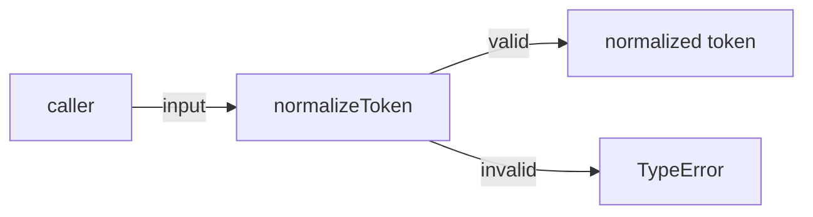
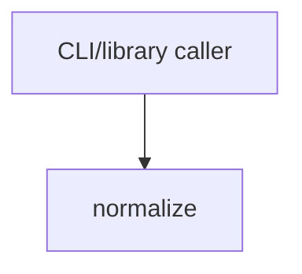

# Module: normalize

<!--SECTION:SPEC_ID-->
TOKEN-NORMALIZE
<!--/SECTION:SPEC_ID-->

<!--SECTION:MODULE_VISION-->
## Module Vision
Модуль `normalize` владеет одной обязанностью: детерминированной нормализацией одного ASCII-токена без состояния и без ввода-вывода. Его контракт сужает [спеку скоупа token](../token.spec.md). Родительских, дочерних и соседних модулей у него нет.
<!--/SECTION:MODULE_VISION-->

<!--SECTION:OVERVIEW-->
## Overview
Модуль принимает один строковый токен, проверяет допустимость входа и возвращает канонический токен либо синхронно выбрасывает `TypeError`.


_Один вызов normalizeToken: валидный вход даёт нормализованный токен, невалидный — TypeError — NOR-REQ-1, NOR-REQ-2._
<!--/SECTION:OVERVIEW-->

<!--SECTION:MODULE_USAGE_EXAMPLE-->
## Module Usage Example
```ts
import { normalizeToken } from './normalize.js';

const token: string = normalizeToken('  Foo__BAR  ');
if (token !== 'foo-bar') throw new Error('unexpected normalization');

try {
  normalizeToken('');
} catch (error) {
  if (!(error instanceof TypeError)) throw error;
}
```
<!--/SECTION:MODULE_USAGE_EXAMPLE-->

<!--SECTION:MODULE_REQUIREMENTS-->
## Requirements
### NOR-REQ-1 [должен]
**Когда** передана строка из ASCII-символов, содержащая хотя бы один символ, отличный от ASCII-пробела, underscore и hyphen, **функция `normalizeToken` должна** обрезать крайние ASCII-пробелы, привести ASCII-буквы к нижнему регистру и свернуть каждую серию ASCII-пробелов, underscore и hyphen в один hyphen.

> Уточняет TOK-REQ-1: модуль фиксирует единственный наблюдаемый формат токена для CLI и библиотечных потребителей; без него один и тот же токен получал бы разные представления.

### NOR-REQ-2 [должен · нештатная]
**Если** строка пустая, состоит только из разделителей (ASCII-пробел, underscore, hyphen) или содержит хотя бы один не-ASCII символ, **то функция `normalizeToken` должна** выбросить `TypeError` без ввода-вывода.

> Уточняет TOK-REQ-2: ошибку входа нельзя маскировать пустым корректным токеном; отсутствие ввода-вывода сохраняет локальность и детерминизм.

Наблюдаемые исходы:

| Input | Outcome |
|---|---|
| `"  Foo__BAR  "` | `"foo-bar"` |
| `""` | `TypeError` |
<!--/SECTION:MODULE_REQUIREMENTS-->

<!--SECTION:INTER_MODULE_DEPENDENCIES-->
## Inter-Module Dependencies
- **Depends on:** нет модулей внутри скоупа `token`.
- **Scope Reference (cross-scope):** нет; модуль не использует интерфейсы других скоупов.
- **Provides to:** нет модулей внутри скоупа; публичный вход доступен внешним CLI и библиотечным потребителям.


_Внешний потребитель вызывает normalize; рёбер к модулям скоупа и другим скоупам нет._
<!--/SECTION:INTER_MODULE_DEPENDENCIES-->

<!--SECTION:ENTITY_INVENTORY-->
## Entity Inventory
_Это полный список сущностей модуля. Любое введение сущности execution-агентом помимо этого списка считается drift'ом и требует обновления spec._

| Name | Type | Purpose |
|------|------|---------|
| `normalizeToken` | Service | Детерминированная нормализация одного ASCII-токена без состояния и ввода-вывода |

Ошибки: throw `TypeError` → `normalizeToken`.

ER-скетч не нужен: инвентарь состоит из одной сущности, связывать нечего.
<!--/SECTION:ENTITY_INVENTORY-->

<!--SECTION:ENTITY_SURFACES-->
## Entity Surfaces
Одна сущность `normalizeToken`; её полная поверхность приведена ниже.

<details>
<summary>Полные поверхности сущностей</summary>

### `normalizeToken`
- **Type:** Function
- **Purpose:** Приводит один допустимый ASCII-токен к каноническому виду и отклоняет недопустимый вход.
- **Public Properties:** N/A
- **Public Operations:** `normalizeToken(input: string): string` — нормализует один токен; при недопустимом входе выбрасывает `TypeError`.
- **Lifecycle:** Вызывающий код создаёт вызов на каждое использование; состояние не создаётся, после возврата или исключения ничего не продолжает существовать.
- **Events Emitted:** N/A
- **Errors & Degradation:** `TypeError` выбрасывается синхронно; владелец ошибки — `normalizeToken`; вызывающий код решает, как её показать. Ввод-вывод не выполняется.
- **Consumers:**
  - Internal: `src/token/normalize/normalize.ts` (планируемый файл; код в этой задаче не создаётся)
  - External: CLI и библиотечные потребители
- **Usage Waiver (external: CLI и библиотечные потребители):** единственная публичная точка входа модуля; фактическое число использований пока не измеримо, потому что реализация ещё не создана.

</details>
<!--/SECTION:ENTITY_SURFACES-->

<!--SECTION:MODULE_CONTRACTS-->
## Module Contracts
Модуль определяет одну Service-функцию `normalizeToken`; Port и Adapter не вводятся.

Граф не рисуется: в модуле нет Port/Adapter, только Service `normalizeToken`.

Call Chain не рисуется: в инвентаре одна абстракция, последовательности вызовов между сущностями модуля нет.

<details>
<summary>Контракты DbC</summary>

### Services

#### Service: `normalizeToken`
- **Purpose:** Детерминированно нормализовать один ASCII-токен и отклонить недопустимый вход.
- **Consumers:** Internal: `src/token/normalize/normalize.ts` (планируемый файл) · External: CLI и библиотечные потребители
- **Runtime Backing:** `not-implemented`
- **Verification Levels:** `contract`, `unit`
- **Deferred Runtime Scope:** Вся реализация и исполняемая проверка отложены; в этой authoring-задаче код не создаётся.

**Contract (DbC)** — one block per operation:
- `normalizeToken(input)`:
  - Pre: `input` — строка, состоящая только из ASCII-символов и содержащая хотя бы один символ, отличный от ASCII-пробела, underscore и hyphen.
  - Post: Возвращается строка с удалёнными крайними ASCII-пробелами, ASCII-буквами в нижнем регистре и каждой серией ASCII-пробелов, underscore и hyphen, заменённой одним hyphen; ввод-вывод не выполняется.
  - On pre-violation: Синхронно выбрасывается `TypeError`; ввод-вывод не выполняется.

</details>
<!--/SECTION:MODULE_CONTRACTS-->

<!--SECTION:PUBLIC_OPTIONS-->
## Public Options & Policies
Публичных опций и политик нет: `normalizeToken` не принимает флагов и не читает конфигурацию.

<details>
<summary>Опции и политики</summary>

Опций нет. Поведение модуля полностью определяется одним аргументом `input`, а нормализация не настраивается.

</details>
<!--/SECTION:PUBLIC_OPTIONS-->

<!--SECTION:FILE_STRUCTURE-->
## File Structure
```
normalize/
├── normalize.ts
└── normalize.test.ts
```

**File Mapping:**
- `src/token/normalize/normalize.ts`: функция `normalizeToken` и проверка допустимости входа.
- `src/token/normalize/normalize.test.ts`: контрактные и unit-тесты для допустимого и недопустимого входа.
<!--/SECTION:FILE_STRUCTURE-->

<!--SECTION:RESEARCH-->
## Research
Исследовательских документов нет: задача ограничена детерминированным локальным поведением и не опирается на `research/`.
<!--/SECTION:RESEARCH-->

<!--SECTION:MODULE_DECISION_LOG-->
## Module Decision Log
Записано одно решение: чистая Service-функция без Port/Adapter.

<details>
<summary>Полные записи Decision Log</summary>

NOR-DL-1 2026-10-24 — `normalizeToken` остаётся чистым Service без Port/Adapter; где: `specs/token/normalize/normalize.spec.md#module-contracts` (почему: одна реализация, вариативность не подтверждена, чистая функция тестируется напрямую; отвергнуто: Port ради тестового шва — лишняя абстракция; риск: вторая стратегия нормализации потребует нового контракта)

</details>
<!--/SECTION:MODULE_DECISION_LOG-->

<!--SECTION:HANDOFF-->
## Handoff to Tasks
- **Implementation files to be created:** `src/token/normalize/normalize.ts`
- **Test files to be created:** `src/token/normalize/normalize.test.ts`
- **Stack dependencies:**
  - Language: `TypeScript` (resolves to `ai/directives/coding/typescript-rules.xml`)
  - Test framework: `node:test` (resolves to `ai/directives/testing/node-test.xml`)
- **Module Rules Additions:** None — scope-wide baseline applies.
- **Open risks & validation needs:** Реализация отсутствует; поведение для входа не типа `string` не задано и требует решения перед исполнением; сценарии не-ASCII и separator-only подтверждаются только будущими тестами.
- **Status:** `pending-operator` — Approval #1 не запрошено и не получено; передача в тикеты не открыта, исполнение не заявлялось.
<!--/SECTION:HANDOFF-->

<!--SECTION:IMPLEMENTATION_INSIGHTS-->
## Implementation Insights
Наблюдений нет: реализация в этой задаче не создавалась.

<details>
<summary>Заметки по реализации</summary>

Раздел не применим: постимплементационных наблюдений нет, потому что код ещё не создавался и аудит-цикл не проходил.

</details>
<!--/SECTION:IMPLEMENTATION_INSIGHTS-->
