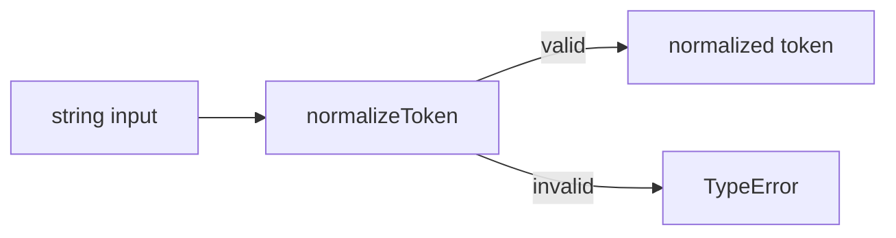
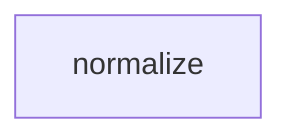

# Module: normalize

<!--SECTION:SPEC_ID-->
TOKEN-NORMALIZE
<!--/SECTION:SPEC_ID-->

<!--SECTION:MODULE_VISION-->
## Module Vision
Own the deterministic, in-process normalization of ASCII tokens inside the [token scope](../token.spec.md): trim ASCII spaces at the edges, lowercase ASCII letters, and collapse runs of ASCII spaces, underscores and hyphens into one hyphen. The module is flat: it has no parent or child modules, and it performs no I/O.
<!--/SECTION:MODULE_VISION-->

<!--SECTION:OVERVIEW-->
## Overview


_Главный путь normalizeToken: ASCII-строка превращается в токен, некорректный вход завершается TypeError — NOR-REQ-1, NOR-REQ-2._
<!--/SECTION:OVERVIEW-->

<!--SECTION:MODULE_USAGE_EXAMPLE-->
## Module Usage Example

```ts
import { normalizeToken } from "./normalize.js";

const token = normalizeToken("  Foo__BAR  ");
console.log(token);

try {
  normalizeToken("");
} catch (error) {
  if (!(error instanceof TypeError)) {
    throw error;
  }
  console.log("invalid input rejected");
}
```

The snippet is self-contained: it imports only this module, exercises the happy path, and shows the minimal error path for invalid input. No sibling module composition is required.
<!--/SECTION:MODULE_USAGE_EXAMPLE-->

<!--SECTION:MODULE_REQUIREMENTS-->
## Requirements

### NOR-REQ-1 [должен]
**Когда** на вход подана ASCII-строка `"  Foo__BAR  "`, **normalizeToken должен** вернуть `"foo-bar"`: убрать крайние ASCII-пробелы, привести ASCII-буквы к lower-case и свернуть серии ASCII-пробелов, underscore и hyphen в один hyphen.
> Уточняет TOK-REQ-1. Case `normalize-example` фиксирует наблюдаемый результат happy path.

### NOR-REQ-2 [должен · нештатная]
**Если** вход пустой, состоит только из разделителей или содержит не-ASCII символ, **то normalizeToken должен** выбросить TypeError без ввода-вывода.
> Уточняет TOK-REQ-2. Case `empty-input-rejection` фиксирует пустой вход; тот же отказ действует для separator-only и не-ASCII входа.

Наблюдаемые исходы двух названных случаев:

| Input | Outcome |
|---|---|
| `"  Foo__BAR  "` | `"foo-bar"` |
| `""` | `TypeError` |
<!--/SECTION:MODULE_REQUIREMENTS-->

<!--SECTION:INTER_MODULE_DEPENDENCIES-->
## Inter-Module Dependencies
- **Depends on:** none within scope `token`.
- **Scope Reference (cross-scope):** none; this module is a pure local library operation.
- **Provides to:** no sibling modules; its public function is consumed directly by local CLI and library consumers.


_Зависимостей внутри скоупа нет: модуль normalize самодостаточен._
<!--/SECTION:INTER_MODULE_DEPENDENCIES-->

<!--SECTION:ENTITY_INVENTORY-->
## Entity Inventory

_Это полный список сущностей модуля. Любое введение сущности execution-агентом помимо этого списка считается drift'ом и требует обновления spec._

| Name | Type | Purpose |
|------|------|---------|
| `normalizeToken` | Function | Детерминированно нормализует ASCII-токен и отклоняет некорректный вход |

Ошибки: throw `TypeError` → `normalizeToken`.

Одна сущность — реляционного ER-наброска нет.
<!--/SECTION:ENTITY_INVENTORY-->

<!--SECTION:ENTITY_SURFACES-->
## Entity Surfaces
One public Function, `normalizeToken`; its surface covers input, output, error behavior and consumers.

<details>
<summary>Полные поверхности сущностей</summary>

### `normalizeToken`
- **Type:** Function
- **Purpose:** Normalize one ASCII token deterministically or reject an invalid input with TypeError.
- **Public Properties:** N/A
- **Public Operations:** normalize one string into a canonical ASCII token; reject invalid input.
- **Lifecycle:** Stateless module export; created on import and has no termination step.
- **Events Emitted:** N/A
- **Errors & Degradation:** `TypeError` via `throw`, owned by `normalizeToken` and surfaced to the calling CLI/library consumer.
- **Consumers:**
  - Internal: planned `normalize.ts` module export.
  - External: local CLI and library consumers.
- **Usage Waiver (external: local CLI and library consumers):** primary public API of this module; production usage count is not established before implementation.

</details>
<!--/SECTION:ENTITY_SURFACES-->

<!--SECTION:MODULE_CONTRACTS-->
## Module Contracts
The module defines one Service function, `normalizeToken`; it defines no Ports or Adapters because there is no confirmed variability or test seam requiring an abstraction.

Граф не рисуется: в модуле нет Port/Adapter, только Service `normalizeToken`.
Call Chain не рисуется: в inventory одна абстракция, это ниже порога ≥2.

<details>
<summary>Контракты DbC</summary>

### Services

#### Service: `normalizeToken`
- **Purpose:** Convert a valid ASCII string into a canonical hyphen-separated lowercase token.
- **Consumers:** internal planned `normalize.ts` export; external local CLI and library consumers.
- **Runtime Backing:** `not-implemented`
- **Verification Levels:** `contract`, `unit`
- **Deferred Runtime Scope:** All declared behavior; this authoring task requests no implementation.

**Contract (DbC)**
- `normalizeToken`:
  - Pre: `input` is a string value.
  - Post: returns the token with leading and trailing ASCII spaces removed, ASCII letters lowercased, and every run of ASCII space, underscore or hyphen replaced by one hyphen.
  - On pre-violation: empty input, separator-only input or input containing any non-ASCII character throws `TypeError` and performs no I/O.

**Invariants:** Deterministic and stateless; the same input yields the same result or TypeError, with no I/O, network, persistence or shared-state mutation.

</details>
<!--/SECTION:MODULE_CONTRACTS-->

<!--SECTION:PUBLIC_OPTIONS-->
## Public Options & Policies
No public options or policies; the normalization grammar is fixed.

<details>
<summary>Опции и политики</summary>

None in v1 — no flags, configuration, locale selection or policy switches are exposed. The behavior is fully fixed by NOR-REQ-1 and NOR-REQ-2.

</details>
<!--/SECTION:PUBLIC_OPTIONS-->

<!--SECTION:FILE_STRUCTURE-->
## File Structure
```
normalize/
├── normalize.ts
└── normalize.test.ts
```

**File Mapping:**
- `normalize.ts`: `normalizeToken(input: string): string` and its TypeError rejection path.
- `normalize.test.ts`: unit cases `normalize-example` and `empty-input-rejection`, plus separator-only and non-ASCII rejection.
<!--/SECTION:FILE_STRUCTURE-->

<!--SECTION:RESEARCH-->
## Research
No research documents. The deterministic transformation and error boundary are specified directly by the operator brief; no research registry entries apply.
<!--/SECTION:RESEARCH-->

<!--SECTION:MODULE_DECISION_LOG-->
## Module Decision Log
No module-level deviations recorded; the owner handoff remains pending operator review.

<details>
<summary>Полные записи Decision Log</summary>

No entries. No public entity is removed or postcondition weakened, so no pivot invalidation list applies.

</details>
<!--/SECTION:MODULE_DECISION_LOG-->

<!--SECTION:HANDOFF-->
## Handoff to Tasks
- **Implementation files to be created:** `normalize.ts`
- **Test files to be created:** `normalize.test.ts`
- **Stack dependencies:**
  - Language: `typescript` (resolves to `ai/directives/coding/typescript-rules.xml`)
  - Test framework: `vitest` (resolves to `ai/directives/testing/vitest-rules.xml`)
- **Module Rules Additions:** None.
- **Open risks & validation needs:** No implementation exists and no operator approval has been given. TypeScript and Vitest are the conservative local defaults; confirm them at the operator boundary before scaffolding.
<!--/SECTION:HANDOFF-->

<!--SECTION:IMPLEMENTATION_INSIGHTS-->
## Implementation Insights
Not applicable — no implementation exists yet; this appendix is authored only after post-implementation audit compaction.

<details>
<summary>Заметки по реализации</summary>

No post-implementation learnings exist. Do not add execution claims or operator approval here.

</details>
<!--/SECTION:IMPLEMENTATION_INSIGHTS-->
