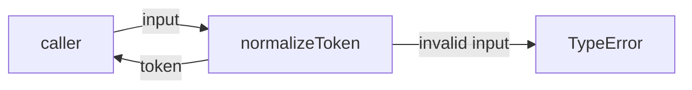
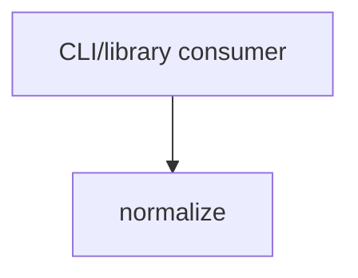

# Module: normalize

<!--SECTION:SPEC_ID-->
TOKEN-NORMALIZE
<!--/SECTION:SPEC_ID-->

<!--SECTION:MODULE_VISION-->
## Module Vision
Owns deterministic ASCII token normalization for local CLI and library consumers. Parent scope: [token](../token.spec.md). This is a flat module: it has no sibling, parent, or child modules, and it does not own CLI transport, persistence, configuration, or Unicode transliteration.
<!--/SECTION:MODULE_VISION-->

<!--SECTION:OVERVIEW-->
## Overview

_Основной путь нормализации и отказа при недопустимом входе — NOR-REQ-1, NOR-REQ-2._
<!--/SECTION:OVERVIEW-->

<!--SECTION:MODULE_USAGE_EXAMPLE-->
## Module Usage Example
```ts
import { normalizeToken } from "./normalize";

const token: string = normalizeToken("  Foo__BAR  ");
console.log(token);

try {
  normalizeToken("");
} catch (error) {
  if (error instanceof TypeError) {
    console.error(error.message);
  }
}
```
<!--/SECTION:MODULE_USAGE_EXAMPLE-->

<!--SECTION:MODULE_REQUIREMENTS-->
## Requirements
### NOR-REQ-1 [должен]
**Когда** передана строка, содержащая хотя бы один ASCII-символ, отличный от пробела, underscore и hyphen, **нормализатор должен** обрезать крайние ASCII-пробелы, привести ASCII-буквы к нижнему регистру и свернуть последовательности пробелов, underscore и hyphen в один hyphen.

> Уточняет TOK-REQ-1: модуль фиксирует конкретную форму токена для CLI и библиотечных потребителей.

### NOR-REQ-2 [должен · нештатная]
**Если** строка пустая, состоит только из разделителей или содержит не-ASCII символ, **то нормализатор должен** выбросить TypeError без операций ввода-вывода.

> Уточняет TOK-REQ-2: недопустимый вход нельзя маскировать пустым корректным токеном.

| Input | Outcome |
|---|---|
| `"  Foo__BAR  "` | `"foo-bar"` |
| `""` | `TypeError` |
<!--/SECTION:MODULE_REQUIREMENTS-->

<!--SECTION:INTER_MODULE_DEPENDENCIES-->
## Inter-Module Dependencies
- **Depends on:** None within scope `token`; `normalize` is the only module.
- **Scope Reference (cross-scope):** None at module runtime.
- **Provides to:** None within the module graph; local CLI and library consumers call the public function directly.


_Потребитель вызывает normalize напрямую; соседних модулей нет._
<!--/SECTION:INTER_MODULE_DEPENDENCIES-->

<!--SECTION:ENTITY_INVENTORY-->
## Entity Inventory
_Это полный список сущностей модуля. Любое введение сущности execution-агентом помимо этого списка считается drift'ом и требует обновления spec._

| Name | Type | Purpose |
|------|------|---------|
| `normalizeToken` | Function | Преобразует входную строку в детерминированный ASCII-токен |

Ошибки: throw (`TypeError` при недопустимом входе) → `normalizeToken`

ER-скетч не рисуется: в инвентаре одна сущность, связывать нечего.
<!--/SECTION:ENTITY_INVENTORY-->

<!--SECTION:ENTITY_SURFACES-->
## Entity Surfaces
Модуль публикует одну функцию `normalizeToken`; ошибки обрабатываются механизмом throw, владелец — сама функция.

<details>
<summary>Полные поверхности сущностей</summary>

### `normalizeToken`
- **Type:** Function
- **Purpose:** Нормализует ASCII-строку в детерминированный токен.
- **Public Properties:** N/A
- **Public Operations:** `normalizeToken(input)`
- **Lifecycle:** Создаётся при загрузке модуля, не хранит состояния и не завершается отдельно.
- **Events Emitted:** N/A
- **Errors & Degradation:** `TypeError` через throw для пустого, separator-only и не-ASCII входа; ввод-вывод не выполняется, ошибка возвращается вызывающему коду.
- **Consumers:**
  - Internal: no internal consumers; module public entry point
  - External: local CLI and library consumers
- **Usage Waiver (external: local CLI and library consumers):** Единственная публичная точка входа модуля; без неё нормализация недоступна.

</details>
<!--/SECTION:ENTITY_SURFACES-->

<!--SECTION:MODULE_CONTRACTS-->
## Module Contracts
Модуль определяет один чистый Service `normalizeToken`; Port и Adapter не вводятся.

Граф не рисуется: в модуле нет Port/Adapter, только Service `normalizeToken`.

Call Chain не рисуется: в инвентаре одна абстракция — Service `normalizeToken`, порядка вызовов между несколькими участниками нет.

<details>
<summary>Контракты DbC</summary>

### Services

#### Service: `normalizeToken`
- **Purpose:** Преобразует входную строку в детерминированный ASCII-токен.
- **Consumers:** local CLI and library consumers
- **Runtime Backing:** `not-implemented`
- **Verification Levels:** `contract`, `unit`
- **Deferred Runtime Scope:** Реализация и unit-тесты не создаются в этой authoring-задаче; всё заявленное поведение пока не имеет product runtime.

**Contract (DbC)**
- `normalizeToken`:
  - Pre: `input` — строка, содержащая хотя бы один ASCII-символ, отличный от пробела, underscore и hyphen, и не содержащая не-ASCII символов.
  - Post: Возвращает вход без крайних ASCII-пробелов, с ASCII-буквами в нижнем регистре и с каждой последовательностью пробелов, underscore и hyphen, заменённой одним hyphen; ввод-вывод не выполняется.
  - On pre-violation: Выбрасывает `TypeError` и не выполняет ввод-вывод.

**Invariants**: Для одного и того же входа результат детерминирован; функция не выполняет ввода-вывода.

</details>
<!--/SECTION:MODULE_CONTRACTS-->

<!--SECTION:PUBLIC_OPTIONS-->
## Public Options & Policies
Публичных опций и политик нет: поведение нормализации фиксировано и не настраивается.
<!--/SECTION:PUBLIC_OPTIONS-->

<!--SECTION:FILE_STRUCTURE-->
## File Structure
```
normalize/
├── normalize.ts
└── normalize.test.ts
```

**File Mapping:**
- `normalize/normalize.ts`: реализация `normalizeToken`
- `normalize/normalize.test.ts`: unit-тесты нормализации и отказов `TypeError`
<!--/SECTION:FILE_STRUCTURE-->

<!--SECTION:RESEARCH-->
## Research
No research documents feed this bounded deterministic module.
<!--/SECTION:RESEARCH-->

<!--SECTION:MODULE_DECISION_LOG-->
## Module Decision Log
Зафиксировано одно решение: единственный чистый Service без Port/Adapter.

<details>
<summary>Полные записи Decision Log</summary>

- NOR-DL-1 2026-10-24 — не вводить Port/Adapter для единственной чистой функции; где: specs/token/normalize/normalize.spec.md#module-contracts (почему: нет подтверждённой вариативности или тестового шва, а Port добавил бы слой без обязательства) [verdict: pending-operator]

</details>
<!--/SECTION:MODULE_DECISION_LOG-->

<!--SECTION:HANDOFF-->
## Handoff to Tasks
- **Implementation files to be created:** `normalize/normalize.ts`
- **Test files to be created:** `normalize/normalize.test.ts`
- **Stack dependencies:**
  - Language: `typescript` (resolves to `ai/directives/coding/typescript-rules.xml`)
  - Test framework: `node-test` (resolves to `ai/directives/testing/node-test.xml`)
- **Module Rules Additions:** None
- **Open risks & validation needs:** Реализация и тесты не созданы; граничные случаи (крайние hyphen, смешанные разделители, обнаружение не-ASCII) требуют unit-проверки. Operator approval is pending; no execution is claimed.
<!--/SECTION:HANDOFF-->

<!--SECTION:IMPLEMENTATION_INSIGHTS-->
## Implementation Insights
Not applicable — no implementation exists yet, so there are no post-implementation learnings to record.
<!--/SECTION:IMPLEMENTATION_INSIGHTS-->
