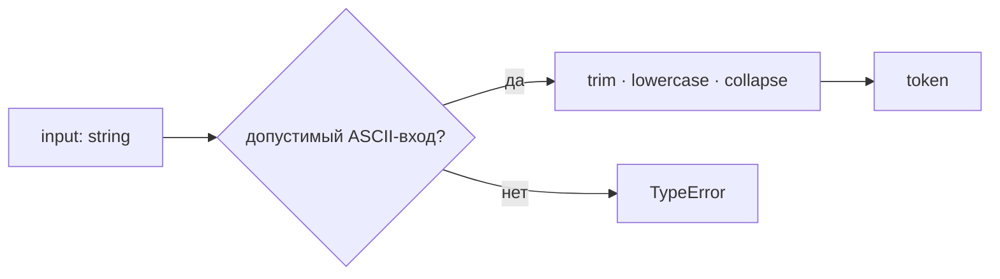
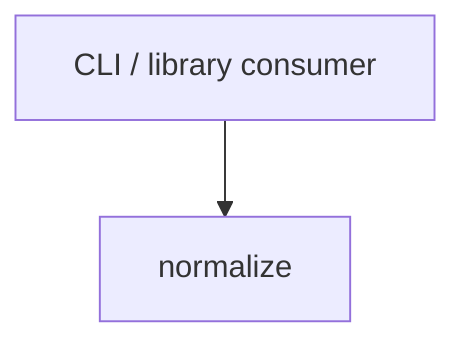

# Module: normalize

<!--SECTION:SPEC_ID-->
TOKEN-NORMALIZE
<!--/SECTION:SPEC_ID-->

<!--SECTION:MODULE_VISION-->
## Module Vision
Модуль `normalize` владеет детерминированной нормализацией входной строки в токен внутри scope `token`: обрезкой крайних ASCII-пробелов, приведением ASCII-букв к lower-case и сворачиванием разделителей в один hyphen. Родительская спека: [token](../token.spec.md). Соседних и дочерних модулей нет — модуль плоский.
<!--/SECTION:MODULE_VISION-->

<!--SECTION:OVERVIEW-->
## Overview


_Путь нормализации токена и отказ на недопустимом входе — NOR-REQ-1, NOR-REQ-2._
<!--/SECTION:OVERVIEW-->

<!--SECTION:MODULE_USAGE_EXAMPLE-->
## Module Usage Example
```ts
import { normalizeToken } from "./normalize";

const token = normalizeToken("  Foo__BAR  ");
console.log(token);

try {
  normalizeToken("");
} catch (error) {
  if (error instanceof TypeError) {
    console.error("invalid token");
  }
}
```
<!--/SECTION:MODULE_USAGE_EXAMPLE-->

<!--SECTION:MODULE_REQUIREMENTS-->
## Requirements
### NOR-REQ-1 [должен]
**Когда** на вход подана ASCII-строка, содержащая хотя бы один символ, отличный от пробела, underscore и hyphen, **нормализатор должен** обрезать крайние ASCII-пробелы, привести ASCII-буквы к lower-case и свернуть пробелы, underscore и hyphen в один hyphen.

> Уточняет TOK-REQ-1: модуль фиксирует единственный детерминированный формат токена для CLI и библиотечных потребителей.

### NOR-REQ-2 [должен · нештатная]
**Если** входная строка пуста, состоит только из разделителей (пробелов, underscore, hyphen) или содержит не-ASCII символ, **то нормализатор должен** выбросить TypeError без ввода-вывода.

> Уточняет TOK-REQ-2: ошибку входа нельзя маскировать пустым корректным токеном.

| Input | Outcome |
|---|---|
| `"  Foo__BAR  "` | `"foo-bar"` |
| `""` | `TypeError` |
<!--/SECTION:MODULE_REQUIREMENTS-->

<!--SECTION:INTER_MODULE_DEPENDENCIES-->
## Inter-Module Dependencies
- **Depends on:** нет
- **Scope Reference (cross-scope):** нет
- **Provides to:** нет — единственный модуль scope


_Внешний потребитель вызывает единственный модуль scope._
<!--/SECTION:INTER_MODULE_DEPENDENCIES-->

<!--SECTION:ENTITY_INVENTORY-->
## Entity Inventory
_Это полный список сущностей модуля. Любое введение сущности execution-агентом помимо этого списка считается drift'ом и требует обновления spec._

| Name | Type | Purpose |
|------|------|---------|
| `normalizeToken` | Function | Детерминированная нормализация входной строки в токен |

Ошибки: throw → `normalizeToken`

ER-набросок не требуется: в инвентаре одна сущность, связей между сущностями нет.
<!--/SECTION:ENTITY_INVENTORY-->

<!--SECTION:ENTITY_SURFACES-->
## Entity Surfaces
Одна публичная функция `normalizeToken`; полная поверхность ниже.

<details>
<summary>Полные поверхности сущностей</summary>

### `normalizeToken`
- **Type:** Function
- **Purpose:** Преобразует допустимую ASCII-строку в нормализованный токен.
- **Public Properties:** N/A
- **Public Operations:** `normalizeToken` — принимает строку и возвращает нормализованный токен.
- **Lifecycle:** Вызывается потребителем; состояние не хранит; завершается после возврата значения или выброса TypeError.
- **Events Emitted:** N/A
- **Errors & Degradation:** `TypeError` через throw для пустой строки, строки только из разделителей и не-ASCII входа; владелец — `normalizeToken`, ошибка передаётся вызывающему коду.
- **Consumers:**
  - Internal: N/A
  - External: CLI и библиотечные потребители
- **Usage Waiver (external: CLI и библиотечные потребители):** Публичная функция — единственная поверхность модуля, её использование задаётся внешними потребителями scope.

</details>
<!--/SECTION:ENTITY_SURFACES-->

<!--SECTION:MODULE_CONTRACTS-->
## Module Contracts
Модуль определяет одну Service-функцию `normalizeToken`; Ports и Adapters отсутствуют.

Граф зависимостей не рисуется: в модуле нет Port/Adapter, только функция `normalizeToken`.
Call Chain не рисуется: в инвентаре одна абстракция — `normalizeToken`.

<details>
<summary>Контракты DbC</summary>

### Services

#### Service: `normalizeToken`
- **Purpose:** Детерминированно нормализовать допустимую ASCII-строку в токен.
- **Consumers:** CLI и библиотечные потребители (external).
- **Runtime Backing:** `not-implemented`
- **Verification Levels:** `contract`, `unit`
- **Deferred Runtime Scope:** Вся заявленная нормализация — реализация не запрошена этой задачей.

**Contract (DbC)**
- `normalizeToken`:
  - Pre: Вход — строка, содержащая хотя бы один ASCII-символ, отличный от пробела, underscore и hyphen, и не содержащая не-ASCII символов.
  - Post: Возвращённый токен не имеет крайних ASCII-пробелов, ASCII-буквы приведены к lower-case, каждая серия пробелов, underscore и hyphen заменена одним hyphen; ввод-вывод не выполняется.
  - On pre-violation: Выбрасывается TypeError без ввода-вывода; токен не возвращается.

**Invariants:** Результат детерминирован для одного и того же входа; функция не хранит состояние и не выполняет ввод-вывод.

</details>
<!--/SECTION:MODULE_CONTRACTS-->

<!--SECTION:PUBLIC_OPTIONS-->
## Public Options & Policies
Публичных опций и политик нет: сигнатура `normalizeToken(input: string): string` фиксирована.
<!--/SECTION:PUBLIC_OPTIONS-->

<!--SECTION:FILE_STRUCTURE-->
## File Structure
```
src/token/normalize/
├── normalize.ts
└── normalize.test.ts
```

**File Mapping:**
- `src/token/normalize/normalize.ts`: чистая реализация `normalizeToken`
- `src/token/normalize/normalize.test.ts`: контрактные и unit-тесты для NOR-REQ-1 и NOR-REQ-2
<!--/SECTION:FILE_STRUCTURE-->

<!--SECTION:RESEARCH-->
## Research
Нет ресёрч-документов: модуль полностью следует из TOK-REQ-1 и TOK-REQ-2.
<!--/SECTION:RESEARCH-->

<!--SECTION:MODULE_DECISION_LOG-->
## Module Decision Log
Одно решение: функция без Port/Adapter; полная запись ниже.

<details>
<summary>Полные записи Decision Log</summary>

NOR-DL-1 2026-10-24 — `normalizeToken` контрактуется как одна Service-функция без Port и Adapter; где: specs/token/normalize/normalize.spec.md#module-contracts (почему: единственная реализация и отсутствие подтверждённой вариативности; отвергнуто: Port ради тестового шва) [verdict: pending-operator].

</details>
<!--/SECTION:MODULE_DECISION_LOG-->

<!--SECTION:HANDOFF-->
## Handoff to Tasks
- **Implementation files to be created:** `src/token/normalize/normalize.ts`
- **Test files to be created:** `src/token/normalize/normalize.test.ts`
- **Stack dependencies:**
  - Language: `typescript` (resolves to `ai/directives/coding/typescript-rules.xml`)
  - Test framework: `node-test` (resolves to `ai/directives/testing/node-test.xml`)
- **Module Rules Additions:** None

- **Open risks & validation needs:** Реализация не запрошена; контракт проверяется тестами после появления кода. Операторское подтверждение отсутствует — handoff остаётся pending-operator.
<!--/SECTION:HANDOFF-->

<!--SECTION:IMPLEMENTATION_INSIGHTS-->
## Implementation Insights
Не применимо: реализация не запрошена, пост-имплементационных наблюдений нет.
<!--/SECTION:IMPLEMENTATION_INSIGHTS-->
