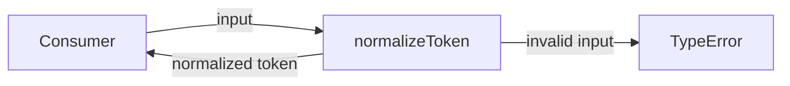
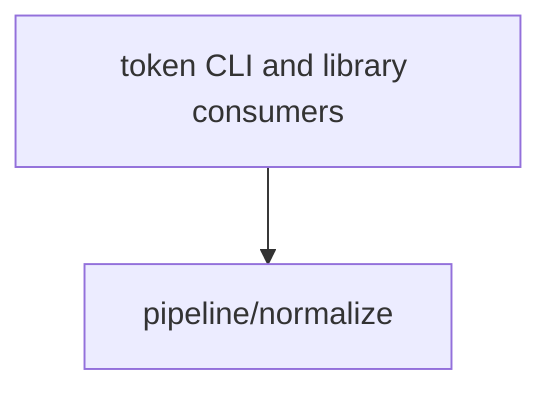

# Module: pipeline/normalize

<!--SECTION:SPEC_ID-->
TOKEN-PIPELINE-NORMALIZE
<!--/SECTION:SPEC_ID-->

<!--SECTION:MODULE_VISION-->
## Module Vision

This module owns deterministic normalization of a single ASCII token for the [`token` scope](../../token.spec.md). It exposes one pure function, `normalizeToken`, and has no sibling, parent, or child module specs in the current scope draft. Input validation belongs here because an invalid token must fail before any consumer can treat it as a normalized value.
<!--/SECTION:MODULE_VISION-->

<!--SECTION:OVERVIEW-->
## Overview


_Главный поток нормализации токена и отказ на некорректном входе — NOR-REQ-1, NOR-REQ-2._
<!--/SECTION:OVERVIEW-->

<!--SECTION:MODULE_USAGE_EXAMPLE-->
## Module Usage Example

```ts
import { normalizeToken } from "./normalize.js";

const normalized = normalizeToken("  Foo__BAR  ");
console.log(normalized);

try {
  normalizeToken("");
} catch (error) {
  if (!(error instanceof TypeError)) throw error;
  console.error(error.message);
}
```
<!--/SECTION:MODULE_USAGE_EXAMPLE-->

<!--SECTION:MODULE_REQUIREMENTS-->
## Requirements

### NOR-REQ-1 [должен]
**Когда** передана непустая ASCII-строка, которая содержит хотя бы один символ, отличный от пробела, underscore и hyphen, **нормализатор должен** обрезать крайние пробелы, привести ASCII-буквы к lower-case и свернуть каждую последовательность пробелов, underscore и hyphen в один hyphen.

> Уточняет TOK-REQ-1: модуль фиксирует единственный детерминированный формат токена, на который опираются CLI и библиотечные потребители.

### NOR-REQ-2 [должен · нештатная]
**Если** строка пустая, состоит только из разделителей или содержит не-ASCII символы, **то нормализатор должен** выбросить `TypeError` без ввода-вывода и без изменения состояния.

> Уточняет TOK-REQ-2: ошибочный вход нельзя маскировать пустым или частично нормализованным токеном, поэтому отказ обязан быть явным.

| Input | Outcome |
|---|---|
| `"  Foo__BAR  "` | `"foo-bar"` |
| `""` | `TypeError` |
<!--/SECTION:MODULE_REQUIREMENTS-->

<!--SECTION:INTER_MODULE_DEPENDENCIES-->
## Inter-Module Dependencies

- **Depends on:** None — no sibling module spec is present in the `token` scope draft.
- **Scope Reference (cross-scope):** None — the parent `token` scope is a library scope, not a cross-scope interface dependency.
- **Provides to:** Consumers of the `token` scope, which receive the normalized token through `normalizeToken`.


_Положение модуля нормализации среди потребителей токена._
<!--/SECTION:INTER_MODULE_DEPENDENCIES-->

<!--SECTION:ENTITY_INVENTORY-->
## Entity Inventory

_Это полный список сущностей модуля. Любое введение сущности execution-агентом помимо этого списка считается drift'ом и требует обновления spec._

| Name | Type | Purpose |
|------|------|---------|
| `normalizeToken` | Function | Normalizes one ASCII token and rejects invalid input |

Ошибки: throw `TypeError` → `normalizeToken`

ER-эскиз не рисуется: в инвентаре одна сущность, связывать нечего.
<!--/SECTION:ENTITY_INVENTORY-->

<!--SECTION:ENTITY_SURFACES-->
## Entity Surfaces

The module has one public function surface: `normalizeToken`, which validates and normalizes a single string input.

<details>
<summary>Полные поверхности сущностей</summary>

### `normalizeToken`
- **Type:** Function
- **Purpose:** Normalizes one ASCII token and rejects input that cannot produce a valid token.
- **Public Properties:** N/A
- **Public Operations:** Validate the input string and return its normalized token.
- **Lifecycle:** Stateless; loaded with the module and retained for the process lifetime, with no creation or termination step.
- **Events Emitted:** N/A
- **Errors & Degradation:** `TypeError` via throw for empty, separator-only, or non-ASCII input; the calling consumer owns handling and display.
- **Consumers:**
  - Internal: `normalize.ts` (planned implementation)
  - External: token CLI and library consumers
- **Usage Waiver (external: token CLI and library consumers):** This is the module's single public entry point and external consumers call it directly; no internal second caller exists yet.

</details>
<!--/SECTION:ENTITY_SURFACES-->

<!--SECTION:MODULE_CONTRACTS-->
## Module Contracts

The module defines one pure Function, `normalizeToken`, with no Ports or Adapters.

Граф зависимостей не рисуется: в модуле нет Port/Adapter, только Function `normalizeToken`.

Call Chain не рисуется: в инвентаре одна абстракция (`normalizeToken`); последовательность из одного участника не добавляет информации.

<details>
<summary>Контракты DbC</summary>

### Services

#### Service: `normalizeToken`
- **Purpose:** Converts one valid ASCII token to the canonical lower-case, hyphen-separated form and rejects invalid input.
- **Consumers:** token CLI, library consumers, and the planned `normalize.ts` implementation
- **Runtime Backing:** `not-implemented`
- **Verification Levels:** `contract`, `unit`
- **Deferred Runtime Scope:** Implementation and execution are not claimed; this specification defines the contract only.

**Contract (DbC)**
- `normalizeToken`:
  - Pre: The input is a string containing at least one ASCII character other than space, underscore, or hyphen, and every character is ASCII.
  - Post: The result trims leading and trailing ASCII spaces, lowercases ASCII letters, and replaces every run of spaces, underscores, and hyphens with exactly one hyphen.
  - On pre-violation: Throws `TypeError` without reading or writing external state and without returning a partial token.

**Invariants:** The operation is deterministic and side-effect free; equal inputs produce equal outputs, and no network, filesystem, environment, or mutable module state is used.

</details>
<!--/SECTION:MODULE_CONTRACTS-->

<!--SECTION:PUBLIC_OPTIONS-->
## Public Options & Policies

No configurable options are exposed; the separator, case, and rejection policies are fixed by the module contract.

<details>
<summary>Опции и политики</summary>

None in v1. The module exposes no flags, environment variables, or runtime policies. Deferred options: none.

</details>
<!--/SECTION:PUBLIC_OPTIONS-->

<!--SECTION:FILE_STRUCTURE-->
## File Structure
```
normalize/
├── normalize.ts
└── normalize.test.ts
```

**File Mapping:**
- `normalize.ts`: pure `normalizeToken` implementation
- `normalize.test.ts`: unit tests for valid normalization and invalid-input `TypeError` behavior
<!--/SECTION:FILE_STRUCTURE-->

<!--SECTION:RESEARCH-->
## Research

No research documents. The contract is derived directly from TOK-REQ-1 and TOK-REQ-2.
<!--/SECTION:RESEARCH-->

<!--SECTION:MODULE_DECISION_LOG-->
## Module Decision Log

Two authoring decisions are recorded: no Port/Adapter seam for the pure function, and the TypeScript plus Node.js test-runner stack.

<details>
<summary>Полные записи Decision Log</summary>

NOR-DL-1 2026-10-24 — оставить нормализацию чистой Function без Port/Adapter (почему: одна реализация без подтверждённой вариативности; отвергнуто: Port/Adapter ради тестового шва — лишняя абстракция для одной операции; риск: смена источника входа потребует нового контракта) [verdict: pending-operator]

NOR-DL-2 2026-10-24 — реализовать модуль на TypeScript с тестами через встроенный Node.js test runner (почему: целевой рантайм infra-base — Node.js 22; отвергнуто: дополнительный тестовый фреймворк — лишняя зависимость для одной чистой функции; риск: ограничение на TS-конструкции, совместимые с native Node.js type stripping) [verdict: pending-operator]

</details>
<!--/SECTION:MODULE_DECISION_LOG-->

<!--SECTION:HANDOFF-->
## Handoff to Tasks

- **Implementation files to be created:**
  - `normalize.ts`
- **Test files to be created:**
  - `normalize.test.ts`
- **Stack dependencies:**
  - Language: `typescript` (resolves to `ai/directives/coding/typescript-rules.xml`)
  - Test framework: `node-test` (resolves to `ai/directives/testing/node-test.xml`)
- **Module Rules Additions:** None.
- **Open risks & validation needs:** Implementation and test execution remain unstarted; the exact non-ASCII detection mechanism needs confirmation during implementation; the language and test-runner choice awaits operator review.
- **Status:** pending-operator
- **Operator decision:** pending

No tickets are created and no execution is approved by this draft.
<!--/SECTION:HANDOFF-->

<!--SECTION:IMPLEMENTATION_INSIGHTS-->
## Implementation Insights

Not applicable — no implementation exists yet; this appendix is reserved for post-implementation learnings.

<details>
<summary>Заметки по реализации</summary>

No implementation has occurred, so there are no library-wrap patterns, transaction details, or fake-runtime pitfalls to preserve.

</details>
<!--/SECTION:IMPLEMENTATION_INSIGHTS-->
