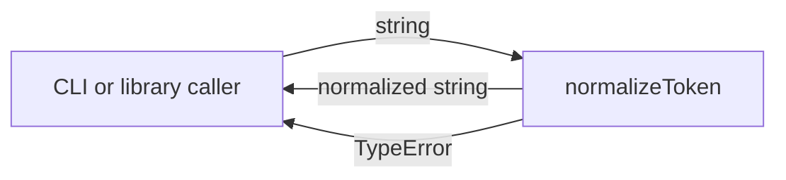
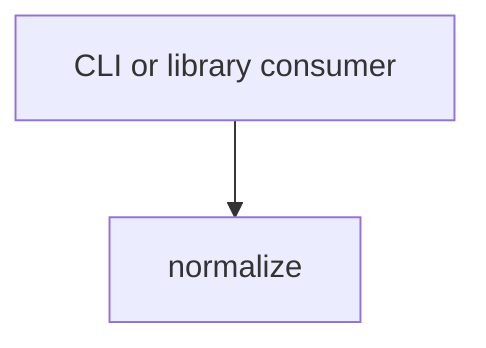

# Module: normalize

<!--SECTION:SPEC_ID-->
TOKEN-PIPELINE-NORMALIZE
<!--/SECTION:SPEC_ID-->

<!--SECTION:MODULE_VISION-->
## Module Vision

This module owns the single deterministic token-normalization operation inside the [token scope](../../token.spec.md): `normalizeToken` turns a valid ASCII token into its canonical lower-case hyphen-separated form and rejects invalid input. It has no sibling, parent or child modules; the scope itself is its only owner context. No implementation is included in this authoring round.
<!--/SECTION:MODULE_VISION-->

<!--SECTION:OVERVIEW-->
## Overview


_Один чистый вызов: валидный токен нормализуется, невалидный вход отклоняется — NOR-REQ-1, NOR-REQ-2._
<!--/SECTION:OVERVIEW-->

<!--SECTION:MODULE_USAGE_EXAMPLE-->
## Module Usage Example

```ts
import { normalizeToken } from "./normalize.js";

const token = normalizeToken("  Foo__BAR  ");
console.log(token);

try {
  normalizeToken("");
} catch (error) {
  if (!(error instanceof TypeError)) throw error;
  console.error("invalid token");
}
```
<!--/SECTION:MODULE_USAGE_EXAMPLE-->

<!--SECTION:MODULE_REQUIREMENTS-->
## Requirements

### NOR-REQ-1 [должен]
**Когда** `normalizeToken` получает непустую ASCII-строку, содержащую хотя бы один символ, отличный от пробела, underscore и hyphen, **функция должна** обрезать ведущие и замыкающие ASCII-пробелы, привести ASCII-буквы к нижнему регистру и свернуть каждую серию пробелов, underscore и hyphen в один hyphen.

> Уточняет TOK-REQ-1: модуль фиксирует единственный канонический формат токена для CLI и библиотечных потребителей.

### NOR-REQ-2 [должен · нештатная]
**Если** вход пуст, состоит только из разделителей (пробелов, underscore и hyphen) или содержит не-ASCII символ, **то функция должна** выбросить `TypeError` без ввода-вывода.

> Уточняет TOK-REQ-2: модуль не маскирует невалидный вход пустым или частично нормализованным токеном.

| Input | Outcome |
|---|---|
| `"  Foo__BAR  "` | `"foo-bar"` |
| `""` | `TypeError` |
<!--/SECTION:MODULE_REQUIREMENTS-->

<!--SECTION:INTER_MODULE_DEPENDENCIES-->
## Inter-Module Dependencies

- **Depends on:** none within the token scope.
- **Scope Reference (cross-scope):** none at runtime; the token scope references [infra-base](../../../infra-base/infra-base.spec.md) only as authoring infrastructure.
- **Provides to:** external CLI and library consumers.


_Модуль не зависит от соседних модулей; единственный вызывающий — внешний потребитель._
<!--/SECTION:INTER_MODULE_DEPENDENCIES-->

<!--SECTION:ENTITY_INVENTORY-->
## Entity Inventory

_Это полный список сущностей модуля. Любое введение сущности execution-агентом помимо этого списка считается drift'ом и требует обновления spec._

| Name | Type | Purpose |
|------|------|---------|
| `normalizeToken` | Function | Чистая нормализация ASCII-токена и отклонение невалидного входа |

Ошибки: throw → `normalizeToken`

ER-скетч не нужен: в инвентаре одна сущность без связей.
<!--/SECTION:ENTITY_INVENTORY-->

<!--SECTION:ENTITY_SURFACES-->
## Entity Surfaces

The module exposes one pure function surface with one public operation and one failure mode.

<details>
<summary>Полные поверхности сущностей</summary>

### `normalizeToken`
- **Type:** Function
- **Purpose:** Normalizes one ASCII token and throws `TypeError` for invalid input.
- **Public Properties:** N/A
- **Public Operations:** Normalize a token and return the canonical form; reject empty, separator-only and non-ASCII input.
- **Lifecycle:** Stateless; created by the importing module and terminated after each call.
- **Events Emitted:** N/A
- **Errors & Degradation:** `TypeError` via throw, owned by `normalizeToken`; no I/O, fallback or partial result.
- **Consumers:**
  - Internal: none
  - External: CLI and library consumers
- **Usage Waiver (external: CLI and library consumers):** The function is the scope's only public normalization surface required by TOK-REQ-1; pre-implementation usage count is zero.

</details>
<!--/SECTION:ENTITY_SURFACES-->

<!--SECTION:MODULE_CONTRACTS-->
## Module Contracts

The module defines one Service-style pure function, `normalizeToken`, and no Ports or Adapters.

Граф не рисуется: в модуле нет Port/Adapter, только Service `normalizeToken`.

Call Chain не рисуется: в модуле одна абстракция (`normalizeToken`), порог ≥2 не достигнут.

<details>
<summary>Контракты DbC</summary>

### Services

#### Service: `normalizeToken`
- **Purpose:** Returns the canonical lower-case hyphen-separated form of a valid ASCII token.
- **Consumers:** External CLI and library consumers; no internal consumer.
- **Runtime Backing:** `not-implemented`
- **Verification Levels:** `contract`, `unit`
- **Deferred Runtime Scope:** The entire operation is declared only; no implementation exists in this authoring round.

**Contract (DbC)** — one block per operation:
- `normalizeToken`:
  - Pre: The input is a string, is non-empty, contains at least one character other than space, underscore and hyphen, and contains only ASCII characters.
  - Post: The result has leading and trailing ASCII spaces removed, ASCII letters lower-cased, and every maximal run of space, underscore and hyphen replaced by one hyphen.
  - On pre-violation: Throws `TypeError` without I/O and without returning a partial token.

**Invariants:** The operation is pure and deterministic; it performs no I/O, keeps no state and returns the same result for the same input.

</details>
<!--/SECTION:MODULE_CONTRACTS-->

<!--SECTION:PUBLIC_OPTIONS-->
## Public Options & Policies

No public options or policies are configurable; the normalization behavior is fixed by the contract above.

<details>
<summary>Опции и политики</summary>

None. No flags, options or deferred policies are consumed in v1.

</details>
<!--/SECTION:PUBLIC_OPTIONS-->

<!--SECTION:FILE_STRUCTURE-->
## File Structure

```
normalize/
└── normalize.ts
```

**File Mapping:**
- `normalize.ts`: `normalizeToken` implementation (not yet created; declared for handoff)
<!--/SECTION:FILE_STRUCTURE-->

<!--SECTION:RESEARCH-->
## Research

No research documents. No external research informed this bounded deterministic module.
<!--/SECTION:RESEARCH-->

<!--SECTION:MODULE_DECISION_LOG-->
## Module Decision Log

One decision records the direct-function contract choice and remains pending operator review.

<details>
<summary>Полные записи Decision Log</summary>

NOR-DL-1 2026-10-24 — `normalizeToken` is a direct pure function without Port or Adapter (почему: no confirmed variability or test seam; отвергнуто: a Port around a single implementation — unnecessary abstraction) [verdict: pending-operator]

</details>
<!--/SECTION:MODULE_DECISION_LOG-->

<!--SECTION:HANDOFF-->
## Handoff to Tasks

- **Implementation files to be created:** `normalize.ts`
- **Test files to be created:** `test/token/pipeline/normalize/normalize.test.ts`
- **Stack dependencies:**
  - Language: `typescript` (resolves to `ai/directives/coding/typescript-rules.xml`)
  - Test framework: `node-test` (resolves to `ai/directives/testing/node-test.xml`)
- **Module Rules Additions:** `None`

  | Rule | Category | Source |
  |------|----------|--------|
  | None | - | - |

- **Open risks & validation needs:** No implementation or runtime exists; operator approval is pending. The fixture does not define a source root, `tsconfig` or test runner configuration.
<!--/SECTION:HANDOFF-->

<!--SECTION:IMPLEMENTATION_INSIGHTS-->
## Implementation Insights

Not applicable: the module has no implementation or post-implementation learnings yet.

<details>
<summary>Заметки по реализации</summary>

None recorded during artifact authoring.

</details>
<!--/SECTION:IMPLEMENTATION_INSIGHTS-->
