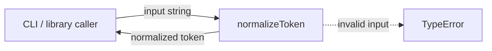
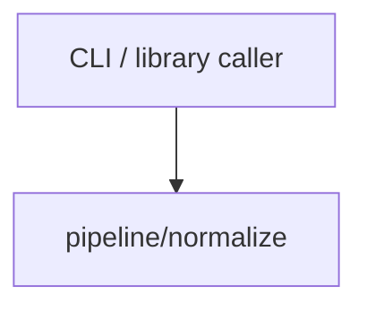

# Module: pipeline/normalize

<!--SECTION:SPEC_ID-->
TOKEN-PIPELINE-NORMALIZE
<!--/SECTION:SPEC_ID-->

<!--SECTION:MODULE_VISION-->
## Module Vision
Owns deterministic normalization of one token string for CLI and library consumers of [scope token](../../token.spec.md). The module is a leaf: it has no parent, child, or sibling module inside the scope, and it owns no persistence, network, or configuration surface.

<!--/SECTION:MODULE_VISION-->

<!--SECTION:OVERVIEW-->
## Overview


_Главный путь нормализации токена и отказ на недопустимом вводе — NOR-REQ-1, NOR-REQ-2._

<!--/SECTION:OVERVIEW-->

<!--SECTION:MODULE_USAGE_EXAMPLE-->
## Module Usage Example

```ts
import { normalizeToken } from "./normalize.js";

const token = normalizeToken("  Foo__BAR  ");
console.log(token);

try {
  normalizeToken("");
} catch (error) {
  if (!(error instanceof TypeError)) throw error;
  console.error("invalid token input");
}
```

Expected output: `foo-bar`, followed by `invalid token input`. The snippet has no setup, I/O, or composition with another module.

<!--/SECTION:MODULE_USAGE_EXAMPLE-->

<!--SECTION:MODULE_REQUIREMENTS-->
## Requirements

### NOR-REQ-1 [должен]
**Когда** на вход подана ASCII-строка, содержащая хотя бы один символ вне множества «пробел, underscore, hyphen», **normalizeToken должен** обрезать крайние ASCII-пробелы, привести ASCII-буквы к lower-case и заменить каждый непрерывный прогон пробелов, underscore и hyphen одним hyphen.

> Уточняет TOK-REQ-1: модуль фиксирует точную форму результата, на которую опираются CLI и библиотечные потребители.

### NOR-REQ-2 [должен · нештатная]
**Если** вход пуст, состоит только из разделителей «пробел, underscore, hyphen» или содержит не-ASCII символ, **то normalizeToken должен** синхронно выбросить TypeError и не выполнять ввод-вывод.

> Уточняет TOK-REQ-2: недопустимый вход нельзя маскировать пустым или частично нормализованным токеном.

| Input | Outcome |
|---|---|
| `"  Foo__BAR  "` | `"foo-bar"` |
| `""` | `TypeError` |

<!--/SECTION:MODULE_REQUIREMENTS-->

<!--SECTION:INTER_MODULE_DEPENDENCIES-->
## Inter-Module Dependencies
- **Depends on:** None.
- **Scope Reference (cross-scope):** None; the module performs no external I/O.
- **Provides to:** CLI and library consumers of `token`; no sibling module consumes it inside this scope.


_Единственная связь — внешний вызывающий код; sibling- и cross-scope-зависимостей нет._

<!--/SECTION:INTER_MODULE_DEPENDENCIES-->

<!--SECTION:ENTITY_INVENTORY-->
## Entity Inventory

_Это полный список сущностей модуля. Любое введение сущности execution-агентом помимо этого списка считается drift'ом и требует обновления spec._

| Name | Type | Purpose |
|------|------|---------|
| `normalizeToken` | Function | Детерминированно преобразует одну строку в нормализованный токен |

Ошибки: throw `TypeError` → `normalizeToken`.

ER-набросок не рисуется: в инвентаре одна сущность, связывать нечего.

<!--/SECTION:ENTITY_INVENTORY-->

<!--SECTION:ENTITY_SURFACES-->
## Entity Surfaces
Одна функция `normalizeToken`: чистый ввод-вывод без состояния, с синхронным `TypeError` на недопустимом входе.

<details>
<summary>Полные поверхности сущностей</summary>

### `normalizeToken`
- **Type:** Function
- **Purpose:** Преобразует одну строку в нормализованный токен.
- **Public Properties:** N/A
- **Public Operations:** нормализовать строку в токен
- **Lifecycle:** Создаётся как чистый вызов на каждый вход; между вызовами состояния и владения нет.
- **Events Emitted:** N/A
- **Errors & Degradation:** `TypeError` выбрасывается синхронно самим `normalizeToken`; вызывающий код владеет обработкой и отображением ошибки.
- **Consumers:**
  - Internal: N/A
  - External: CLI and library consumers of `token`
- **Usage Waiver (external: CLI and library consumers):** единственный публичный экспорт модуля; потребители находятся вне модуля по определению.

</details>

<!--/SECTION:ENTITY_SURFACES-->

<!--SECTION:MODULE_CONTRACTS-->
## Module Contracts
Один чистый Function-контракт `normalizeToken`; Port, Adapter и Service-обёртки не определяются.

Граф не рисуется: в модуле нет Port/Adapter, только Function `normalizeToken`.

Call Chain не рисуется: в инвентаре одна сущность — `normalizeToken`; внешний вызывающий код вызывает её напрямую одним шагом.

<details>
<summary>Контракты DbC</summary>

### Services

#### Service: `normalizeToken`
- **Purpose:** Детерминированно нормализовать одну входную строку в токен.
- **Consumers:** CLI and library consumers of `token`
- **Runtime Backing:** `not-implemented`
- **Verification Levels:** `contract`, `unit`
- **Deferred Runtime Scope:** Всё объявленное поведение; реализация в этом артефакте не запрошена.

**Contract (DbC)**
- `normalizeToken`:
  - Pre: вход — строка ASCII, содержащая хотя бы один символ вне множества «пробел, underscore, hyphen».
  - Post: результат не содержит крайних ASCII-пробелов, все ASCII-буквы приведены к lower-case, каждый непрерывный прогон пробелов, underscore и hyphen заменён одним hyphen.
  - On pre-violation: синхронно выбрасывается `TypeError`; ввод-вывод не выполняется.

**Invariants:** Функция не хранит состояние, не выполняет I/O и возвращает один и тот же результат для одного и того же допустимого входа.

</details>

<!--/SECTION:MODULE_CONTRACTS-->

<!--SECTION:PUBLIC_OPTIONS-->
## Public Options & Policies
Публичных опций и политик нет: сигнатура `normalizeToken(input: string): string` не принимает параметров конфигурации.

<details>
<summary>Опции и политики</summary>

N/A — модуль не предоставляет флагов, опций или настраиваемых политик; все правила нормализации фиксированы контрактом.

</details>

<!--/SECTION:PUBLIC_OPTIONS-->

<!--SECTION:FILE_STRUCTURE-->
## File Structure
```
normalize/
├── normalize.ts
└── normalize.test.ts
```

**File Mapping:**
- `normalize/normalize.ts`: реализация `normalizeToken`
- `normalize/normalize.test.ts`: модульные проверки допустимого и недопустимого входа

<!--/SECTION:FILE_STRUCTURE-->

<!--SECTION:RESEARCH-->
## Research
No research documents were used for this bounded deterministic draft; no research registry entries apply.

<!--/SECTION:RESEARCH-->

<!--SECTION:MODULE_DECISION_LOG-->
## Module Decision Log
Одна запись: `normalizeToken` остаётся чистым Function без Port/Adapter-слоя.

<details>
<summary>Полные записи Decision Log</summary>

NOR-DL-1 2026-10-24 — `normalizeToken` реализуется как чистый Function без Port/Adapter (почему: нет подтверждённой вариативности и I/O, отдельный тестовый шов не нужен; отвергнуто: Port/Adapter-слой — добавил бы абстракцию без потребителя; риск: при появлении второй реализации потребуется рефакторинг).

</details>

<!--/SECTION:MODULE_DECISION_LOG-->

<!--SECTION:HANDOFF-->
## Handoff to Tasks
- **Implementation files to be created:** planned downstream, not created by this authoring draft — `normalize/normalize.ts` for `normalizeToken`.
- **Test files to be created:** planned downstream, not created by this authoring draft — `normalize/normalize.test.ts` for the two tabled cases.
- **Stack dependencies:**
  - Language: `typescript` (resolves to `ai/directives/coding/typescript-rules.xml`)
  - Test framework: Node.js built-in test runner (resolves to `ai/directives/testing/node-test.xml`)
- **Module Rules Additions:** None.
- **Open risks & validation needs:** No implementation or execution exists. Edge cases beyond the two tabled examples — leading or trailing separators and digits — are not validated by this draft. Owner handoff status: pending-operator; no approval, ticket creation, or execution claim is made here.

<!--/SECTION:HANDOFF-->

<!--SECTION:IMPLEMENTATION_INSIGHTS-->
## Implementation Insights
Not applicable: no implementation has occurred, so there are no post-implementation learnings to record.

<details>
<summary>Заметки по реализации</summary>

N/A — appendix is populated only after implementation and audit-cycle compaction.

</details>

<!--/SECTION:IMPLEMENTATION_INSIGHTS-->
