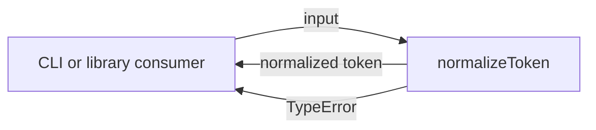
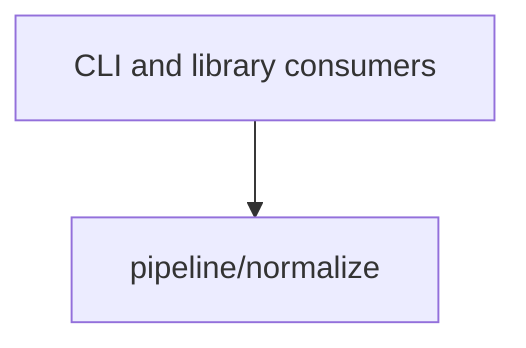

# Module: normalize

<!--SECTION:SPEC_ID-->
TOKEN-PIPELINE-NORMALIZE
<!--/SECTION:SPEC_ID-->

<!--SECTION:MODULE_VISION-->
## Module Vision

This module owns the single pure operation `normalizeToken` inside scope [token](../../token.spec.md): it trims, lowercases, and collapses an input token into one deterministic form, and rejects invalid input. There are no sibling or child modules.
<!--/SECTION:MODULE_VISION-->

<!--SECTION:OVERVIEW-->
## Overview


_Путь нормализации токена: результат или отказ TypeError — NOR-REQ-1, NOR-REQ-2._
<!--/SECTION:OVERVIEW-->

<!--SECTION:MODULE_USAGE_EXAMPLE-->
## Module Usage Example

```ts
import { normalizeToken } from "./normalize.js";

const normalized = normalizeToken("  Foo__BAR  ");
console.log(normalized); // "foo-bar"

try {
  normalizeToken("");
} catch (error) {
  console.error(error instanceof TypeError); // true
}
```
<!--/SECTION:MODULE_USAGE_EXAMPLE-->

<!--SECTION:MODULE_REQUIREMENTS-->
## Requirements

### NOR-REQ-1 [должен]
**Когда** на вход подана строка `"  Foo__BAR  "`, **нормализатор должен** вернуть `"foo-bar"`.

> The `normalize-example` scenario fixes the observable outcome of parent TOK-REQ-1 for this module.

### NOR-REQ-2 [должен · нештатная]
**Если** входная строка пустая ИЛИ состоит только из ASCII-пробелов, underscore и hyphen ИЛИ содержит хотя бы один не-ASCII символ, **то нормализатор должен** выбросить TypeError без ввода-вывода.

> The `empty-input-rejection` scenario narrows the negative branch of parent TOK-REQ-2: an input error is never masked by an empty valid token.

| Input | Outcome |
|---|---|
| `"  Foo__BAR  "` | `"foo-bar"` |
| `""` | `TypeError` |
<!--/SECTION:MODULE_REQUIREMENTS-->

<!--SECTION:INTER_MODULE_DEPENDENCIES-->
## Inter-Module Dependencies

- **Depends on:** None — `pipeline/normalize` is the only module in scope `token`.
- **Scope Reference (cross-scope):** None.
- **Provides to:** None within scope; `normalizeToken` is exposed to CLI and library consumers through the scope public API.


_Единственный модуль скоупа token; внешний потребитель — CLI и библиотека._
<!--/SECTION:INTER_MODULE_DEPENDENCIES-->

<!--SECTION:ENTITY_INVENTORY-->
## Entity Inventory

_This is the complete entity inventory of the module. Any entity introduced by an execution agent outside this list is drift and requires a spec update._

| Name | Type | Purpose |
|------|------|---------|
| `normalizeToken` | Function | Pure normalization of the input token |

Ошибки: throw TypeError → `normalizeToken`.

ER-скетч не рисуется: в инвентаре одна сущность, связывать нечего.
<!--/SECTION:ENTITY_INVENTORY-->

<!--SECTION:ENTITY_SURFACES-->
## Entity Surfaces

One public surface: the pure function `normalizeToken`, with one input and either one result or a TypeError.

<details>
<summary>Полные поверхности сущностей</summary>

### `normalizeToken`
- **Type:** Function
- **Purpose:** Normalizes the input token deterministically or rejects invalid input.
- **Public Properties:** N/A
- **Public Operations:** `normalizeToken(input: string): string`
- **Lifecycle:** Created on module import; no state; no termination.
- **Events Emitted:** N/A
- **Errors & Degradation:** `TypeError` via throw; the calling consumer owns handling.
- **Consumers:**
  - Internal: `pipeline/normalize/normalize.ts`
  - External: CLI and library consumers
- **Usage Waiver (external: CLI and library consumers):** The public operation is consumed outside the module boundary; there are no other entities.

</details>
<!--/SECTION:ENTITY_SURFACES-->

<!--SECTION:MODULE_CONTRACTS-->
## Module Contracts

The module defines one pure function, `normalizeToken`; no Ports or Adapters are introduced.

Граф не рисуется: в модуле нет Port/Adapter, только Function `normalizeToken`. Call Chain не рисуется: в инвентаре одна абстракция, порог ≥2 не достигнут.

<details>
<summary>Контракты DbC</summary>

### Services

#### Service: `normalizeToken`
- **Purpose:** Deterministically normalize an input token or reject invalid input.
- **Consumers:** CLI and library consumers through the scope public API.
- **Runtime Backing:** `not-implemented`
- **Verification Levels:** `contract`, `unit`
- **Deferred Runtime Scope:** The entire implementation is deferred; no code is created in this authoring task.

**Contract (DbC)** — one block per operation:
- `normalizeToken(input)`:
  - Pre: `input` is a string whose characters are all ASCII and which contains at least one character other than an ASCII space, underscore, or hyphen.
  - Post: Returns a string with leading and trailing ASCII spaces trimmed, ASCII letters lowercased, and runs of ASCII spaces, underscores, and hyphens collapsed to one hyphen.
  - On pre-violation: Throws TypeError; no I/O, network access, or persistent state mutation occurs.

**Invariants:** The function is deterministic and has no observable side effects; the same input always produces the same result.

</details>
<!--/SECTION:MODULE_CONTRACTS-->

<!--SECTION:PUBLIC_OPTIONS-->
## Public Options & Policies

There are no publicly observable flags or options: `normalizeToken` accepts only its input string.

<details>
<summary>Опции и политики</summary>

Options are not applicable: the module has no configuration, policies, or deferred options.

</details>
<!--/SECTION:PUBLIC_OPTIONS-->

<!--SECTION:FILE_STRUCTURE-->
## File Structure
```
pipeline/normalize/
├── normalize.ts
└── normalize.test.ts
```

**File Mapping:**
- `pipeline/normalize/normalize.ts`: pure function `normalizeToken` (planned, not created).
- `pipeline/normalize/normalize.test.ts`: unit tests for the normalization example and TypeError rejection (planned, not created).
<!--/SECTION:FILE_STRUCTURE-->

<!--SECTION:RESEARCH-->
## Research

No research documents: this module follows the already fixed scope contract in `docs/token-contract.md`.
<!--/SECTION:RESEARCH-->

<!--SECTION:MODULE_DECISION_LOG-->
## Module Decision Log

One decision is recorded: the conscious choice of a pure Function with no Port or Adapter.

<details>
<summary>Полные записи Decision Log</summary>

NOR-DL-1 2026-10-24 — pure Function `normalizeToken` without Port or Adapter (почему: single deterministic implementation, no confirmed variability; отвергнуто: Port+Adapter — an extra layer with no test seam; риск: none identified).

</details>
<!--/SECTION:MODULE_DECISION_LOG-->

<!--SECTION:HANDOFF-->
## Handoff to Tasks

- **Implementation files to be created:** `pipeline/normalize/normalize.ts` (not created in this authoring task).
- **Test files to be created:** `pipeline/normalize/normalize.test.ts` (not created in this authoring task).
- **Stack dependencies:**
  - Language: `TypeScript` (resolves to `ai/directives/coding/typescript-rules.xml`)
  - Test framework: `node-test` (resolves to `ai/directives/testing/node-test.xml`)
- **Module Rules Additions:** None.
- **Open risks & validation needs:** No implementation or runtime evidence exists. Owner handoff and Approval #1 remain pending-operator. Non-ASCII rejection must be verified explicitly at implementation time.
<!--/SECTION:HANDOFF-->

<!--SECTION:IMPLEMENTATION_INSIGHTS-->
## Implementation Insights

Not applicable: no implementation exists yet, so there are no post-implementation learnings.

<details>
<summary>Заметки по реализации</summary>

No implementation notes yet.

</details>
<!--/SECTION:IMPLEMENTATION_INSIGHTS-->
