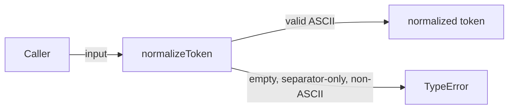
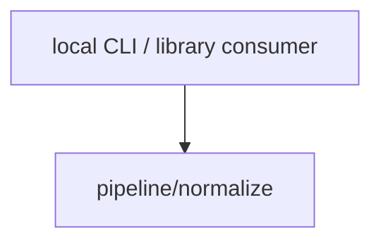

# Module: pipeline/normalize

<!--SECTION:SPEC_ID-->
TOKEN-PIPELINE-NORMALIZE
<!--/SECTION:SPEC_ID-->

<!--SECTION:MODULE_VISION-->
## Module Vision

Модуль `pipeline/normalize` владеет единственной чистой операцией нормализации ASCII-токена:
обрезкой крайних пробелов, приведением ASCII-букв к нижнему регистру и сворачиванием разделителей
в один hyphen. Родительская спека — [token](../../token.spec.md). Соседних, родительских или
дочерних модулей у этого модуля нет: он реализует всю поверхность скоупа `token` без собственной
декомпозиции.
<!--/SECTION:MODULE_VISION-->

<!--SECTION:OVERVIEW-->
## Overview


_Один детерминированный проход: корректный ASCII-вход даёт токен, недопустимый — TypeError — NOR-REQ-1, NOR-REQ-2._
<!--/SECTION:OVERVIEW-->

<!--SECTION:MODULE_USAGE_EXAMPLE-->
## Module Usage Example

```ts
import { normalizeToken } from "./normalize.js";

console.log(normalizeToken("  Foo__BAR  ")); // "foo-bar"

try {
  normalizeToken("");
} catch (error) {
  console.error(error instanceof TypeError ? "invalid token" : error);
}
```
<!--/SECTION:MODULE_USAGE_EXAMPLE-->

<!--SECTION:MODULE_REQUIREMENTS-->
## Requirements

### NOR-REQ-1 [должен]
**Когда** `normalizeToken` получает ASCII-строку, содержащую хотя бы один символ вне ASCII-пробела, `_` и `-`, **нормализатор должен** обрезать крайние ASCII-пробелы, привести ASCII-буквы к нижнему регистру и заменить каждый непрерывный отрезок из ASCII-пробелов, `_` и `-` одним `-`.

> Уточняет TOK-REQ-1: модуль фиксирует точную последовательность преобразования, чтобы локальные CLI- и библиотечные потребители получали один и тот же токен.

### NOR-REQ-2 [должен · нештатная]
**Если** вход пустой, состоит только из ASCII-пробелов, `_` и `-` или содержит хотя бы один не-ASCII символ, **то нормализатор должен** выбросить `TypeError` без файлового, сетевого и иного ввода-вывода.

> Уточняет TOK-REQ-2: недопустимый вход нельзя маскировать пустым или искажённым корректным токеном.

| Input | Outcome |
|---|---|
| `"  Foo__BAR  "` | `"foo-bar"` |
| `""` | `TypeError` |
<!--/SECTION:MODULE_REQUIREMENTS-->

<!--SECTION:INTER_MODULE_DEPENDENCIES-->
## Inter-Module Dependencies

- **Depends on:** нет модулей внутри скоупа `token`
- **Scope Reference (cross-scope):** нет; `infra-base` относится только к авторской инфраструктуре и не является runtime-зависимостью
- **Provides to:** локальные CLI- и библиотечные потребители скоупа `token`


_Межмодульных рёбер нет: нормализатор вызывается напрямую потребителем._
<!--/SECTION:INTER_MODULE_DEPENDENCIES-->

<!--SECTION:ENTITY_INVENTORY-->
## Entity Inventory

_Это полный список сущностей модуля. Любое введение сущности execution-агентом помимо этого списка считается drift'ом и требует обновления spec._

| Name | Type | Purpose |
|------|------|---------|
| `normalizeToken` | Service | Чистая нормализация ASCII-токена одним детерминированным проходом |

Ошибки: throw (`TypeError`) → `normalizeToken`

ER-набросок не рисуется: в инвентаре одна сущность, связывать её не с чем.
<!--/SECTION:ENTITY_INVENTORY-->

<!--SECTION:ENTITY_SURFACES-->
## Entity Surfaces

Одна публичная функция `normalizeToken`; её полная поверхность приведена ниже.

<details>
<summary>Полные поверхности сущностей</summary>

### `normalizeToken`

- **Type:** Service
- **Purpose:** Преобразует корректный ASCII-вход в нормализованный токен и отвергает недопустимый вход.
- **Public Properties:** N/A
- **Public Operations:** нормализация строки в токен; отклонение пустого, separator-only и не-ASCII входа
- **Lifecycle:** создаётся вызывающим кодом как чистая функция; собственного состояния не имеет; завершается возвратом токена или выбросом `TypeError`
- **Events Emitted:** N/A
- **Errors & Degradation:** `TypeError` через throw внутри `normalizeToken`; обработка и показ ошибки остаются у вызывающего потребителя, ввода-вывода нет
- **Consumers:**
  - Internal: `src/token/pipeline/normalize/normalize.ts`
  - External: local CLI / library consumers
- **Usage Waiver (external: local CLI / library consumers):** Публичный контракт скоупа `token`; внутренних мест вызова меньше двух, потому что библиотека отдаёт функцию потребителю напрямую.

</details>
<!--/SECTION:ENTITY_SURFACES-->

<!--SECTION:MODULE_CONTRACTS-->
## Module Contracts

Модуль определяет один чистый Service `normalizeToken`; Port и Adapter не вводятся, подтверждённой вариативности нет.

Граф не рисуется: в модуле нет Port/Adapter, только Service `normalizeToken`.

Цепочка вызовов не рисуется: в инвентаре одна абстракция (`normalizeToken`).

<details>
<summary>Контракты DbC</summary>

### Services

#### Service: `normalizeToken`

- **Purpose:** Детерминированно нормализовать корректный ASCII-вход и явно отвергнуть недопустимый.
- **Consumers:** local CLI / library consumers
- **Runtime Backing:** `not-implemented`
- **Verification Levels:** `contract`, `unit`
- **Deferred Runtime Scope:** Всё объявленное runtime-поведение — реализация в этот авторский проход не запрошена.

**Contract (DbC)**

- `normalizeToken`:
  - Pre: вход — строка, содержит только ASCII-символы и хотя бы один символ вне ASCII-пробела, `_` и `-`.
  - Post: возвращённая строка не имеет крайних ASCII-пробелов, все ASCII-буквы в нижнем регистре, каждый непрерывный отрезок из ASCII-пробелов, `_` и `-` заменён одним `-`; ввода-вывода не выполняется.
  - On pre-violation: при пустом, separator-only или содержащем не-ASCII символ входе выбрасывается `TypeError` без ввода-вывода.

**Invariants**

Операция чистая и детерминированная: одинаковый корректный вход всегда даёт одинаковый токен, а модуль не хранит состояние и не выполняет ввод-вывод.

</details>
<!--/SECTION:MODULE_CONTRACTS-->

<!--SECTION:PUBLIC_OPTIONS-->
## Public Options & Policies

Публичных опций нет: поведение `normalizeToken` полностью фиксировано.

<details>
<summary>Опции и политики</summary>

Флаги, настройки разделителей и политики локали не предусмотрены в v1. Внешняя конфигурация не потребляется.

</details>
<!--/SECTION:PUBLIC_OPTIONS-->

<!--SECTION:FILE_STRUCTURE-->
## File Structure

```
src/token/pipeline/normalize/
└── normalize.ts
tests/token/pipeline/normalize/
└── normalize.test.ts
```

**File Mapping:**
- `src/token/pipeline/normalize/normalize.ts`: Service `normalizeToken`
- `tests/token/pipeline/normalize/normalize.test.ts`: контрактные и unit-проверки нормализации и отклонения входа
<!--/SECTION:FILE_STRUCTURE-->

<!--SECTION:RESEARCH-->
## Research

Не применимо: для этого ограниченного детерминированного модуля ресёрч-документов нет.
<!--/SECTION:RESEARCH-->

<!--SECTION:MODULE_DECISION_LOG-->
## Module Decision Log

Зафиксировано одно решение: чистый Service без Port/Adapter.

<details>
<summary>Полные записи Decision Log</summary>

NOR-DL-1 2026-10-24 — нормализацию владеет чистый Service `normalizeToken` без Port/Adapter; где: `specs/token/pipeline/normalize/normalize.spec.md#module-contracts` (почему: преобразование не имеет состояния, а подтверждённой вариативности или тестового шва для Port нет; отвергнуто: stateful service — состояние не требуется и усложнило бы контракт; риск: будущая вариативность потребует явного изменения контракта) [verdict: pending-operator]

</details>
<!--/SECTION:MODULE_DECISION_LOG-->

<!--SECTION:HANDOFF-->
## Handoff to Tasks

- **Implementation files to be created:** `src/token/pipeline/normalize/normalize.ts`
- **Test files to be created:** `tests/token/pipeline/normalize/normalize.test.ts`
- **Stack dependencies:**
  - Language: `typescript` (resolves to `ai/directives/coding/typescript-rules.xml`)
  - Test framework: `node-test` (resolves to `ai/directives/testing/node-test.xml`)
- **Module Rules Additions:** None
- **Open risks & validation needs:** Реализация не запрошена, поэтому runtime-поведение не проверено. Approval #1 остаётся pending; операторское одобрение, тикеты и исполнение отсутствуют.
<!--/SECTION:HANDOFF-->

<!--SECTION:IMPLEMENTATION_INSIGHTS-->
## Implementation Insights

Не применимо: артефакт создаётся до реализации, post-implementation наблюдений ещё нет.
<!--/SECTION:IMPLEMENTATION_INSIGHTS-->
