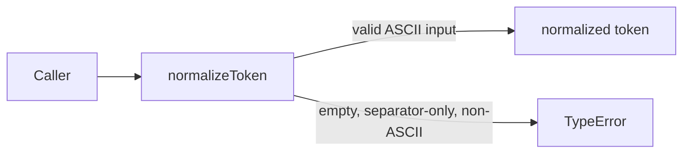
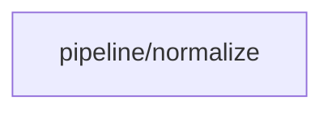

# Module: pipeline/normalize

<!--SECTION:SPEC_ID-->
TOKEN-PIPELINE-NORMALIZE
<!--/SECTION:SPEC_ID-->

<!--SECTION:MODULE_VISION-->
## Module Vision

Модуль владеет единственной чистой операцией `normalizeToken`, которая приводит допустимую ASCII-строку к детерминированному токену без сети, хранилища и состояния. Он входит в скоуп [token](../../token.spec.md) и не имеет parent/child модулей: `pipeline/normalize` — единственный модуль этой ветки.
<!--/SECTION:MODULE_VISION-->

<!--SECTION:OVERVIEW-->
## Overview


_Главный путь нормализации и отказ на недопустимом входе — NOR-REQ-1, NOR-REQ-2._
<!--/SECTION:OVERVIEW-->

<!--SECTION:MODULE_USAGE_EXAMPLE-->
## Module Usage Example

```ts
import { normalizeToken } from "./normalize.js";

const token = normalizeToken("  Foo__BAR  ");
// token === "foo-bar"

try {
  normalizeToken("");
} catch (error) {
  if (!(error instanceof TypeError)) {
    throw error;
  }
  // invalid input: empty, separator-only, or non-ASCII
}
```
<!--/SECTION:MODULE_USAGE_EXAMPLE-->

<!--SECTION:MODULE_REQUIREMENTS-->
## Requirements

### NOR-REQ-1 [должен]
**Когда** передана строка, содержащая хотя бы один ASCII-символ, отличный от пробела, underscore и hyphen, **normalizeToken должен** обрезать крайние ASCII-пробелы, привести ASCII-буквы к нижнему регистру и свернуть серии пробелов, underscore и hyphen в один hyphen.

> Уточняет TOK-REQ-1 для модуля: фиксирует единственный локальный формат токена без сети, хранилища и настраиваемых политик.

### NOR-REQ-2 [должен · нештатная]
**Если** входная строка пустая, состоит только из разделителей (пробел, underscore, hyphen) или содержит не-ASCII символ, **то normalizeToken должен** выбросить TypeError без ввода-вывода.

> Уточняет TOK-REQ-2 для модуля: ошибка входа остаётся явной и не маскируется пустым корректным токеном.

| Input | Outcome |
|---|---|
| `"  Foo__BAR  "` | `"foo-bar"` |
| `""` | `TypeError` |
<!--/SECTION:MODULE_REQUIREMENTS-->

<!--SECTION:INTER_MODULE_DEPENDENCIES-->
## Inter-Module Dependencies

- **Depends on:** нет зависимостей внутри скоупа `token`.
- **Scope Reference (cross-scope):** нет; операция полностью локальная.
- **Provides to:** нет потребителей-модулей внутри скоупа `token`; функцию вызывают CLI- и библиотечные потребители напрямую.


_Модуль не имеет зависимостей и потребителей-модулей внутри скоупа token._
<!--/SECTION:INTER_MODULE_DEPENDENCIES-->

<!--SECTION:ENTITY_INVENTORY-->
## Entity Inventory

_Это полный список сущностей модуля. Любое введение сущности execution-агентом помимо этого списка считается drift'ом и требует обновления spec._

| Name | Type | Purpose |
|------|------|---------|
| `normalizeToken` | Function | Приводит входную строку к детерминированному токену |

Ошибки: throw TypeError → `normalizeToken`

ER-эскиз не нужен: в инвентаре одна сущность, связей между сущностями нет.
<!--/SECTION:ENTITY_INVENTORY-->

<!--SECTION:ENTITY_SURFACES-->
## Entity Surfaces

Одна публичная функция `normalizeToken`; её поверхность и владение ошибкой раскрыты ниже.

<details>
<summary>Полные поверхности сущностей</summary>

### `normalizeToken`
- **Type:** Function
- **Purpose:** Приводит допустимую ASCII-строку к нормализованному токену.
- **Public Properties:** N/A
- **Public Operations:** `normalizeToken(input)` — вернуть нормализованный токен или выбросить TypeError.
- **Lifecycle:** Создаётся на каждый вызов, состояния не хранит, завершается возвратом значения или исключением.
- **Events Emitted:** N/A
- **Errors & Degradation:** `TypeError` через throw для пустого, состоящего только из разделителей или не-ASCII входа; обработка ошибки — на стороне вызывающего.
- **Consumers:**
  - Internal: нет
  - External: CLI- и библиотечные потребители
- **Usage Waiver (external: CLI- и библиотечные потребители):** Единственная публичная операция модуля; вызовов в implementation-коде пока нет.

</details>
<!--/SECTION:ENTITY_SURFACES-->

<!--SECTION:MODULE_CONTRACTS-->
## Module Contracts

Модуль предоставляет один чистый Service `normalizeToken`; Port и Adapter не вводятся.

Граф не рисуется: в модуле нет Port/Adapter, только Service `normalizeToken`.

Цепочка вызовов не рисуется: в модуле одна абстракция — Service `normalizeToken`.

<details>
<summary>Контракты DbC</summary>

### Services

#### Service: `normalizeToken`
- **Purpose:** Приводит допустимую ASCII-строку к детерминированному токену.
- **Consumers:** CLI- и библиотечные потребители
- **Runtime Backing:** `not-implemented`
- **Verification Levels:** `contract`, `unit`
- **Deferred Runtime Scope:** Реализация отсутствует; контракт задаёт будущее поведение.

**Contract (DbC)**
- `normalizeToken`:
  - Pre: вход — строка, содержащая хотя бы один ASCII-символ, отличный от пробела, underscore и hyphen.
  - Post: возвращает строку без крайних ASCII-пробелов, с ASCII-буквами в нижнем регистре и сериями пробелов, underscore и hyphen, свёрнутыми в один hyphen.
  - On pre-violation: выбрасывает TypeError без операций ввода-вывода.

**Invariants:** Операция детерминирована и не выполняет ввод-вывод; результат не содержит пробелов, underscore и заглавных ASCII-букв.

</details>
<!--/SECTION:MODULE_CONTRACTS-->

<!--SECTION:PUBLIC_OPTIONS-->
## Public Options & Policies

Публичных опций нет: поведение задано единственным контрактом `normalizeToken`.

<details>
<summary>Опции и политики</summary>

Настраиваемые флаги, политики и параметры не предусмотрены; отложенных опций в v1 нет.

</details>
<!--/SECTION:PUBLIC_OPTIONS-->

<!--SECTION:FILE_STRUCTURE-->
## File Structure

```
src/token/pipeline/normalize/
└── normalize.ts
```

**File Mapping:**
- `src/token/pipeline/normalize/normalize.ts`: реализация `normalizeToken`.
<!--/SECTION:FILE_STRUCTURE-->

<!--SECTION:RESEARCH-->
## Research

No research documents for this bounded deterministic module; the behavior is fully specified by the scope requirements and `docs/token-contract.md`.
<!--/SECTION:RESEARCH-->

<!--SECTION:MODULE_DECISION_LOG-->
## Module Decision Log

Зафиксировано решение NOR-DL-1: один чистый Function/Service без Port/Adapter; вердикт остаётся за оператором.

<details>
<summary>Полные записи Decision Log</summary>

NOR-DL-1 2026-10-24 — выбран один чистый Function/Service `normalizeToken` без Port/Adapter; где: specs/token/pipeline/normalize/normalize.spec.md#module-contracts (почему: нет подтверждённой вариативности и тестового шва; отвергнуто: Port с единственной реализацией; риск: будущая замена реализации потребует правки спеки) [verdict: pending-operator]

</details>
<!--/SECTION:MODULE_DECISION_LOG-->

<!--SECTION:HANDOFF-->
## Handoff to Tasks

- **Implementation files to be created:** `src/token/pipeline/normalize/normalize.ts`
- **Test files to be created:** `src/token/pipeline/normalize/normalize.test.ts`
- **Stack dependencies:**
  - Language: `typescript` (resolves to `ai/directives/coding/typescript-rules.xml`)
  - Test framework: `node-test` (resolves to `ai/directives/testing/node-test.xml`)
- **Module Rules Additions:** None

  | Rule | Category | Source |
  |------|----------|--------|
  | None | - | - |

- **Open risks & validation needs:** Authoring remains pending operator approval; no implementation, tickets, or execution are claimed. Non-ASCII rejection must be validated against the stated contract.
<!--/SECTION:HANDOFF-->

<!--SECTION:IMPLEMENTATION_INSIGHTS-->
## Implementation Insights

Not applicable: no implementation exists yet, so there are no post-implementation learnings.

<details>
<summary>Заметки по реализации</summary>

Not applicable until implementation and audit-cycle compaction exist.

</details>
<!--/SECTION:IMPLEMENTATION_INSIGHTS-->
