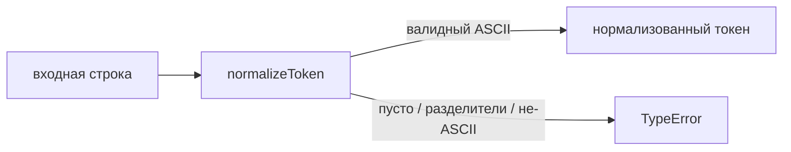
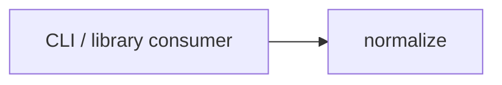

# Module: pipeline/normalize

<!--SECTION:SPEC_ID-->
TOKEN-PIPELINE-NORMALIZE
<!--/SECTION:SPEC_ID-->

<!--SECTION:MODULE_VISION-->
## Module Vision
`pipeline/normalize` owns deterministic, in-memory normalization of a single token for the [`token`](../../token.spec.md) scope. It owns `normalizeToken` and the `TypeError` boundary for invalid input; it does not own CLI parsing, token consumption, or any I/O. The scope declares no sibling, parent or child modules, so this is the scope's only module.
<!--/SECTION:MODULE_VISION-->

<!--SECTION:OVERVIEW-->
## Overview

_Главный поток нормализации одного токена и его граница ошибки — NOR-REQ-1, NOR-REQ-2._
<!--/SECTION:OVERVIEW-->

<!--SECTION:MODULE_USAGE_EXAMPLE-->
## Module Usage Example
```ts
import { normalizeToken } from "./normalize";

const token = normalizeToken("  Foo__BAR  ");
console.log(token);

try {
  normalizeToken("");
} catch (error) {
  console.error(error instanceof TypeError);
}
```

The happy path returns `"foo-bar"`. The error path throws `TypeError` for `""` and is caught by the caller; no setup, network, or persistent state is involved.
<!--/SECTION:MODULE_USAGE_EXAMPLE-->

<!--SECTION:MODULE_REQUIREMENTS-->
## Requirements
### NOR-REQ-1 [должен]
**Когда** на вход передана строка, содержащая хотя бы один ASCII-символ, отличный от пробела, underscore и hyphen, **нормализатор должен** обрезать крайние ASCII-пробелы, привести ASCII-буквы к нижнему регистру и свернуть последовательности пробелов, underscore и hyphen в один hyphen.

> Уточняет TOK-REQ-1 для модуля: закрепляет единственный детерминированный формат токена и исключает зависимость от состояния, времени или I/O.

### NOR-REQ-2 [должен · нештатная]
**Если** входная строка пустая, состоит только из разделителей или содержит не-ASCII символы, **то нормализатор должен** выбросить `TypeError` без ввода-вывода.

> Уточняет TOK-REQ-2 для модуля: недопустимый вход нельзя маскировать пустым или частично нормализованным токеном.

| Input | Outcome |
|---|---|
| `"  Foo__BAR  "` | `"foo-bar"` |
| `""` | `TypeError` |
<!--/SECTION:MODULE_REQUIREMENTS-->

<!--SECTION:INTER_MODULE_DEPENDENCIES-->
## Inter-Module Dependencies
- **Depends on:** None — the module has no sibling or cross-scope dependencies.
- **Scope Reference (cross-scope):** None.
- **Provides to:** CLI and library consumers of the `token` scope.


_Внешние потребители вызывают модуль normalize; внутрискоупных зависимостей нет._
<!--/SECTION:INTER_MODULE_DEPENDENCIES-->

<!--SECTION:ENTITY_INVENTORY-->
## Entity Inventory
_Это полный список сущностей модуля. Любое введение сущности execution-агентом помимо этого списка считается drift'ом и требует обновления spec._

| Name | Type | Purpose |
|------|------|---------|
| `normalizeToken` | Function | Нормализует один ASCII-токен детерминированно, без I/O |

Ошибки: throw → `normalizeToken`

ER-эскиз не рисуется: в инвентаре одна сущность, связывать нечего.
<!--/SECTION:ENTITY_INVENTORY-->

<!--SECTION:ENTITY_SURFACES-->
## Entity Surfaces
Модуль экспортирует одну функцию `normalizeToken`; её полная поверхность описана ниже.

<details>
<summary>Полные поверхности сущностей</summary>

### `normalizeToken`
- **Type:** Function
- **Purpose:** Преобразует одну входную строку в детерминированный токен или выбрасывает `TypeError`.
- **Public Properties:** N/A
- **Public Operations:** нормализовать одну строку в токен
- **Lifecycle:** Создаётся потребителем в момент вызова, не хранит состояние и завершается при возврате значения или исключении.
- **Events Emitted:** N/A
- **Errors & Degradation:** `TypeError` через throw при пустом, состоящем только из разделителей или не-ASCII входе; обработка принадлежит вызывающему потребителю. I/O отсутствует.
- **Consumers:**
  - Internal: `normalize/normalize.ts` (planned implementation)
  - External: CLI and library consumers
- **Usage Waiver (external: CLI and library consumers):** Функция — единственный публичный экспорт модуля и предназначена для внешних потребителей; production-вызовов пока нет, потому что реализация не запрошена.

</details>
<!--/SECTION:ENTITY_SURFACES-->

<!--SECTION:MODULE_CONTRACTS-->
## Module Contracts
Модуль определяет один Service — чистую функцию `normalizeToken`; Port и Adapter отсутствуют.

Граф не рисуется: в модуле нет Port/Adapter, только Service `normalizeToken`.

Call Chain не рисуется: в модуле одна абстракция — Service `normalizeToken`; последовательность вызовов тривиальна.

<details>
<summary>Контракты DbC</summary>

### Services

#### Service: `normalizeToken`
- **Purpose:** Нормализует одну ASCII-строку в детерминированный токен или сигнализирует о недопустимом входе.
- **Consumers:** internal `normalize/normalize.ts` (planned); external CLI and library consumers.
- **Runtime Backing:** `not-implemented`
- **Verification Levels:** `contract`, `unit`
- **Deferred Runtime Scope:** Реализация и исполнение тестов отложены до задач; runtime не заявлен.

**Contract (DbC)**
- `normalizeToken`:
  - Pre: Вызывающий передаёт ровно одну строку; конфигурация и I/O не требуются.
  - Post: Для допустимого ASCII-входа возвращается строка с обрезанными крайними ASCII-пробелами, ASCII-буквами в нижнем регистре и последовательностями пробелов, underscore и hyphen, свёрнутыми в один hyphen.
  - On pre-violation: Для пустой строки, строки только из разделителей или не-ASCII входа выбрасывается `TypeError` без ввода-вывода.

**Invariants:** Результат детерминирован, не содержит ASCII-пробелов и underscore, не начинается и не заканчивается hyphen и не содержит двух hyphen подряд.

</details>
<!--/SECTION:MODULE_CONTRACTS-->

<!--SECTION:PUBLIC_OPTIONS-->
## Public Options & Policies
Публичных опций и политик в v1 нет — поведение фиксировано функцией `normalizeToken`.

<details>
<summary>Опции и политики</summary>

Not applicable: модуль не предоставляет флагов, опций или настраиваемых политик; единственная поверхность — `normalizeToken`.

</details>
<!--/SECTION:PUBLIC_OPTIONS-->

<!--SECTION:FILE_STRUCTURE-->
## File Structure
```
normalize/
├── normalize.ts
└── normalize.test.ts
```

**File Mapping:**
- `normalize/normalize.ts`: чистая функция `normalizeToken` (planned)
- `normalize/normalize.test.ts`: unit-тесты допустимого и недопустимого входа (planned)
<!--/SECTION:FILE_STRUCTURE-->

<!--SECTION:RESEARCH-->
## Research
No research documents feed this bounded deterministic module.
<!--/SECTION:RESEARCH-->

<!--SECTION:MODULE_DECISION_LOG-->
## Module Decision Log
Записано одно решение: NOR-DL-1 — одна чистая функция без Port/Adapter.

<details>
<summary>Полные записи Decision Log</summary>

NOR-DL-1 2026-10-24 — модуль реализуется одной чистой функцией без Port/Adapter; где: specs/token/pipeline/normalize/normalize.spec.md#module-contracts (почему: подтверждённой вариативности и тестового шва нет, трансформация не требует состояния) [verdict: pending-operator]

</details>
<!--/SECTION:MODULE_DECISION_LOG-->

<!--SECTION:HANDOFF-->
## Handoff to Tasks
- **Implementation files to be created:** `normalize/normalize.ts`
- **Test files to be created:** `normalize/normalize.test.ts`
- **Stack dependencies:**
  - Language: `TypeScript` (resolves to `ai/directives/coding/typescript-rules.xml`)
  - Test framework: `node:test` (resolves to `ai/directives/testing/node-test.xml`)
- **Module Rules Additions:** None.

- **Open risks & validation needs:** Реализация отсутствует; Unicode-транслитерация намеренно вне scope по TOK-REQ-2; упаковка и запуск тестового раннера не подтверждены.
- **Operator approval:** pending — Approval #1 не предоставлен; тикеты не создавались и execution не одобрялся.
<!--/SECTION:HANDOFF-->

<!--SECTION:IMPLEMENTATION_INSIGHTS-->
## Implementation Insights
Not applicable yet: реализации и audit-cycle compaction не было, поэтому post-implementation learnings отсутствуют.
<!--/SECTION:IMPLEMENTATION_INSIGHTS-->
