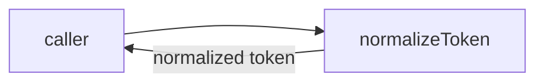
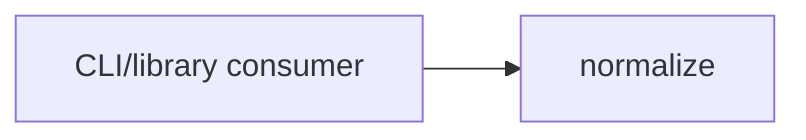

# Module: normalize

<!--SECTION:SPEC_ID-->
TOKEN-PIPELINE-NORMALIZE
<!--/SECTION:SPEC_ID-->

<!--SECTION:MODULE_VISION-->
## Module Vision
Own deterministic, local token normalization for the [token](../../token.spec.md) scope: one pure function, `normalizeToken`, with no I/O, persistence, or configuration. No parent, child, or sibling modules exist in this scope; the scope spec is the direct parent.
<!--/SECTION:MODULE_VISION-->

<!--SECTION:OVERVIEW-->
## Overview

_Главный путь: чистая нормализация токена и возврат результата — NOR-REQ-1._
<!--/SECTION:OVERVIEW-->

<!--SECTION:MODULE_USAGE_EXAMPLE-->
## Module Usage Example
```ts
import { normalizeToken } from "./index.js";

const token = normalizeToken("  Foo__BAR  ");
console.log(token);

try {
  normalizeToken("");
} catch (error) {
  if (error instanceof TypeError) {
    console.error("invalid token");
  }
}
```
<!--/SECTION:MODULE_USAGE_EXAMPLE-->

<!--SECTION:MODULE_REQUIREMENTS-->
## Requirements
### NOR-REQ-1 [должен]
**Когда** на вход подана ASCII-строка, в которой есть хотя бы один символ, отличный от ASCII-пробела, underscore и hyphen, **нормализатор должен** обрезать ведущие и замыкающие ASCII-пробелы, привести ASCII-буквы к нижнему регистру и свернуть каждую серию ASCII-пробелов, underscore и hyphen в один hyphen.

> Уточняет parent requirement TOK-REQ-1: модуль фиксирует точную форму одного канонического токена для CLI и библиотечных потребителей.

### NOR-REQ-2 [должен · нештатная]
**Если** вход пустой, или состоит только из ASCII-пробелов, underscore и hyphen, или содержит хотя бы один не-ASCII символ, **то нормализатор должен** выбросить `TypeError` без чтения и записи данных, файлов, сети или иного ввода-вывода.

> Уточняет parent requirement TOK-REQ-2: ошибочный вход нельзя маскировать пустым или искажённым корректным токеном.

| Input | Outcome |
|---|---|
| `"  Foo__BAR  "` | `"foo-bar"` |
| `""` | `TypeError` |
<!--/SECTION:MODULE_REQUIREMENTS-->

<!--SECTION:INTER_MODULE_DEPENDENCIES-->
## Inter-Module Dependencies
- **Depends on:** None; no sibling modules exist in the token scope.
- **Scope Reference (cross-scope):** None.
- **Provides to:** None within this scope; external CLI and library consumers use the public `normalizeToken` function directly.


_Направление зависимости: внешний потребитель вызывает normalize; sibling-модулей нет._
<!--/SECTION:INTER_MODULE_DEPENDENCIES-->

<!--SECTION:ENTITY_INVENTORY-->
## Entity Inventory
_Это полный список сущностей модуля. Любое введение сущности execution-агентом помимо этого списка считается drift'ом и требует обновления spec._

| Name | Type | Purpose |
|------|------|---------|
| `normalizeToken` | Function | Trim, lowercase and collapse token text deterministically |

Ошибки: throw `TypeError` → `normalizeToken`

Одна сущность без отношений; ER-скетч не рисуется, связывать нечего.
<!--/SECTION:ENTITY_INVENTORY-->

<!--SECTION:ENTITY_SURFACES-->
## Entity Surfaces
`normalizeToken` is a stateless pure function with one public operation and no events.

<details>
<summary>Полные поверхности сущностей</summary>

### `normalizeToken`
- **Type:** Function
- **Purpose:** Produce one canonical local token from a valid ASCII string.
- **Public Properties:** N/A
- **Public Operations:** normalizeToken(input: string): string
- **Lifecycle:** Stateless pure function; available at module load and terminates on return or on the thrown TypeError.
- **Events Emitted:** N/A
- **Errors & Degradation:** `TypeError` via throw for empty, separator-only, or non-ASCII input; owned and raised directly by `normalizeToken` with no I/O.
- **Consumers:**
  - Internal: None in v1.
  - External: CLI and library consumers calling the public export.
- **Usage Waiver (external: CLI and library consumers):** The module exists to expose exactly this one function; no internal caller is expected in v1.

</details>
<!--/SECTION:ENTITY_SURFACES-->

<!--SECTION:MODULE_CONTRACTS-->
## Module Contracts
One pure `normalizeToken` Service; no Port or Adapter is defined.

Граф не рисуется: в модуле нет Port/Adapter, только Service `normalizeToken`.

Call Chain не рисуется: в инвентаре одна абстракция (Service `normalizeToken`), порог ≥2 не достигнут.

<details>
<summary>Контракты DbC</summary>

### Services

#### Service: `normalizeToken`
- **Purpose:** Deterministic token normalization for local CLI and library consumers.
- **Consumers:** internal: `src/token/pipeline/normalize/index.ts`; external: CLI and library consumers.
- **Runtime Backing:** `not-implemented`
- **Verification Levels:** `contract` | `unit`
- **Deferred Runtime Scope:** All declared behavior lacks real runtime in this authoring-only draft.
- **Usage Waiver (external: CLI and library consumers):** The public export is the module's single responsibility and has no internal caller in v1.

**Contract (DbC)**
- `normalizeToken`:
  - Pre: `input` is a string whose every character is ASCII and which contains at least one character that is not an ASCII space, underscore, or hyphen.
  - Post: returns the input with leading and trailing ASCII spaces removed, ASCII letters lowercased, and every run of one or more ASCII spaces, underscores, or hyphens replaced by one hyphen; no I/O occurs.
  - On pre-violation: throws `TypeError` without reading or writing storage, network, filesystem, or any other I/O.

**Invariants:** The function is pure and deterministic: the same input always yields the same output or the same `TypeError`, with no observable side effects.

</details>
<!--/SECTION:MODULE_CONTRACTS-->

<!--SECTION:PUBLIC_OPTIONS-->
## Public Options & Policies
No public options; normalization policy is fixed by NOR-REQ-1 and NOR-REQ-2.

<details>
<summary>Опции и политики</summary>

No flags, options, or policies are exposed in v1. Locale-aware case folding and configurable separator sets are deferred / not consumed in v1; no activating ticket exists.

</details>
<!--/SECTION:PUBLIC_OPTIONS-->

<!--SECTION:FILE_STRUCTURE-->
## File Structure
```text
src/token/pipeline/normalize/
└── index.ts
```

**File Mapping:**
- `src/token/pipeline/normalize/index.ts`: `normalizeToken` implementation and public export.
<!--/SECTION:FILE_STRUCTURE-->

<!--SECTION:RESEARCH-->
## Research
No research documents support this bounded deterministic draft; the behavior derives directly from parent requirements TOK-REQ-1 and TOK-REQ-2.
<!--/SECTION:RESEARCH-->

<!--SECTION:MODULE_DECISION_LOG-->
## Module Decision Log
NOR-DL-1 records the pure-function contract without Port or Adapter; the operator verdict remains pending.

<details>
<summary>Полные записи Decision Log</summary>

- NOR-DL-1 2026-10-24 — use a pure `normalizeToken` Function/Service with no Port or Adapter (почему: одна детерминированная трансформация без вариативности и без тестового seam; отвергнуто: Port и Adapter для единственной реализации; риск: будущая сменяемая политика разделителей потребует нового контракта) [verdict: pending-operator]

NOR-DL-2 2026-10-23 — module draft complete (почему: sdd-check --spec specs/token/pipeline/normalize/normalize.spec.md --authoring прошёл без замечаний)

</details>
<!--/SECTION:MODULE_DECISION_LOG-->

<!--SECTION:HANDOFF-->
## Handoff to Tasks
- **Implementation files to be created:** `src/token/pipeline/normalize/index.ts`
- **Test files to be created:** `src/token/pipeline/normalize/normalize.test.ts`
- **Stack dependencies:**
  - Language: `TypeScript` (resolves to `ai/directives/coding/typescript-rules.xml`)
  - Test framework: `node-test` (resolves to `ai/directives/testing/node-test.xml`)
- **Module Rules Additions:** None — the scope-wide baseline applies; no module-specific coding, testing, architecture, or quality rules are added.
- **Owner handoff:** pending-operator — no approval, ticket creation, or execution is claimed.
- **Open risks & validation needs:** No operator approval and no independent review exist; no implementation has been started. Non-ASCII input is rejected by design, so Unicode normalization remains out of scope.
<!--/SECTION:HANDOFF-->

<!--SECTION:IMPLEMENTATION_INSIGHTS-->
## Implementation Insights
Not applicable: this authoring-only draft has no implementation, so no post-implementation learnings exist.

<details>
<summary>Заметки по реализации</summary>

Not applicable — no implementation exists yet.

</details>
<!--/SECTION:IMPLEMENTATION_INSIGHTS-->
