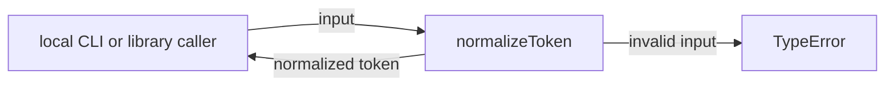
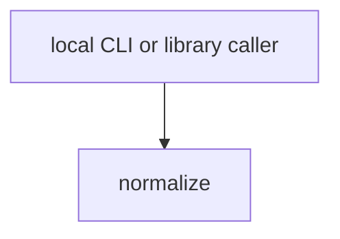

# Module: normalize

<!--SECTION:SPEC_ID-->
TOKEN-PIPELINE-NORMALIZE
<!--/SECTION:SPEC_ID-->

<!--SECTION:MODULE_VISION-->
## Module Vision

`normalize` owns the single deterministic token transformation of the `token` scope: `normalizeToken(input: string): string`. The module has no I/O, no state and no persistence.

Parent scope: [token](../../token.spec.md). No parent, child or sibling module specs exist for this module.
<!--/SECTION:MODULE_VISION-->

<!--SECTION:OVERVIEW-->
## Overview


_Путь одного вызова normalizeToken — NOR-REQ-1, NOR-REQ-2._
<!--/SECTION:OVERVIEW-->

<!--SECTION:MODULE_USAGE_EXAMPLE-->
## Module Usage Example

```ts
import { normalizeToken } from "./normalize";

const token = normalizeToken("  Foo__BAR  ");

try {
  normalizeToken("");
} catch (error) {
  if (error instanceof TypeError) {
    // The caller decides how to surface invalid input.
  }
}
```
<!--/SECTION:MODULE_USAGE_EXAMPLE-->

<!--SECTION:MODULE_REQUIREMENTS-->
## Requirements

### NOR-REQ-1 [должен]
**Когда** вызывается `normalizeToken` с ASCII-строкой, которая содержит хотя бы один символ, отличный от пробела, underscore и hyphen, **normalizeToken должен** обрезать крайние ASCII-пробелы, привести ASCII-буквы к lower-case и свернуть каждый прогон ASCII-пробелов, underscore и hyphen в один hyphen.

> Реализует TOK-REQ-1 на уровне модуля: одна и та же входная строка всегда даёт один канонический токен, пригодный и для CLI, и для библиотечного вызова; без этого потребители получат разные написания одного токена.

### NOR-REQ-2 [должен · нештатная]
**Если** входная строка пустая, состоит только из ASCII-разделителей (пробел, underscore, hyphen) или содержит не-ASCII символ, **то normalizeToken должен** выбросить TypeError, не выполняя ввода-вывода.

> Реализует TOK-REQ-2 на уровне модуля: ошибочный вход нельзя маскировать пустым или частично нормализованным токеном; вызывающая сторона должна получить явный TypeError и сама решить, как его обработать.

Проверочные примеры `normalize-example` и `empty-input-rejection`:

| Input | Outcome |
|---|---|
| `"  Foo__BAR  "` | `"foo-bar"` |
| `""` | `TypeError` |
<!--/SECTION:MODULE_REQUIREMENTS-->

<!--SECTION:INTER_MODULE_DEPENDENCIES-->
## Inter-Module Dependencies
- **Depends on:** None — no sibling module exists in scope `token`.
- **Scope Reference (cross-scope):** None; the module is called directly by local CLI/library consumers and has no cross-scope module interface.
- **Provides to:** None — no sibling module consumes it in this draft.


_Внешний вызов нормализатора без внутренних зависимостей — NOR-REQ-1._
<!--/SECTION:INTER_MODULE_DEPENDENCIES-->

<!--SECTION:ENTITY_INVENTORY-->
## Entity Inventory

_Это полный список сущностей модуля. Любое введение сущности execution-агентом помимо этого списка считается drift'ом и требует обновления spec._

| Name | Type | Purpose |
|------|------|---------|
| `normalizeToken` | Function | Нормализует ASCII-токен и отклоняет недопустимый вход через TypeError |

Ошибки: throw → `normalizeToken`

ER-эскиз не нужен: в инвентаре одна сущность, связей между сущностями нет.
<!--/SECTION:ENTITY_INVENTORY-->

<!--SECTION:ENTITY_SURFACES-->
## Entity Surfaces

Одна публичная функция `normalizeToken`; отдельного состояния, событий и побочных поверхностей нет.

<details>
<summary>Полные поверхности сущностей</summary>

### `normalizeToken`
- **Type:** Function
- **Purpose:** Преобразует допустимую ASCII-строку в канонический токен и отвергает недопустимый вход.
- **Public Properties:** N/A
- **Public Operations:** Normalize a token; reject empty, separator-only or non-ASCII input.
- **Lifecycle:** Вызывается на каждый запрос; состояние не создаётся и не сохраняется.
- **Events Emitted:** N/A
- **Errors & Degradation:** `TypeError` через throw для пустого, состоящего только из разделителей или не-ASCII входа; обработка и отображение принадлежат вызывающей стороне.
- **Consumers:**
  - Internal: нет — реализация ещё не создана.
  - External: local CLI and library consumers.
- **Usage Waiver (external: local CLI and library consumers):** Публичная поверхность модуля для внешних потребителей; production-вызовов пока нет, потому что реализация не входит в этот authoring round.

</details>
<!--/SECTION:ENTITY_SURFACES-->

<!--SECTION:MODULE_CONTRACTS-->
## Module Contracts

Модуль определяет одну чистую Service-функцию `normalizeToken`; Ports и Adapters отсутствуют.

Граф не рисуется: в модуле нет Port/Adapter, только Service `normalizeToken`.
Call Chain не рисуется: в инвентаре одна абстракция — `normalizeToken`.

<details>
<summary>Контракты DbC</summary>

### Services

#### Service: `normalizeToken`
- **Purpose:** Детерминированно нормализовать ASCII-токен без I/O и состояния.
- **Consumers:** local CLI and library consumers.
- **Runtime Backing:** `not-implemented`
- **Verification Levels:** `contract`
- **Deferred Runtime Scope:** Всё поведение — реализация не входит в этот authoring round.

**Contract (DbC)**
- `normalizeToken`:
  - Pre: Вход — строка, не пустая, не состоящая только из ASCII-разделителей (пробел, underscore, hyphen) и содержащая только ASCII-символы.
  - Post: Возвращается строка без крайних ASCII-пробелов, с ASCII-буквами в lower-case и каждым прогоном ASCII-пробелов, underscore и hyphen, свёрнутым в один hyphen.
  - On pre-violation: Выбрасывается `TypeError`; ввода-вывода не выполняется.

**Invariants:** Для одного и того же входа результат детерминирован; функция не читает и не изменяет внешнее состояние.

</details>
<!--/SECTION:MODULE_CONTRACTS-->

<!--SECTION:PUBLIC_OPTIONS-->
## Public Options & Policies

Публичных опций и политик нет: поведение `normalizeToken` фиксировано.

<details>
<summary>Опции и политики</summary>

None. No flags, policies or configuration are consumed in v1.
</details>
<!--/SECTION:PUBLIC_OPTIONS-->

<!--SECTION:FILE_STRUCTURE-->
## File Structure
```
normalize/
├── normalize.ts
└── normalize.test.ts
```

**File Mapping:**
- `normalize.ts`: `normalizeToken` implementation and its TypeError contract.
- `normalize.test.ts`: contract tests for normalization and invalid-input rejection.
<!--/SECTION:FILE_STRUCTURE-->

<!--SECTION:RESEARCH-->
## Research

Ресёрч не применим: детерминированное преобразование токена задано в [token contract](../../../docs/token-contract.md); отдельных research-документов нет.
<!--/SECTION:RESEARCH-->

<!--SECTION:MODULE_DECISION_LOG-->
## Module Decision Log

Одна запись: `normalizeToken` остаётся чистой функцией без Port/Adapter.

<details>
<summary>Полные записи Decision Log</summary>

NOR-DL-1 2026-10-24 — `normalizeToken` остаётся чистой функцией без Port/Adapter (почему: одна детерминированная трансформация без подтверждённой вариативности; отвергнуто: отдельный Port ради тестового шва — избыточен для одной функции).

</details>
<!--/SECTION:MODULE_DECISION_LOG-->

<!--SECTION:HANDOFF-->
## Handoff to Tasks
- **Implementation files to be created:** `normalize.ts` — `normalizeToken` with its TypeError contract.
- **Test files to be created:** `normalize.test.ts` — normalization, empty, separator-only and non-ASCII cases.
- **Stack dependencies:**
  - Language: `typescript` (resolves to `ai/directives/coding/typescript-rules.xml`)
  - Test framework: `node-test` (resolves to `ai/directives/testing/node-test.xml`)
- **Module Rules Additions:** None on top of the scope-wide baseline; no module-specific rule is added.

- **Open risks & validation needs:** Behavior is specified only; no implementation was requested, so no runtime result exists. Non-ASCII rejection needs explicit code-point validation in tasks. Approval #1 remains pending with the operator; no tickets were created and no execution is approved.

- **Approval boundary:** Approval #1 pending; this artifact is not operator-approved.
<!--/SECTION:HANDOFF-->

<!--SECTION:IMPLEMENTATION_INSIGHTS-->
## Implementation Insights

Не применимо: реализация ещё не создана; appendix заполняется после audit-cycle compaction.

<details>
<summary>Заметки по реализации</summary>

Not applicable — no implementation exists for this module in the current authoring round.
</details>
<!--/SECTION:IMPLEMENTATION_INSIGHTS-->
