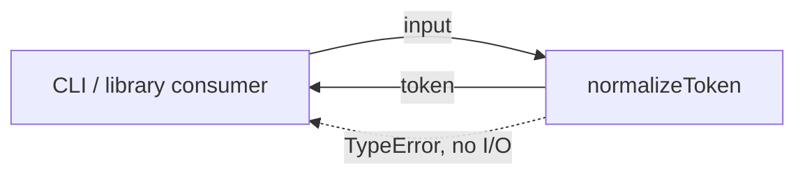
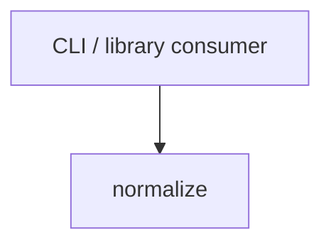

# Module: Token Normalize

<!--SECTION:SPEC_ID-->
TOKEN-PIPELINE-NORMALIZE
<!--/SECTION:SPEC_ID-->

<!--SECTION:MODULE_VISION-->
## Module Vision
Модуль владеет единственной операцией нормализации токена — `normalizeToken(input: string): string`. Она обрезает крайние ASCII-пробелы, приводит ASCII-буквы к нижнему регистру и сворачивает последовательности ASCII-пробелов, underscore и hyphen в один hyphen; пустой, состоящий только из разделителей или не-ASCII вход отклоняется через `TypeError` без ввода-вывода.

Родительская спека: [token](../../token.spec.md). Соседних и дочерних модулей нет.
<!--/SECTION:MODULE_VISION-->

<!--SECTION:OVERVIEW-->
## Overview


_Нормализация входа в токен или отказ через TypeError без ввода-вывода — NOR-REQ-1, NOR-REQ-2._
<!--/SECTION:OVERVIEW-->

<!--SECTION:MODULE_USAGE_EXAMPLE-->
## Module Usage Example
```ts
import { normalizeToken } from "./normalize";

const token = normalizeToken("  Foo__BAR  ");
console.log(token); // "foo-bar"

try {
  normalizeToken("");
} catch (error) {
  console.error(error instanceof TypeError); // true
}
```
<!--/SECTION:MODULE_USAGE_EXAMPLE-->

<!--SECTION:MODULE_REQUIREMENTS-->
## Requirements
### NOR-REQ-1 [должен]
**Когда** передана непустая ASCII-строка, содержащая хотя бы один символ, отличный от ASCII-пробела, underscore и hyphen, **normalizeToken должен** обрезать ведущие и замыкающие ASCII-пробелы, привести ASCII-буквы к нижнему регистру и свернуть каждую последовательность ASCII-пробелов, underscore и hyphen в один hyphen.

> Уточняет TOK-REQ-1: модуль фиксирует границы допустимого входа и точный результат нормализации в пределах своей единственной операции.

### NOR-REQ-2 [должен · нештатная]
**Если** входная строка пустая, состоит только из ASCII-пробелов, underscore и hyphen или содержит не-ASCII символ, **то normalizeToken должен** выбросить `TypeError` без ввода-вывода.

> Уточняет TOK-REQ-2: пустой или неподходящий вход нельзя маскировать корректным на вид токеном, а отказ не должен зависеть от внешнего состояния.

| Input | Outcome |
|---|---|
| `"  Foo__BAR  "` | `"foo-bar"` |
| `""` | `TypeError` |
<!--/SECTION:MODULE_REQUIREMENTS-->

<!--SECTION:INTER_MODULE_DEPENDENCIES-->
## Inter-Module Dependencies
- **Depends on:** Нет модулей внутри скоупа `token`.
- **Scope Reference (cross-scope):** Нет: модуль не потребляет контракты других скоупов.
- **Provides to:** Внешние CLI и библиотечные потребители скоупа `token`; соседним модулям ничего не предоставляется.


_Единственная внешняя связь модуля: потребитель вызывает normalize; внутренних рёбер нет._
<!--/SECTION:INTER_MODULE_DEPENDENCIES-->

<!--SECTION:ENTITY_INVENTORY-->
## Entity Inventory

_Это полный список сущностей модуля. Любое введение сущности execution-агентом помимо этого списка считается drift'ом и требует обновления spec._

| Name | Type | Purpose |
|------|------|---------|
| `normalizeToken` | Service | Чистая детерминированная нормализация строки в токен |

Ошибки: throw `TypeError` → `normalizeToken`

ER-эскиз не рисуется: в инвентаре одна сущность, связывать нечего.
<!--/SECTION:ENTITY_INVENTORY-->

<!--SECTION:ENTITY_SURFACES-->
## Entity Surfaces
Единственная сущность модуля — `normalizeToken`; её полная поверхность раскрыта ниже.

<details>
<summary>Полные поверхности сущностей</summary>

### `normalizeToken`
- **Type:** Service
- **Purpose:** Преобразует допустимую ASCII-строку в детерминированный токен или отклоняет недопустимый вход.
- **Public Properties:** N/A
- **Public Operations:** `normalizeToken` — нормализует строку и возвращает токен.
- **Lifecycle:** Не хранит состояние; создаётся окружением как чистая операция и завершается вместе с вызовом.
- **Events Emitted:** N/A
- **Errors & Degradation:** `TypeError` через throw; владелец обработки и показа — `normalizeToken`; ввода-вывода при ошибке нет.
- **Consumers:**
  - Internal: нет внутренних потребителей в этом модуле
  - External: CLI и библиотечные потребители скоупа `token`

</details>
<!--/SECTION:ENTITY_SURFACES-->

<!--SECTION:MODULE_CONTRACTS-->
## Module Contracts
Модуль определяет один Service `normalizeToken`; Port и Adapter не вводятся.

Граф не рисуется: в модуле нет Port/Adapter, только Service `normalizeToken`.

Call chain не рисуется: в модуле одна абстракция — Service `normalizeToken`.

<details>
<summary>Контракты DbC</summary>

### Service: `normalizeToken`
- **Purpose:** Детерминированно нормализовать допустимый ASCII-вход в токен.
- **Consumers:** внешние CLI и библиотечные потребители скоупа `token`
- **Runtime Backing:** `not-implemented`
- **Verification Levels:** `contract`, `unit`
- **Deferred Runtime Scope:** Реализация `normalizeToken` не создана в этой авторской задаче.

**Contract (DbC)**
- `normalizeToken`:
  - Pre: вход — непустая ASCII-строка, содержащая хотя бы один символ, отличный от ASCII-пробела, underscore и hyphen.
  - Post: возвращена строка без ведущих и замыкающих ASCII-пробелов, с ASCII-буквами в нижнем регистре и каждой последовательностью ASCII-пробелов, underscore и hyphen, свёрнутой в один hyphen; ввода-вывода нет.
  - On pre-violation: выброшен `TypeError` без ввода-вывода.

**Invariants:** Результат зависит только от `input`; общее состояние не читается и не изменяется, внешние эффекты отсутствуют.

</details>
<!--/SECTION:MODULE_CONTRACTS-->

<!--SECTION:PUBLIC_OPTIONS-->
## Public Options & Policies
Публичных опций нет: сигнатура `normalizeToken(input: string): string` не принимает флагов, режимов или политик.

<details>
<summary>Опции и политики</summary>

Не применимо: в модуле нет публично наблюдаемых настроек или политик, которые можно было бы включить либо отложить.

</details>
<!--/SECTION:PUBLIC_OPTIONS-->

<!--SECTION:FILE_STRUCTURE-->
## File Structure
```
src/token/pipeline/normalize/
├── normalize.ts
└── normalize.test.ts
```

**File Mapping:**
- `src/token/pipeline/normalize/normalize.ts`: `normalizeToken`
- `src/token/pipeline/normalize/normalize.test.ts`: проверки допустимого и недопустимого входа
<!--/SECTION:FILE_STRUCTURE-->

<!--SECTION:RESEARCH-->
## Research
Документов ресёрча нет: поведение модуля полностью задано родительской спекой и локальным контрактом `normalizeToken`.
<!--/SECTION:RESEARCH-->

<!--SECTION:MODULE_DECISION_LOG-->
## Module Decision Log
Записано одно решение: `normalizeToken` оформлен как чистый Service без Port/Adapter.

<details>
<summary>Полные записи Decision Log</summary>

NOR-DL-1 2026-10-24 — `normalizeToken` оформлен как чистый Service без Port/Adapter (почему: одна реализация, нет вариативности и внешних зависимостей; отвергнуто: Port ради тестового шва — для чистой функции он не нужен; риск: нет в границах локального детерминированного модуля) [verdict: pending-operator]

</details>
<!--/SECTION:MODULE_DECISION_LOG-->

<!--SECTION:HANDOFF-->
## Handoff to Tasks
- **Implementation files to be created:** `src/token/pipeline/normalize/normalize.ts`
- **Test files to be created:** `src/token/pipeline/normalize/normalize.test.ts`
- **Stack dependencies:**
  - Language: `TypeScript` (resolves to `ai/directives/coding/typescript-rules.xml`)
  - Test framework: `node-test` (resolves to `ai/directives/testing/node-test.xml`)
- **Module Rules Additions:** None — модуль наследует правила скоупа и не добавляет своих.

- **Open risks & validation needs:** Реализация не создана; «не-ASCII» трактуется как любой код-поинт вне ASCII. Владельческий handoff остаётся `pending-operator`; билеты и исполнение не созданы и не подтверждены.
<!--/SECTION:HANDOFF-->

<!--SECTION:IMPLEMENTATION_INSIGHTS-->
## Implementation Insights
Не применимо: реализации ещё нет, post-implementation наблюдений нет.

<details>
<summary>Заметки по реализации</summary>

Раздел не заполняется до появления реализации и аудита.

</details>
<!--/SECTION:IMPLEMENTATION_INSIGHTS-->
