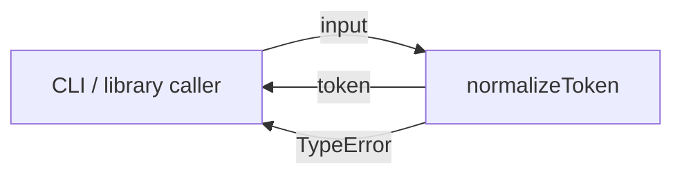
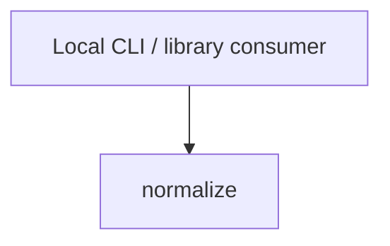

# Module: normalize

<!--SECTION:SPEC_ID-->
TOKEN-PIPELINE-NORMALIZE
<!--/SECTION:SPEC_ID-->

<!--SECTION:MODULE_VISION-->
## Module Vision

`normalize` owns the single pure transformation that turns one valid ASCII input string into a deterministic token. It is the only module currently mapped by the [`token` scope](../../token.spec.md); the scope names no parent, child or sibling modules.

The module refines parent requirements TOK-REQ-1 and TOK-REQ-2 and owns no persistence, network, CLI parsing or configuration behavior.
<!--/SECTION:MODULE_VISION-->

<!--SECTION:OVERVIEW-->
## Overview


_Один вызов normalizeToken: валидный ASCII-вход даёт токен, невалидный вход даёт TypeError — NOR-REQ-1, NOR-REQ-2._
<!--/SECTION:OVERVIEW-->

<!--SECTION:MODULE_USAGE_EXAMPLE-->
## Module Usage Example

```ts
import { normalizeToken } from "./normalize";

const token = normalizeToken("  Foo__BAR  ");
console.log(token);

try {
  normalizeToken("");
} catch (error) {
  if (error instanceof TypeError) {
    console.error("normalizeToken rejected the input");
  }
}
```

Ожидаемый вывод: `foo-bar`; пустая строка приводит к `TypeError`.
<!--/SECTION:MODULE_USAGE_EXAMPLE-->

<!--SECTION:MODULE_REQUIREMENTS-->
## Requirements

### NOR-REQ-1 [должен]
**Когда** передана ASCII-строка, содержащая хотя бы один символ, отличный от ASCII-пробела, underscore и hyphen, **нормализатор должен** обрезать ведущие и хвостовые ASCII-пробелы, привести ASCII-буквы к нижнему регистру и свернуть каждый прогон ASCII-пробелов, underscore и hyphen в один hyphen.

> Уточняет TOK-REQ-1: потребителям нужен один детерминированный формат токена без настройки.

### NOR-REQ-2 [должен · нештатная]
**Если** входная строка пустая, состоит только из разделителей или содержит не-ASCII символы, **то нормализатор должен** выбросить `TypeError` без ввода-вывода.

> Уточняет TOK-REQ-2: ошибочный вход нельзя маскировать пустым или частично нормализованным токеном.

| Input | Outcome |
|---|---|
| `"  Foo__BAR  "` | `"foo-bar"` |
| `""` | `TypeError` |
<!--/SECTION:MODULE_REQUIREMENTS-->

<!--SECTION:INTER_MODULE_DEPENDENCIES-->
## Inter-Module Dependencies
- **Depends on:** None — `token` has no sibling modules.
- **Scope Reference (cross-scope):** None; `infra-base` is authoring tooling, not a runtime interface for this module.
- **Provides to:** No sibling modules; local CLI and library callers consume the module directly.


_Нормализатор не имеет рёбер к соседним модулям; единственная связь — вызов потребителя — NOR-REQ-1, NOR-REQ-2._
<!--/SECTION:INTER_MODULE_DEPENDENCIES-->

<!--SECTION:ENTITY_INVENTORY-->
## Entity Inventory

_Полный список сущностей модуля. Любое введение сущности execution-агентом помимо этого списка считается drift'ом и требует обновления spec._

| Name | Type | Purpose |
|------|------|---------|
| `normalizeToken` | Function | Чистая нормализация одного ASCII-токена |

Ошибки: throw `TypeError` → `normalizeToken`.

ER sketch not applicable: the inventory has one entity, so there is no relationship to draw.
<!--/SECTION:ENTITY_INVENTORY-->

<!--SECTION:ENTITY_SURFACES-->
## Entity Surfaces

Одна публичная функция; её поверхность сводится к вызову и синхронному результату или `TypeError`.

<details>
<summary>Полные поверхности сущностей</summary>

### `normalizeToken`
- **Type:** Function
- **Purpose:** Преобразовать один валидный ASCII-вход в детерминированный токен.
- **Public Properties:** N/A
- **Public Operations:** Нормализовать один ASCII-токен; отклонить невалидный вход через `TypeError`.
- **Lifecycle:** Stateless; вызывается потребителем на каждый вход и не имеет состояния между вызовами.
- **Events Emitted:** N/A
- **Errors & Degradation:** `TypeError` через throw; владелец — `normalizeToken`, потребитель получает ошибку синхронно.
- **Consumers:**
  - Internal: `normalize.ts` (единственная реализация модуля)
  - External: Local CLI and library consumers
- **Usage Waiver (external: local CLI and library consumers):** Единственный публичный API модуля; каждый потребитель вызывает его для нормализации одного токена.

</details>
<!--/SECTION:ENTITY_SURFACES-->

<!--SECTION:MODULE_CONTRACTS-->
## Module Contracts

Модуль определяет один чистый Service `normalizeToken`; Port и Adapter отсутствуют, потому что подтверждённой вариативности или тестового шва нет.

Граф не рисуется: в модуле нет Port/Adapter, только Service `normalizeToken`.

Call chain: not applicable — одна абстракция, упорядочивать нечего.

<details>
<summary>Контракты DbC</summary>

### Services

#### Service: `normalizeToken`
- **Purpose:** Детерминированно нормализовать один ASCII-токен.
- **Consumers:** Local CLI and library consumers.
- **Runtime Backing:** `not-implemented`
- **Verification Levels:** `contract`, `unit`
- **Deferred Runtime Scope:** Реализация и тесты не созданы; runtime-поведение в этом черновике не подтверждено.

**Contract (DbC)** — one block per operation:
- `normalizeToken`:
  - Pre: `input` — строка, содержащая хотя бы один символ, отличный от ASCII-пробела, underscore и hyphen, и не содержащая не-ASCII символов.
  - Post: возвращается токен без ведущих и хвостовых ASCII-пробелов, с ASCII-буквами в нижнем регистре и каждым прогоном ASCII-пробелов, underscore и hyphen, заменённым одним hyphen; ввод-вывод не выполняется.
  - On pre-violation: выбрасывается `TypeError` без ввода-вывода, если вход пустой, состоит только из разделителей или содержит не-ASCII символы.

**Invariants:** Операция чистая и детерминированная: одинаковый вход даёт одинаковый результат, состояние не сохраняется, ввод-вывод не наблюдается.

</details>
<!--/SECTION:MODULE_CONTRACTS-->

<!--SECTION:PUBLIC_OPTIONS-->
## Public Options & Policies

Публичных опций и политик нет: модуль экспортирует только `normalizeToken` без флагов и конфигурации.

<details>
<summary>Опции и политики</summary>

None. No flags, environment variables or configurable policies are part of this module.

</details>
<!--/SECTION:PUBLIC_OPTIONS-->

<!--SECTION:FILE_STRUCTURE-->
## File Structure

```text
normalize/
├── normalize.ts
└── normalize.test.ts
```

**File Mapping:**
- `normalize.ts`: чистая реализация `normalizeToken`
- `normalize.test.ts`: контрактные и unit-тесты для `normalizeToken`
<!--/SECTION:FILE_STRUCTURE-->

<!--SECTION:RESEARCH-->
## Research

No research documents; this bounded draft derives from the parent scope requirements TOK-REQ-1 and TOK-REQ-2.
<!--/SECTION:RESEARCH-->

<!--SECTION:MODULE_DECISION_LOG-->
## Module Decision Log

Одно решение: единственная чистая функция без Port/Adapter; полная запись ниже.

<details>
<summary>Полные записи Decision Log</summary>

NOR-DL-1 2026-10-24 — единственная чистая функция `normalizeToken` без Port и Adapter; где: `specs/token/pipeline/normalize/normalize.spec.md#module-contracts` (почему: подтверждённой вариативности и тестового шва нет; дополнительная абстракция не добавляет наблюдаемого поведения) [verdict: pending-operator]

</details>
<!--/SECTION:MODULE_DECISION_LOG-->

<!--SECTION:HANDOFF-->
## Handoff to Tasks

- **Implementation files to be created:** `normalize.ts`
- **Test files to be created:** `normalize.test.ts`
- **Stack dependencies:**
  - Language: `TypeScript` (resolves to `ai/directives/coding/typescript-rules.xml`)
  - Test framework: `node:test` (resolves to `ai/directives/testing/node-test.xml`)
- **Module Rules Additions:** None.
- **Open risks & validation needs:** Реализация и тесты не созданы, поэтому поведение и гарантия отсутствия ввода-вывода не проверены.
- **Approval:** pending-operator; no execution or ticket creation is claimed.
<!--/SECTION:HANDOFF-->

<!--SECTION:IMPLEMENTATION_INSIGHTS-->
## Implementation Insights

Not applicable: implementation is deferred, so no post-implementation learnings exist.

<details>
<summary>Заметки по реализации</summary>

No implementation has been executed; this appendix stays empty until a later implementation cycle produces durable learnings.

</details>
<!--/SECTION:IMPLEMENTATION_INSIGHTS-->
