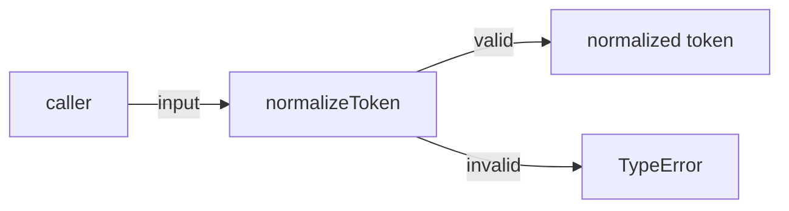
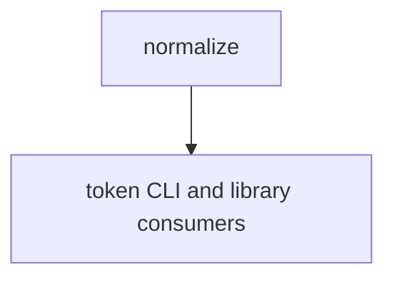

# Module: pipeline/normalize

<!--SECTION:SPEC_ID-->
TOKEN-PIPELINE-NORMALIZE
<!--/SECTION:SPEC_ID-->

<!--SECTION:MODULE_VISION-->
## Module Vision
Owns the pure, deterministic token normalization of the `token` scope: trim, ASCII lowercasing and separator collapsing. Parent scope: [token](../../token.spec.md). This module has no sibling module specs and no parent or child module specs in the current scope.
<!--/SECTION:MODULE_VISION-->

<!--SECTION:OVERVIEW-->
## Overview

_Единый поток нормализации: валидный ввод даёт токен, невалидный — TypeError — NOR-REQ-1, NOR-REQ-2._
<!--/SECTION:OVERVIEW-->

<!--SECTION:MODULE_USAGE_EXAMPLE-->
## Module Usage Example
```ts
import { normalizeToken } from "./normalize.ts";

console.log(normalizeToken("  Foo__BAR  "));

try {
  normalizeToken("");
} catch (error) {
  if (error instanceof TypeError) {
    console.error(error.message);
  }
}
```
<!--/SECTION:MODULE_USAGE_EXAMPLE-->

<!--SECTION:MODULE_REQUIREMENTS-->
## Requirements
### NOR-REQ-1 [должен]
**Когда** на вход подана строка `"  Foo__BAR  "`, **функция normalizeToken должна** вернуть `"foo-bar"`.

> Уточняет TOK-REQ-1: крайние ASCII-пробелы обрезаются, ASCII-буквы приводятся к нижнему регистру, а серия пробелов, underscore и hyphen сворачивается в один hyphen.

### NOR-REQ-2 [должен · нештатная]
**Если** входная строка пустая, состоит только из разделителей или содержит не-ASCII символ, **то функция normalizeToken должна** выбросить `TypeError` без ввода-вывода.

> Уточняет TOK-REQ-2: невалидный вход не маскируется пустым или искажённым токеном, а среда не получает побочных операций ввода-вывода.

| Input | Outcome |
|---|---|
| `"  Foo__BAR  "` | `"foo-bar"` |
| `""` | `TypeError` |
<!--/SECTION:MODULE_REQUIREMENTS-->

<!--SECTION:INTER_MODULE_DEPENDENCIES-->
## Inter-Module Dependencies
- **Depends on:** None — the module is self-contained and uses no sibling module.
- **Scope Reference (cross-scope):** None — the module consumes no cross-scope interface.
- **Provides to:** the public surface of the [token scope](../../token.spec.md); no sibling module consumes it.


_Нормализация не зависит от соседних модулей; её результат получают потребители скоупа token._
<!--/SECTION:INTER_MODULE_DEPENDENCIES-->

<!--SECTION:ENTITY_INVENTORY-->
## Entity Inventory
_Это полный список сущностей модуля. Любое введение сущности execution-агентом помимо этого списка считается drift'ом и требует обновления spec._

| Name | Type | Purpose |
|------|------|---------|
| `normalizeToken` | Function | Чистая детерминированная нормализация входной строки в токен |

Ошибки: throw `TypeError` → `normalizeToken`

ER sketch not applicable: the inventory contains one entity and therefore no relational edge.
<!--/SECTION:ENTITY_INVENTORY-->

<!--SECTION:ENTITY_SURFACES-->
## Entity Surfaces
`normalizeToken` exposes one pure operation and throws `TypeError`; it has no lifecycle state, events, or persistence.

<details>
<summary>Полные поверхности сущностей</summary>

### `normalizeToken`
- **Type:** Function
- **Purpose:** Convert a valid string into one deterministic hyphen-separated token.
- **Public Properties:** N/A
- **Public Operations:** Normalize one input string into a token; reject invalid input with `TypeError`.
- **Lifecycle:** Stateless; created per call and terminated on return or thrown error.
- **Events Emitted:** N/A
- **Errors & Degradation:** `TypeError` via throw, owned and surfaced by `normalizeToken` directly to the caller; no I/O or fallback token.
- **Consumers:**
  - Internal: `specs/token/token.spec.md` (public API surface)
  - External: token CLI and library consumers
- **Usage Waiver (external: token CLI and library consumers):** Sole public normalization entry point of the scope.

</details>
<!--/SECTION:ENTITY_SURFACES-->

<!--SECTION:MODULE_CONTRACTS-->
## Module Contracts
Only the `normalizeToken` Service is defined; no Port or Adapter exists because no second implementation or test seam has confirmed variability.

Граф не рисуется: в модуле нет Port/Adapter, только Service `normalizeToken`.

Call Chain не рисуется: в модуле одна абстракция — Service `normalizeToken`.

<details>
<summary>Контракты DbC</summary>

### Services

#### Service: `normalizeToken`
- **Purpose:** Normalize a valid input string into a deterministic token.
- **Consumers:** `specs/token/token.spec.md` (public API surface); external token CLI and library consumers.
- **Runtime Backing:** `not-implemented`
- **Verification Levels:** `contract`, `unit`
- **Deferred Runtime Scope:** All declared behavior — this authoring task requests no implementation.

**Contract (DbC)** — one block per operation:
- `normalizeToken`:
  - Pre: The input is a string containing at least one ASCII character other than space, underscore, or hyphen, and contains no non-ASCII character.
  - Post: The returned string has leading and trailing ASCII spaces removed, ASCII letters lowercased, and every run of space, underscore, or hyphen replaced by one hyphen.
  - On pre-violation: Throws `TypeError` and performs no input or output.

**Invariants:** Every valid call is pure and deterministic; the operation performs no I/O and keeps no state between calls.

</details>
<!--/SECTION:MODULE_CONTRACTS-->

<!--SECTION:PUBLIC_OPTIONS-->
## Public Options & Policies
No public options or policies; normalization behavior is fixed and deterministic.

<details>
<summary>Опции и политики</summary>

None. The module consumes no flags, environment variables, configuration, or persistence.

</details>
<!--/SECTION:PUBLIC_OPTIONS-->

<!--SECTION:FILE_STRUCTURE-->
## File Structure
```
normalize/
├── normalize.ts
└── normalize.test.ts
```

**File Mapping:**
- `normalize.ts`: `normalizeToken` function
- `normalize.test.ts`: contract tests for valid and rejected inputs
<!--/SECTION:FILE_STRUCTURE-->

<!--SECTION:RESEARCH-->
## Research
Not applicable: no research document backs this deterministic module, and the parent scope records no research documents.
<!--/SECTION:RESEARCH-->

<!--SECTION:MODULE_DECISION_LOG-->
## Module Decision Log
One decision recorded: `normalizeToken` stays a single pure Service without a Port or Adapter.

<details>
<summary>Полные записи Decision Log</summary>

NOR-DL-1 2026-10-24 — represent normalization as one pure Service without a Port or Adapter (почему: единственная реализация и нет подтверждённой вариативности; отвергнуто: Port + Adapter — второй реализации и тестового шва нет; риск: изменение алгоритма затронет прямых потребителей).

</details>
<!--/SECTION:MODULE_DECISION_LOG-->

<!--SECTION:HANDOFF-->
## Handoff to Tasks
- **Implementation files to be created:** `specs/token/pipeline/normalize/normalize.ts`
- **Test files to be created:** `specs/token/pipeline/normalize/normalize.test.ts`
- **Stack dependencies:**
  - Language: `TypeScript` (resolves to `ai/directives/coding/typescript-rules.xml`)
  - Test framework: `node-test` (resolves to `ai/directives/testing/node-test.xml`)
- **Module Rules Additions:** None; the scope-wide baseline applies.

- **Authoring status:** pending-operator; no operator approval, ticket creation, or execution is claimed.
- **Open risks & validation needs:** Independent semantic review has not been performed; no implementation exists to validate runtime behavior.
<!--/SECTION:HANDOFF-->

<!--SECTION:IMPLEMENTATION_INSIGHTS-->
## Implementation Insights
Not applicable: no implementation exists, so there are no post-implementation learnings to preserve.

<details>
<summary>Заметки по реализации</summary>

None. This appendix is intentionally empty until an implementation and audit cycle exist.

</details>
<!--/SECTION:IMPLEMENTATION_INSIGHTS-->
