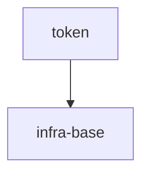

# token

## Vision

Локальный детерминированный нормализатор токенов для CLI и библиотечных потребителей. `normalizeToken(input: string): string` обрезает ведущие и завершающие ASCII-пробелы, приводит ASCII-буквы к нижнему регистру и сворачивает последовательности пробелов, underscore и hyphen в один hyphen, не выполняя сетевого ввода-вывода и не сохраняя состояние; пустой, состоящий только из разделителей или содержащий не-ASCII символы ввод отклоняется через `TypeError`.

- **Для кого:** CLI и библиотечные потребители, которым нужен единый формат токена.
- **Боль:** сейчас нет общего детерминированного правила, поэтому регистр и разделители трактуются по-разному.
- **Успех:** одинаковый корректный ввод всегда даёт один и тот же токен, а невалидный ввод явно отклоняется через `TypeError` без ввода-вывода.
- **Принципы:** детерминированность, локальность без сети и состояния, явная ошибка вместо маскировки неверного ввода.

## Scope Graph

## Scopes

| Scope | Type | Spec | Description |
|---|---|---|---|
| [`token`](./token/token.spec.md) | library | 🚧 | Детерминированный нормализатор токенов для локальных CLI и библиотечных потребителей |
| [`infra-base`](./infra-base/infra-base.spec.md) | infrastructure | 🚧 | Локальная среда авторинга и базовый набор инструментов |
