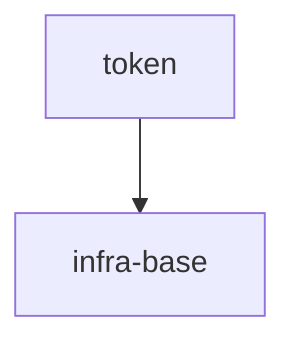

# Token normalizer

## Vision

Локальный детерминированный нормализатор токенов, который превращает произвольный ASCII-ввод в один канонический токен для CLI и библиотечных потребителей — без сети, состояния и персистентности.

- **Для кого:** CLI- и библиотечные потребители, которым нужен стабильный формат токена.
- **Боль:** разный регистр и разделители дают несовпадающие токены, а ошибку входа легко замаскировать пустым корректным результатом.
- **Успех:** `normalizeToken("  Foo__BAR  ")` возвращает `"foo-bar"`, а пустой, состоящий только из разделителей или не-ASCII ввод выбрасывает `TypeError` без ввода-вывода.
- **Принципы:** детерминированность, локальность, отсутствие I/O; невалидный ввод никогда не нормализуется молча.

## Scope Graph

## Scopes

| Scope | Type | Spec | Description |
|---|---|---|---|
| [`token`](./token/token.spec.md) | library | 🚧 | Детерминированный `normalizeToken` для CLI и библиотечных потребителей. |
| [`infra-base`](./infra-base/infra-base.spec.md) | infrastructure | 🚧 | Локальное окружение авторинга: Node.js 22 и установленный Gennady CLI. |
