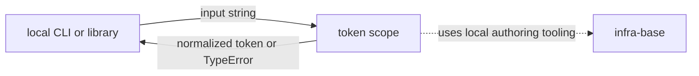
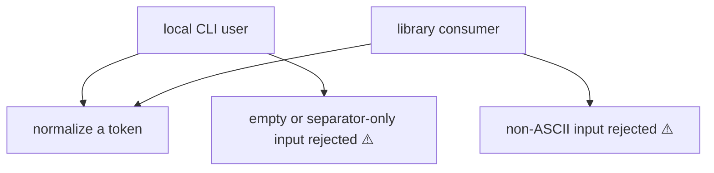
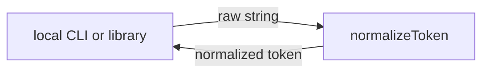
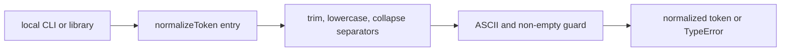

# token: Scope Specification

<!--SECTION:SPEC_ID-->
TOKEN
<!--/SECTION:SPEC_ID-->

<!--SECTION:SCOPE_TYPE-->
## scope-type
product
<!--/SECTION:SCOPE_TYPE-->

<!--SECTION:VISION-->
## Vision & Primary Goal
Provide a local deterministic token normalizer for CLI and library consumers: one pure function turns an ASCII token into a lowercase hyphen-separated form, and rejects invalid input with `TypeError` instead of guessing.
<!--/SECTION:VISION-->

<!--SECTION:OVERVIEW-->
## Overview

_Как token сцеплен с локальным потребителем и infra-base._

Scope boundary: this spec owns only `normalizeToken(input: string): string`. It does not own CLI argument parsing, file formats, networking, persistence or any other product behavior.
<!--/SECTION:OVERVIEW-->

<!--SECTION:PROJECT_TYPE-->
## Project Type
- **Type:** cli-utility
- **Why this type:** the deliverable is a small local callable utility consumed from a CLI or a library, with no service process or interface surface of its own.
<!--/SECTION:PROJECT_TYPE-->

<!--SECTION:GOLDEN_DX-->
## Target Experience

**Setup.** The consumer already runs the local Node.js toolchain supplied by `infra-base`. Nothing has to be configured, downloaded or started: `normalizeToken` is imported by a library consumer or called by the local CLI wrapper and runs in the same process.

**Happy path.** A caller passes a token that is already close to the desired shape. Leading and trailing ASCII spaces disappear, ASCII letters become lowercase, and each run of ASCII spaces, underscores and hyphens becomes one hyphen:

```text
normalizeToken("  Foo__BAR  ")  ->  "foo-bar"
normalizeToken("Release_Notes") ->  "release-notes"
```

The input string itself is not mutated; the normalized value is returned.

**Error and degradation path.** Empty input, input made only of spaces, underscores and hyphens, and input containing a non-ASCII character all throw `TypeError`. The failure is immediate and observable: the function never falls back to an empty token, never transliterates, and performs no reads, writes or network calls. A caller that needs an empty or non-ASCII token must handle that case outside this scope.

**Repeatability.** Two calls with the same input return the same result; the function keeps no state between calls.
<!--/SECTION:GOLDEN_DX-->

<!--SECTION:SCOPE_DEPENDENCIES-->
## Scope Dependencies
- **Depends on:** `infra-base` — local Node.js and installed Gennady tooling for authoring and verification. The normalizer itself adds no dependency on that tooling at runtime.
- **Provides to:** no separate consumer scopes in this repository; local CLI and library consumers call the function directly.
<!--/SECTION:SCOPE_DEPENDENCIES-->

<!--SECTION:REQUIREMENTS_AND_CONSTRAINTS-->
## Requirements & Constraints

### Requirements

### TOK-REQ-1 [должен]
**Когда** вызывающий передаёт непустую ASCII-строку, **`normalizeToken` должен** удалить ведущие и замыкающие ASCII-пробелы, привести ASCII-буквы к нижнему регистру и заменить каждую непрерывную последовательность ASCII-пробелов, символов подчёркивания и дефисов одним дефисом.

> Это единственная наблюдаемая трансформация контракта; без неё локальные потребители получают разные написания одного и того же токена.

### TOK-REQ-2 [должен · нештатная]
**Если** на вход подана пустая строка, **то `normalizeToken` должен** выбросить `TypeError` до любого чтения, записи или сетевого обращения.

> Пустая строка не является токеном; явная ошибка не позволяет вернуть бессмысленный результат.

### TOK-REQ-3 [должен · нештатная]
**Если** вход состоит только из ASCII-пробелов, символов подчёркивания и дефисов, **то `normalizeToken` должен** выбросить `TypeError` без операций ввода-вывода.

> После нормализации у такого входа не остаётся символов; ошибка фиксирует отказ вместо пустого токена.

### TOK-REQ-4 [должен · нештатная]
**Если** вход содержит хотя бы один не-ASCII символ, **то `normalizeToken` должен** выбросить `TypeError` без операций ввода-вывода.

> Контракт ограничен ASCII; молчаливое искажение не-ASCII текста изменило бы данные потребителя.

### TOK-REQ-5 [должен]
**Когда** вызывающий повторяет вызов с тем же входом, **`normalizeToken` должен** вернуть тот же результат и не сохранять состояние между вызовами.

> Детерминизм позволяет потребителям и тестам полагаться на одно и то же преобразование без скрытого состояния.

Input/Outcome examples:

| Input | Outcome |
|---|---|
| `"  Foo__BAR  "` | `"foo-bar"` |
| `""` | `TypeError` |

### Out-of-Scope
- CLI argument parsing, help output and process exit codes.
- Transliteration, Unicode normalization or any non-ASCII handling.
- Configuration files, external rule tables and persisted state.
- Networking, filesystem access and logging.

### Runtime & Deferred Scope
The normalizer is an in-process pure function with no runtime service, storage, network or configuration. The only trust boundary is the caller-supplied string: it is validated as ASCII and non-empty before transformation. No deferred runtime capability is planned.

### Rules
| Rule | Category | Source |
|---|---|---|
| Normalize only ASCII letters, ASCII spaces, underscores and hyphens | Domain | [Token contract](../../docs/token-contract.md) |
| Reject empty, separator-only and non-ASCII input with TypeError | Domain | [Token contract](../../docs/token-contract.md) |
| Keep the function local and free of I/O | Constraint | [Brief](../../inputs/brief.md) |
<!--/SECTION:REQUIREMENTS_AND_CONSTRAINTS-->

<!--SECTION:USE_CASES-->
## Use Cases

_Сценарии нормализации и отказов — TOK-REQ-1, TOK-REQ-2, TOK-REQ-3, TOK-REQ-4._
<!--/SECTION:USE_CASES-->

<!--SECTION:DATA_FLOW-->
## Data Flow

_Путь строки через единый процесс нормализации — TOK-REQ-1, TOK-REQ-5._
<!--/SECTION:DATA_FLOW-->

<!--SECTION:ARCHITECTURE-->
## High-Level Architecture
The scope is one cohesive pure function with a fixed pipeline: trim, lowercase, collapse separators, then return. Validation of emptiness and ASCII membership happens before or during that pipeline and yields `TypeError`; no component holds state or talks to another process.


_Состав нормализатора и его единственная точка входа — TOK-REQ-1, TOK-REQ-2, TOK-REQ-4._

### Rejected Alternatives
- **Stateful normalizer service.** Rejected because the contract requires a local deterministic call with no I/O or persistence.
- **Configuration-driven replacement table.** Rejected because it would add external state and make results depend on files outside the input.
- **Silent best-effort handling of non-ASCII input.** Rejected because it would alter caller data instead of reporting the unsupported input.
<!--/SECTION:ARCHITECTURE-->

<!--SECTION:MODULE_MAP-->
## Module Map
Modules not yet decomposed — run `module-decomposition token`
<!--/SECTION:MODULE_MAP-->

<!--SECTION:RESEARCH-->
## Research
No research documents were used for this bounded deterministic scope.
<!--/SECTION:RESEARCH-->

<!--SECTION:DECISION_LOG-->
## Decision Log
No disputed autonomous decisions were recorded; the scope keeps one pure function with the normalization and rejection rules fixed by the token contract.

<details>
<summary>Полные записи Decision Log</summary>

Записей нет: в границах брифа спорных автономных решений не возникало. Operator approval remains pending.

</details>
<!--/SECTION:DECISION_LOG-->

<!--SECTION:BOOTSTRAP_REQUIREMENTS-->
## Prerequisites
No external bootstrap required.

<details>
<summary>Таблица предусловий</summary>

| Requirement | Kind | Owner | Resolution | Readiness Gates | Gate Artifacts |
|---|---|---|---|---|---|
| No external bootstrap required | — | — | The scope adds no package, runtime, network or configuration prerequisite. | — | — |

</details>
<!--/SECTION:BOOTSTRAP_REQUIREMENTS-->

<!--SECTION:HANDOFF-->
## Handoff to Modules
- **Primary input:** `specs/token/token.spec.md`
- **Areas requiring decomposition:** `normalizeToken` public entry, ASCII validation and rejection path, separator-collapsing transformation.
- **Named abstractions:** `normalizeToken(input: string): string`.
- **Bootstrap tickets ready for cascade:** none — see Prerequisites.
- **Open risks:** exact treatment of the ASCII space character set and separator-only detection need verification against the contract when implementation is authorized.
- **Status:** pending-operator — no approval, ticket creation or execution is claimed by this draft.
<!--/SECTION:HANDOFF-->
