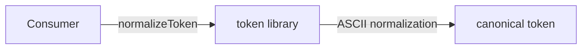
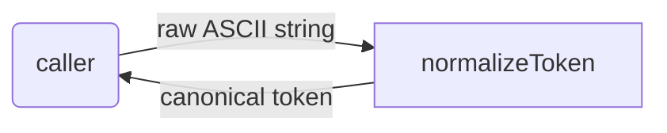

# token: Library Specification

<!--SECTION:SPEC_ID-->
TOKEN
<!--/SECTION:SPEC_ID-->

<!--SECTION:SCOPE_TYPE-->
## scope-type
library
<!--/SECTION:SCOPE_TYPE-->

<!--SECTION:VISION-->
## Vision & Primary Goal
Provide a pure, deterministic token normalizer for local CLI and library consumers. The library turns an ASCII string into one canonical lowercase hyphen-separated token and rejects inputs that cannot produce a meaningful token, without network access, configuration, or persistent state.
<!--/SECTION:VISION-->

<!--SECTION:OVERVIEW-->
## Overview


_Как consumer получает канонический токен из локальной библиотеки._
<!--/SECTION:OVERVIEW-->

<!--SECTION:GOLDEN_DX-->
## Target Experience
Setup is limited to importing the module: there is no initialization, configuration, or I/O. The happy path trims, lowercases, and collapses separators. The error path throws `TypeError` for empty, separator-only, and non-ASCII input.

```ts
import { normalizeToken } from 'token';

normalizeToken('  Foo__BAR  ');
// => 'foo-bar' — leading/trailing ASCII spaces removed, letters lowercased,
//    the run of underscores and the surrounding spaces collapsed to one hyphen.

normalizeToken('');
// => throws TypeError — no input stream, file, or network is touched.
```
<!--/SECTION:GOLDEN_DX-->

<!--SECTION:SCOPE_DEPENDENCIES-->
## Scope Dependencies
- **Depends on:** None.
- **Provides to:** None — consumed directly by local CLI and library callers.
<!--/SECTION:SCOPE_DEPENDENCIES-->

<!--SECTION:REQUIREMENTS_AND_CONSTRAINTS-->
## Requirements & Constraints

### Requirements

### TOK-REQ-1 [должен]
**Когда** вызывается `normalizeToken`, **библиотека должна** обрезать ведущие и замыкающие ASCII-пробелы, привести ASCII-буквы к нижнему регистру и заменить каждую серию пробелов, подчёркиваний и дефисов одним дефисом.

> Одна каноническая форма устраняет расхождения в написании идентификаторов между локальными потребителями.

### TOK-REQ-2 [должен]
**Когда** на вход подана строка `"  Foo__BAR  "`, **библиотека должна** вернуть `"foo-bar"`.

> Фиксированный пример задаёт проверяемый контракт нормализации для потребителей.

### TOK-REQ-3 [должен · нештатная]
**Если** входная строка пуста, **то библиотека должна** выбросить `TypeError`.

> Пустая строка не имеет допустимого канонического представления; явная ошибка не даёт вернуть невалидный токен.

### TOK-REQ-4 [должен · нештатная]
**Если** входная строка состоит только из пробелов, подчёркиваний или дефисов, **то библиотека должна** выбросить `TypeError`.

> После нормализации такая строка была бы пустой; ошибка сохраняет инвариант непустого токена.

### TOK-REQ-5 [должен · нештатная]
**Если** входная строка содержит хотя бы один не-ASCII символ, **то библиотека должна** выбросить `TypeError`.

> Контракт ограничен ASCII; отказ на не-ASCII входе предотвращает неоднозначную нормализацию Unicode.

### TOK-REQ-6 [должен]
**Библиотека должна** выполнять нормализацию без сетевого и файлового ввода-вывода и не сохранять состояние между вызовами.

> Детерминированная локальная функция воспроизводима и не зависит от окружения.

Проверяемые примеры:

| Input | Outcome |
|---|---|
| `"  Foo__BAR  "` | `"foo-bar"` |
| `""` | `TypeError` |

### Out-of-Scope
- Implementation code, CLI packaging, and dependency installation.
- Network, file-system, database, and other I/O behavior.
- Unicode normalization, transliteration, and locale-aware case folding.

### Runtime & Deferred Scope
The library runs locally and synchronously in the consumer's JavaScript/TypeScript runtime; no runtime services back it. Unicode support and any additional normalization rules are deferred and are not part of this scope.

### Rules
| Rule | Category | Source |
|---|---|---|
| Reject empty, separator-only, and non-ASCII input with TypeError | validation | TOK-REQ-3, TOK-REQ-4, TOK-REQ-5 |
<!--/SECTION:REQUIREMENTS_AND_CONSTRAINTS-->

<!--SECTION:DATA_FLOW-->
## Data Flow


_Путь входной строки через normalizer к каноническому токену — TOK-REQ-1, TOK-REQ-2, TOK-REQ-6._
<!--/SECTION:DATA_FLOW-->

<!--SECTION:PUBLIC_API_SURFACE-->
## Public API Surface
- **`normalizeToken(input: string): string`** — returns the canonical lowercase hyphen-separated token for ASCII input and throws `TypeError` for invalid input. The owning module is pending module decomposition; its exact contract will live in that module spec.
<!--/SECTION:PUBLIC_API_SURFACE-->

<!--SECTION:ARCHITECTURE-->
## Architecture
A single pure function with no state, no configuration, and no I/O: input is validated, normalized in one pass, and returned or rejected. Rejected alternatives: a configurable class (unneeded state for one fixed contract), a plugin pipeline (over-engineered for one transformation), and locale-aware Unicode case folding (outside the ASCII contract).
<!--/SECTION:ARCHITECTURE-->

<!--SECTION:MODULE_MAP-->
## Module Map
Modules not yet decomposed — run `module-decomposition token`.
<!--/SECTION:MODULE_MAP-->

<!--SECTION:RESEARCH-->
## Research
No research documents back this deterministic scope.
<!--/SECTION:RESEARCH-->

<!--SECTION:DECISION_LOG-->
## Decision Log
Two decisions: keep the library pure and stateless, and restrict its contract to ASCII.

<details>
<summary>Полные записи Decision Log</summary>

TOK-DL-1 2026-10-23 — реализовать нормализацию одной чистой функцией без состояния (почему: контракт требует детерминированного локального поведения; отвергнуто: класс с конфигурацией — лишнее состояние; риск: нет)

TOK-DL-2 2026-10-23 — ограничить вход ASCII и отклонять не-ASCII через TypeError (почему: Unicode-нормализация не входит в задачу; отвергнуто: locale-aware case folding — неоднозначно; риск: Unicode-потребители не поддержаны)

</details>
<!--/SECTION:DECISION_LOG-->

<!--SECTION:BOOTSTRAP_REQUIREMENTS-->
## Prerequisites
No external bootstrap required.

<details>
<summary>Таблица предусловий</summary>

| Requirement | Kind | Owner | Resolution | Readiness Gates | Gate Artifacts |
|---|---|---|---|---|---|

No external bootstrap required.

</details>
<!--/SECTION:BOOTSTRAP_REQUIREMENTS-->

<!--SECTION:HANDOFF-->
## Handoff to Modules
- **Areas requiring decomposition:** the single token-normalization capability; module decomposition has not run.
- **Named abstractions:** `normalizeToken` — pure ASCII token normalization.
- **Bootstrap tickets ready for cascade:** none — see Prerequisites.
- **Open risks:** exact error messages and stack traces are unspecified; Unicode behavior is intentionally out of scope.
- **Status:** pending-operator — authoring handoff only; no approval, ticket creation, or execution is claimed.
<!--/SECTION:HANDOFF-->
