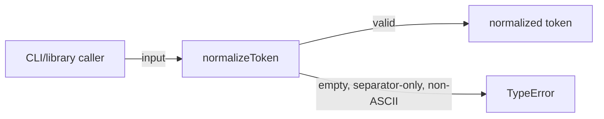

# infra-token: Infrastructure Specification

<!--SECTION:SPEC_ID-->
INFRA-TOKEN
<!--/SECTION:SPEC_ID-->

<!--SECTION:SCOPE_TYPE-->
## scope-type
infrastructure
<!--/SECTION:SCOPE_TYPE-->

<!--SECTION:VISION-->
## Vision
Локальное воспроизводимое окружение для детерминированного нормализатора ASCII-токенов: Node.js 22, npm, git и минимальный набор проверок без сети и внешнего состояния. Продуктовое поведение нормализатора ограничено контрактом `normalizeToken`; реализация в этой спеке не создаётся.
<!--/SECTION:VISION-->

<!--SECTION:OVERVIEW-->
## Overview

_Что делает локальный нормализатор с допустимым и недопустимым входом._
<!--/SECTION:OVERVIEW-->

<!--SECTION:SCOPE_DEPENDENCIES-->
## Scope Dependencies
- **Depends on:** `infra-base` — поставляет Node.js 22 и локальный Gennady CLI.
- **Provides rules to:** продуктовые и библиотечные scope, которые будут использовать `normalizeToken`; таких спек пока нет.
<!--/SECTION:SCOPE_DEPENDENCIES-->

<!--SECTION:REQUIREMENTS_AND_CONSTRAINTS-->
## Requirements & Constraints

### Requirements

### IT-REQ-1 [должен]
**Когда** `normalizeToken` получает строку из ASCII, **функция должна** обрезать ведущие и замыкающие ASCII-пробелы, привести ASCII-буквы к нижнему регистру и свернуть любые серии пробелов, подчёркиваний и дефисов в один дефис, вернув полученный токен.

> Детерминированное преобразование делает одинаковыми разные написания одного токена у локальных CLI- и библиотечных потребителей.

### IT-REQ-2 [должен · нештатная]
**Если** входная строка пуста, состоит только из разделителей (ASCII-пробелы, `_`, `-`) или содержит не-ASCII символы, **то функция должна** выбросить `TypeError` и не выполнять ввод-вывод.

> Явная ошибка на недопустимом входе не даёт молча вернуть пустой или искажённый токен; запрет ввода-вывода сохраняет проверку локальной и воспроизводимой.

### IT-REQ-3 [должен]
**Функция должна** быть чистой и детерминированной: один и тот же вход даёт один и тот же результат без сети, файлового ввода-вывода и внешнего состояния.

> Чистая функция воспроизводима в любом окружении и не требует стенда.

### IT-REQ-4 [должен]
**Публичный API должен** иметь сигнатуру `normalizeToken(input: string): string`, доступную локальным CLI- и библиотечным потребителям.

> Единая сигнатура фиксирует контракт для потребителей и тестов.

### IT-REQ-5 [должен · нештатная]
**Если** Node.js 22, npm или локальный Gennady CLI недоступен, **то рабочий процесс должен** остановиться до изменения артефакта и сообщить фактическую ошибку запуска, не устанавливая инструмент из registry.

> Инструменты поставляет среда; подмена отсутствующего инструмента ломает воспроизводимость и маскирует сбой проверки.

**Input/Outcome**

| Input | Outcome |
|---|---|
| `"  Foo__BAR  "` | `"foo-bar"` |
| `""` | `TypeError` |
| `"___---"` | `TypeError` |
| `"café"` | `TypeError` |

<!--/SECTION:REQUIREMENTS_AND_CONSTRAINTS-->

<!--SECTION:TOOL_STACK-->
## Tool Stack

### Categories Covered
- **Обязательные:** vcs — git; package-management — npm; git-hooks — нативные хуки через `core.hooksPath`.
- **Опциональные:** test-unit — встроенный `node:test`.
- **Исключены:** type-check, linting, formatting, bundler, ci, monorepo-tool, docs и test-e2e. Для одной чистой функции нет отдельного build-выхода, а у локального нормализатора нет живого runtime для e2e; отказ от e2e записан в IT-DL-5.

### Tool Choices
| Category | Tool | Rationale |
|---|---|---|
| vcs | git | IT-DL-1 |
| package-management | npm | IT-DL-2 |
| git-hooks | нативный `.githooks/pre-commit` через `core.hooksPath` | IT-DL-3 |
| test-unit | `node:test` | IT-DL-4 |
| test-e2e | нет | IT-DL-5 |

### Integration Detail
- **git**
  - Версия/API: системный Git, CLI.
  - Нужные методы: `git config core.hooksPath`, `git commit`, `git status`.
  - Эскиз интеграции: хуки лежат в `.githooks/`, каталог `.git/hooks` не редактируется.
  - Ограничения: локальные хуки не заменяют CI; `--no-verify` запрещён без явного разрешения оператора.
- **npm**
  - Версия/API: npm из состава Node.js 22; `package.json` и `package-lock.json`.
  - Нужные методы: `npm ci`, `npm test`.
  - Эскиз интеграции: `"type": "module"`, one-shot-скрипты, точный пин dev-инструментов.
  - Ограничения: один lock-файл; registry берётся из lock-файла или `.npmrc` без подмены.
- **нативный git hook**
  - Версия/API: POSIX `sh` и механизм `core.hooksPath` в git.
  - Нужные методы: `.githooks/pre-commit` вызывает `node --test`.
  - Эскиз интеграции: исполняемый файл в `.githooks/`, подключение одной командой `git config core.hooksPath .githooks`.
  - Ограничения: нужен бит исполнения; hook можно обойти, поэтому правило git-setup требует явного разрешения на `--no-verify`.
- **node:test**
  - Версия/API: встроен в Node.js 22.
  - Нужные методы: `node --test`.
  - Эскиз интеграции: `test/token.test.js` использует `node:test` и `node:assert/strict`.
  - Ограничения: one-shot-режим; watch-режим не используется в агентских проверках.

<!--/SECTION:TOOL_STACK-->

<!--SECTION:WORKFLOW_EXAMPLE-->
## Developer Workflow Example
```bash
# setup
cd token-authoring-benchmark
nvm use
npm ci
git config core.hooksPath .githooks

# daily flow
npm test
node -e "import('./src/token.js').then(({ normalizeToken }) => console.log(normalizeToken('  Foo__BAR  ')))"

# commit flow
git add src/token.js test/token.test.js
git commit -m "feat(token): add deterministic normalizer"

# debug flow
node --test test/token.test.js
node -e "import('./src/token.js').then(({ normalizeToken }) => { try { normalizeToken('') } catch (error) { console.error(error.name) } })"
```
<!--/SECTION:WORKFLOW_EXAMPLE-->

<!--SECTION:FILE_STRUCTURE-->
## File Structure
```text
.
├── .githooks/
│   └── pre-commit
├── .gitignore
├── .npmrc
├── .nvmrc
├── docs/
│   └── token-contract.md
├── package.json
├── package-lock.json
├── src/
│   └── token.js
├── test/
│   └── token.test.js
└── specs/
    └── infra-token/
        └── infra-token.spec.md
```

| File | Role |
|---|---|
| `.nvmrc` | точная patch-версия Node.js 22 |
| `.npmrc` | явный registry без токенов |
| `.gitignore` | `node_modules/`, `dist/`, `coverage/`, `.claude/tmp/` |
| `package.json` | ESM, `engines.node`, one-shot-скрипты |
| `package-lock.json` | зафиксированное дерево зависимостей |
| `.githooks/pre-commit` | локальный запуск `node --test` |
| `src/token.js` | будущая реализация `normalizeToken`; в этой авторской сессии не создаётся |
| `test/token.test.js` | unit-тесты контракта |
| `docs/token-contract.md` | исходный контракт нормализатора |
<!--/SECTION:FILE_STRUCTURE-->

<!--SECTION:EFFECTIVE_RULES-->
## Effective Rules (for cascade)
Два активных infra-правила: `git-setup` и `nodejs-npm-setup`; правила coding и testing на уровне scope не активируются.

<details>
<summary>Таблица правил</summary>

| Rule | Category | Source |
|---|---|---|
| git-setup | infra | `ai/directives/infra/git-setup.xml` (IT-DL-1) |
| nodejs-npm-setup | infra | `ai/directives/infra/nodejs-npm-setup.xml` (IT-DL-2) |

Базовый `.gitignore` включает `node_modules/`, `dist/`, `coverage/` и `.claude/tmp/`. Форматтер не выбран, поэтому отдельное исключение `specs/` для ignore-файла форматтера не требуется.

</details>
<!--/SECTION:EFFECTIVE_RULES-->

<!--SECTION:VERIFICATION_COMMANDS-->
## Verification Commands
| Command Name | Invocation |
|---|---|
| spec-check-command | `npx --no-install gennady sdd-check --spec specs/infra-token/infra-token.spec.md --authoring` |
| test-command | `node --test` |
| hooks-check-command | `git config --get core.hooksPath` |

`typecheck-command`, `lint-command`, `format-command`, `coverage-command`, `check-command` и `fix-command` не применимы: в стеке нет type-checker, линтера, форматтера и порога покрытия, поэтому отдельный repair-конвейер не объявляется.
<!--/SECTION:VERIFICATION_COMMANDS-->

<!--SECTION:RESEARCH-->
## Research
Внешний ресёрч в этой ограниченной авторской сессии не проводился. Выбраны только встроенные возможности Node.js 22 и git; решения по инструментам ждут подтверждения оператора.
<!--/SECTION:RESEARCH-->

<!--SECTION:DECISION_LOG-->
## Decision Log
Пять черновых решений по инструментам: git, npm, нативные git hooks, `node:test` и отказ от test-e2e; утверждение оператора ожидается.

<details>
<summary>Полные записи Decision Log</summary>

IT-DL-1 2026-10-23 — предложен git как система контроля версий (почему: категория vcs обязательна, репозиторий уже использует git; отвергнуто: второй VCS не нужен).
IT-DL-2 2026-10-23 — предложен npm как пакетный менеджер (почему: npm входит в Node.js 22, проект уже использует ESM; отвергнуто: yarn и pnpm добавили бы второй lock-файл).
IT-DL-3 2026-10-23 — предложены нативные git hooks через `core.hooksPath` (почему: категория git-hooks обязательна, нужен один локальный pre-commit без внешнего раннера; отвергнуто: husky и lefthook добавляют зависимость и отдельный шаг установки; риск: hook обходится через `--no-verify`).
IT-DL-4 2026-10-23 — предложен `node:test` как unit-раннер (почему: встроен в Node.js 22 и запускается одной командой `node --test`; отвергнуто: vitest и jest добавляют пакеты и конфигурацию).
IT-DL-5 2026-10-23 — test-e2e не выбран (почему: у локальной чистой функции нет живого runtime для e2e; отвергнуто: имитация e2e через unit-тест не даёт нового сигнала; риск: контракт проверяется только на unit-уровне).

</details>
<!--/SECTION:DECISION_LOG-->

<!--SECTION:BOOTSTRAP_REQUIREMENTS-->
## Prerequisites
Требуются runtime из `infra-base` и setup-задачи этого scope; тикеты ещё не созданы.

<details>
<summary>Таблица предусловий</summary>

| Requirement | Kind | Owner | Resolution | Readiness Gates | Gate Artifacts |
|---|---|---|---|---|---|
| Node.js 22 и npm | tool | external-prereq-scope | предоставляется scope `infra-base` | `node --version`, `npm --version` | — |
| package.json и package-lock.json | package | this-scope-task | setup-задача фиксирует ESM, `engines.node` и lock-файл | `npm ci` завершается успешно | `package.json, package-lock.json` |
| .nvmrc и .npmrc | file | this-scope-task | setup-задача фиксирует точную версию Node и registry | `HOOK_NVMRC_EXACT`, `HOOK_NPMRC_REGISTRY` | `.nvmrc, .npmrc` |
| .githooks/pre-commit | file | this-scope-task | setup-задача добавляет исполняемый hook | `git config --get core.hooksPath`, тестовый commit | `.githooks/pre-commit` |

</details>
<!--/SECTION:BOOTSTRAP_REQUIREMENTS-->

<!--SECTION:HANDOFF-->
## Handoff
- **Status:** pending-operator — спека ожидает утверждения #1.
- **Operator decision:** pending; маркер утверждения не выставлен.
- **Setup tasks to scaffold:** runtime-триада (`.nvmrc`, `.npmrc`, `package.json`, `package-lock.json`) и установка `.githooks/pre-commit`; реализация токена и unit-тестов — отдельная работа после утверждения, в этой сессии не создаётся.
- **Effective rules ready for cascade:** см. Effective Rules.
- **Verification Commands ready for cascade:** см. Verification Commands.
- **Bootstrap tickets ready for cascade:** см. Prerequisites.
- **Open risks:** test-e2e не выбран; точная patch-версия Node.js не зафиксирована до setup; выбор инструментов ждёт подтверждения оператора.

Тикеты не созданы, выполнение не запущено и не заявлено.
<!--/SECTION:HANDOFF-->
