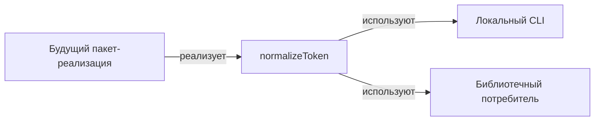

# token-api: Interface Specification

<!--SECTION:SPEC_ID-->
TOKEN-API
<!--/SECTION:SPEC_ID-->

<!--SECTION:SCOPE_TYPE-->
## scope-type
interface
<!--/SECTION:SCOPE_TYPE-->

<!--SECTION:VISION-->
## Vision
Определяет единственный контракт локальной нормализации ASCII-токена — сигнатуру `normalizeToken(input: string): string` и её наблюдаемое поведение — для локальных CLI- и библиотечных потребителей. Контракт синхронный, чистый и не выполняет ввод-вывод.

Источник контракта: [docs/token-contract.md](../../docs/token-contract.md); место в графе проекта: [specs/README.md](../README.md). Реализация, упаковка и CLI-обвязка в область этой спеки не входят.
<!--/SECTION:VISION-->

<!--SECTION:OVERVIEW-->
## Overview

_Кто предоставляет контракт нормализации и кто его потребляет._

Контракт описывает только вызов в процессе. Сетевого или файлового транспорта, схемы сериализации и состояния у него нет.
<!--/SECTION:OVERVIEW-->

<!--SECTION:SCOPE_DEPENDENCIES-->
## Scope Dependencies
- **Depends on:** `infra-base` — локальные Node.js 22 и установленный Gennady CLI для авторинга; сам контракт нормализации не зависит от их поведения и не выполняет ввод-вывод.
- **Provides interface to:** зарегистрированных product/library-спек пока нет; предполагаемые потребители — локальный CLI и библиотечные потребители, названные в [портале](../README.md).
<!--/SECTION:SCOPE_DEPENDENCIES-->

<!--SECTION:REQUIREMENTS_AND_CONSTRAINTS-->
## Requirements & Constraints

### TA-REQ-1 [должен]
**Когда** вход является ASCII-строкой и после удаления ведущих и замыкающих ASCII-пробелов содержит хотя бы один символ, отличный от пробела, `_` и `-`, **функция должна** вернуть строку без ведущих и замыкающих ASCII-пробелов, с ASCII-буквами в нижнем регистре и с каждой серией символов ` `, `_` и `-`, заменённой одним `-`.

> Это основной путь контракта: успешный пример из портала — `"  Foo__BAR  "` → `"foo-bar"`.

### TA-REQ-2 [должен · нештатная]
**Если** вход пустой или после удаления ведущих и замыкающих ASCII-пробелов состоит только из символов ` `, `_` и `-`, **то функция должна** выбросить `TypeError` и не выполнять ввод-вывод.

> Нормализовать нечего; пустой результат скрыл бы ошибку вызывающего кода.

### TA-REQ-3 [должен · нештатная]
**Если** вход содержит хотя бы один символ с кодовой точкой выше `0x7F`, **то функция должна** выбросить `TypeError` и не выполнять ввод-вывод.

> Контракт ограничен ASCII; молчаливое принятие не-ASCII сделало бы результат зависимым от локали и кодировки.

### TA-REQ-4 [должен]
**Функция должна** быть детерминированной и чистой: один и тот же вход всегда даёт один и тот же результат, без сети, файлов, часов, случайности, переменных окружения и изменяемого глобального состояния.

> Локальный потребитель должен получать воспроизводимый результат при повторном вызове и в любом процессе.

### TA-REQ-5 [должен]
**Когда** локальный CLI или библиотечный потребитель вызывает `normalizeToken`, **контракт должен** вернуть результат синхронно в той же единице выполнения, без промисов, колбэков и фоновых задач.

> Единственная операция контракта — преобразование строки в памяти; асинхронность добавила бы потребителю неоговорённую сложность.

**Input / Outcome**

| Input | Outcome |
|---|---|
| "  Foo__BAR  " | "foo-bar" |
| "" | TypeError |

Строки таблицы закрепляют успешный пример и минимальный негативный сценарий контракта.
<!--/SECTION:REQUIREMENTS_AND_CONSTRAINTS-->

<!--SECTION:INTERFACE_DECLARATION-->
## Interface Declaration
- **Schema format:** TypeScript-сигнатура функции; сериализуемая схема (OpenAPI 3.x, gRPC proto3, JSON Schema, GraphQL SDL) не применима, потому что вызов идёт в процессе без сетевого или файлового транспорта.
- **Versioning scheme:** semver
- **Namespace:** пакет `token-api`; экспортируемая функция `normalizeToken`
- **Interfaces:** `normalizeToken(input: string): string` — единственная операция; синхронная, без ввода-вывода.
<!--/SECTION:INTERFACE_DECLARATION-->

<!--SECTION:VERSIONING_POLICY-->
## Versioning Policy
Схема — semver. Начальная версия контракта — 0.1.0.

- **Патч** (0.1.x): исправления документации и внутренней реализации, не меняющие наблюдаемое поведение.
- **Минор** (0.x.0): обратно совместимое расширение, например новая экспортируемая функция; поведение `normalizeToken` не меняется.
- **Мажор** (x.0.0): любое изменение сигнатуры, принимаемого входа, отображения результата, типа исключения или удаление экспорта.

**Протокол breaking change.** Изменение, ломающее совместимость, выпускается только в новой мажорной версии. Перед удалением или заменой прежнего поведения оно проходит минимум один минорный релиз с явным предупреждением об устаревании; прежняя мажорная линия остаётся описанной до миграции зарегистрированных потребителей. Перед выпуском мажорной версии каждый потребитель из Compatibility Matrix уведомляется отдельно; при отсутствии зарегистрированных потребителей уведомлением служит запись о версии в Decision Log.
<!--/SECTION:VERSIONING_POLICY-->

<!--SECTION:COMPATIBILITY_MATRIX-->
## Compatibility Matrix
Зарегистрированных потребителей нет; pending breaking changes нет; минимальная совместимая версия — 0.1.0.

Матрица совместимости

| Consumer scope | Min compatible version | Breaking change protocol |
|---|---|---|
| нет зарегистрированных потребителей | 0.1.0 | мажорное повышение после одного минорного релиза с предупреждением и уведомлением потребителя |

<!--/SECTION:COMPATIBILITY_MATRIX-->

<!--SECTION:RESEARCH-->
## Research
Research-документов нет. Контракт взят из [docs/token-contract.md](../../docs/token-contract.md) и [портала](../README.md); отдельных исследований не требуется.
<!--/SECTION:RESEARCH-->

<!--SECTION:DECISION_LOG-->
## Decision Log
Три решения: формат контракта, схема версионирования и протокол breaking change.

Полные записи Decision Log

TA-DL-1 2026-10-23 — контракт объявлен TypeScript-сигнатурой `normalizeToken(input: string): string` без сериализуемой wire-схемы (почему: вызов идёт в процессе локального CLI или библиотеки, транспорта нет; отвергнуто: OpenAPI 3.x / gRPC proto3 / JSON Schema / GraphQL SDL — описывают сетевую или файловую передачу, которой в контракте нет; риск: потребители вне TypeScript должны повторить сигнатуру и правила сами).

TA-DL-2 2026-10-23 — выбрана semver-схема с начальной версией 0.1.0 (почему: библиотечному контракту нужна явная совместимость по версиям; отвергнуто: date-based — не выражает совместимость, `none` — скрывает breaking changes; риск: до 1.0.0 потребители обязаны фиксировать точную версию).

TA-DL-3 2026-10-23 — breaking change выпускается только в новой мажорной версии после одного минорного релиза с предупреждением об устаревании и уведомления каждого зарегистрированного потребителя (почему: миграция потребителя должна быть возможна до удаления поведения; отвергнуто: немедленное удаление — ломает потребителей без предупреждения; риск: параллельная поддержка двух мажорных линий дольше).

<!--/SECTION:DECISION_LOG-->

<!--SECTION:BOOTSTRAP_REQUIREMENTS-->
## Prerequisites
No external bootstrap required.

Таблица предусловий

Внешних допущений нет: Node.js 22 и установленный Gennady CLI уже поставляет `infra-base`; контракт нормализации не выполняет ввод-вывод и не требует пакетов.

| Requirement | Kind | Owner | Resolution | Readiness Gates | Gate Artifacts |
|---|---|---|---|---|---|

<!--/SECTION:BOOTSTRAP_REQUIREMENTS-->

<!--SECTION:HANDOFF-->
## Handoff
- **Contract files to scaffold:** нет wire-схемы; контракт фиксируется в этом документе сигнатурой `normalizeToken(input: string): string`.
- **Bootstrap tickets ready for cascade:** нет — см. Prerequisites.
- **Open risks:** потребители ещё не зарегистрированы, реализации нет; наблюдаемое поведение остаётся контрактом до появления кода и независимой проверки.
- **Operator approval:** pending — approval #1 не дано.
- **Status:** pending-operator.
No tickets created and no implementation approved by this draft.
<!--/SECTION:HANDOFF-->
