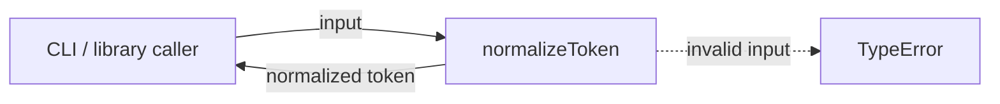
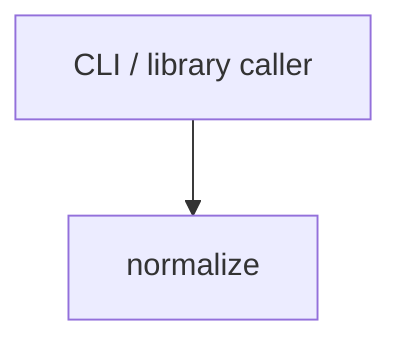

# Module: normalize

<!--SECTION:SPEC_ID-->
TOKEN-NORMALIZE
<!--/SECTION:SPEC_ID-->

<!--SECTION:MODULE_VISION-->
## Module Vision
Модуль `normalize` владеет детерминированной нормализацией токена в скоупе [token](../token.spec.md). Он предоставляет одну чистую функцию без ввода-вывода и состояния; CLI и библиотечные потребители вызывают её напрямую.

Модуль плоский: соседних, родительских и дочерних модулей нет. Реализация продукта не входит в эту спеку.
<!--/SECTION:MODULE_VISION-->

<!--SECTION:OVERVIEW-->
## Overview
Модуль принимает строку, проверяет допустимость входа и возвращает один нормализованный ASCII-токен; недопустимый вход завершается ошибкой типа.


_Путь нормализации и отказ на недопустимом входе — NOR-REQ-1, NOR-REQ-2._
<!--/SECTION:OVERVIEW-->

<!--SECTION:MODULE_USAGE_EXAMPLE-->
## Module Usage Example
```ts
import { normalizeToken } from "./normalize";

const token = normalizeToken("  Foo__BAR  ");
console.log(token);

try {
  normalizeToken("");
} catch (error) {
  console.error(error instanceof TypeError ? "invalid token" : error);
}
```
<!--/SECTION:MODULE_USAGE_EXAMPLE-->

<!--SECTION:MODULE_REQUIREMENTS-->
## Requirements
### NOR-REQ-1 [должен]
**Когда** передана непустая ASCII-строка, содержащая хотя бы один символ, не являющийся пробелом, underscore или hyphen, **нормализатор должен** обрезать крайние ASCII-пробелы, привести ASCII-буквы к нижнему регистру и свернуть каждый непрерывный ряд пробелов, underscore и hyphen в один hyphen.

> Уточняет TOK-REQ-1: задаёт единственный детерминированный формат токена для CLI и библиотечных потребителей.

### NOR-REQ-2 [должен · нештатная]
**Если** строка пустая, состоит только из разделителей (пробелов, underscore и hyphen) или содержит не-ASCII символ, **то нормализатор должен** выбросить TypeError без ввода-вывода.

> Уточняет TOK-REQ-2: ошибочный вход нельзя маскировать пустым или искажённым токеном.

| Input | Outcome |
|---|---|
| `"  Foo__BAR  "` | `"foo-bar"` |
| `""` | `TypeError` |
<!--/SECTION:MODULE_REQUIREMENTS-->

<!--SECTION:INTER_MODULE_DEPENDENCIES-->
## Inter-Module Dependencies
- **Depends on:** нет модулей-зависимостей внутри скоупа `token`.
- **Scope Reference (cross-scope):** родительский скоуп [token](../token.spec.md) (библиотечный, не интерфейсный).
- **Provides to:** нет соседних модулей; функцию вызывают внешние CLI и библиотечные потребители.


_Единственный потребитель модуля — вызывающий код; рёбер между модулями скоупа нет._
<!--/SECTION:INTER_MODULE_DEPENDENCIES-->

<!--SECTION:ENTITY_INVENTORY-->
## Entity Inventory
_Это полный список сущностей модуля. Любое введение сущности execution-агентом помимо этого списка считается drift'ом и требует обновления spec._

| Name | Type | Purpose |
|------|------|---------|
| `normalizeToken` | Function | Детерминированно нормализует ASCII-токен и отвергает недопустимый вход |

Ошибки: throw → `normalizeToken`

Инвентарь односущностный: ER-набросок не применим, связывать нечего.
<!--/SECTION:ENTITY_INVENTORY-->

<!--SECTION:ENTITY_SURFACES-->
## Entity Surfaces
Поверхность одна: чистая функция `normalizeToken` с явным контрактом ошибки; подробности ниже.

<details>
<summary>Полные поверхности сущностей</summary>

### `normalizeToken`
- **Type:** Function
- **Purpose:** Детерминированно нормализует ASCII-токен и отвергает недопустимый вход.
- **Public Properties:** N/A
- **Public Operations:** normalize — обрезать крайние ASCII-пробелы, привести ASCII-буквы к нижнему регистру и свернуть ряды разделителей в один hyphen; при недопустимом входе выбросить TypeError.
- **Lifecycle:** Создаётся на время вызова как чистая функция; состояния не имеет; завершается возвратом результата или TypeError.
- **Events Emitted:** N/A
- **Errors & Degradation:** TypeError через throw при пустом, состоящем только из разделителей или не-ASCII входе; обработка принадлежит вызывающему коду; ввод-вывод отсутствует.
- **Consumers:**
  - Internal: N/A — потребителей внутри модуля нет, вызывающий код находится вне модуля.
  - External: CLI и библиотечные потребители скоупа token.
- **Usage Waiver (external: CLI и библиотечные потребители):** Публичная поверхность модуля; каждый вызов реализует весь контракт.

</details>
<!--/SECTION:ENTITY_SURFACES-->

<!--SECTION:MODULE_CONTRACTS-->
## Module Contracts
Модуль определяет одну чистую функцию `normalizeToken`; Port и Adapter отсутствуют.

Граф не рисуется: в модуле нет Port/Adapter, только Function normalizeToken.

Цепочка вызовов не рисуется: в модуле одна абстракция (normalizeToken), порог ≥2 не достигнут.

<details>
<summary>Контракты DbC</summary>

### Services

#### Service: `normalizeToken`
- **Purpose:** Детерминированно нормализует ASCII-токен и отвергает недопустимый вход.
- **Consumers:** внешние CLI и библиотечные потребители скоупа token.
- **Runtime Backing:** `not-implemented`
- **Verification Levels:** `contract`, `unit`
- **Deferred Runtime Scope:** Вся реализация отложена: код не создаётся этой спекой.

**Contract (DbC)** — one block per operation:
- `normalizeToken`:
  - Pre: вход — строка; она не пуста, содержит хотя бы один символ, не являющийся пробелом, underscore или hyphen, и состоит только из ASCII-символов.
  - Post: возвращена строка, полученная из входа удалением крайних ASCII-пробелов, переводом ASCII-букв в нижний регистр и заменой каждого непрерывного ряда пробелов, underscore и hyphen одним hyphen; ввод-вывод не выполняется.
  - On pre-violation: выброшен TypeError; ввод-вывод не выполняется.

**Invariants:** Результат зависит только от входной строки; функция не хранит состояние и не выполняет ввод-вывод.

</details>
<!--/SECTION:MODULE_CONTRACTS-->

<!--SECTION:PUBLIC_OPTIONS-->
## Public Options & Policies
Публичных опций и политик нет.

<details>
<summary>Опции и политики</summary>

Модуль не имеет настраиваемых флагов, опций или политик; поведение полностью задано контрактом `normalizeToken`.

</details>
<!--/SECTION:PUBLIC_OPTIONS-->

<!--SECTION:FILE_STRUCTURE-->
## File Structure
```
src/token/normalize/
└── normalize.ts
```

**File Mapping:**
- `src/token/normalize/normalize.ts`: реализация функции `normalizeToken`
<!--/SECTION:FILE_STRUCTURE-->

<!--SECTION:RESEARCH-->
## Research
Ресёрч-документов, питающих этот модуль, нет.
<!--/SECTION:RESEARCH-->

<!--SECTION:MODULE_DECISION_LOG-->
## Module Decision Log
Записано одно решение: чистая функция без Port/Adapter.

<details>
<summary>Полные записи Decision Log</summary>

NOR-DL-1 2026-10-23 — чистый normalizeToken без Port/Adapter (почему: одна реализация без подтверждённой вариативности; отвергнуто: Port ради тестового шва — избыточен для чистой функции) [verdict: pending-operator]

</details>
<!--/SECTION:MODULE_DECISION_LOG-->

<!--SECTION:HANDOFF-->
## Handoff to Tasks
- **Implementation files to be created:** `src/token/normalize/normalize.ts`
- **Test files to be created:** `src/token/normalize/normalize.test.ts`
- **Stack dependencies:**
  - Language: `typescript` (resolves to `ai/directives/coding/typescript-rules.xml`)
  - Test framework: `node-test` (resolves to `ai/directives/testing/node-test.xml`)
- **Module Rules Additions:** None

  | Rule | Category | Source |
  |------|----------|--------|
  | None | — | — |

- **Open risks & validation needs:** Реализация не создана; спекa ожидает операторского approval. Для тестов нужно подтвердить границу «не-ASCII» как любой код символа вне диапазона ASCII.
<!--/SECTION:HANDOFF-->

<!--SECTION:IMPLEMENTATION_INSIGHTS-->
## Implementation Insights
Not applicable — реализация не выполнялась, поэтому постымплементационных наблюдений нет.

<details>
<summary>Заметки по реализации</summary>

Не применимо: эта спекa authored без исполнения кода и без audit-cycle compaction.
</details>
<!--/SECTION:IMPLEMENTATION_INSIGHTS-->
