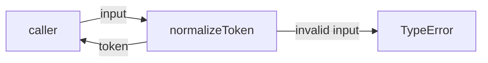
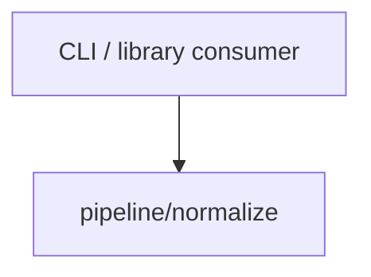

# Module: pipeline/normalize

<!--SECTION:SPEC_ID-->
TOKEN-PIPELINE-NORMALIZE
<!--/SECTION:SPEC_ID-->

<!--SECTION:MODULE_VISION-->
## Module Vision
Модуль `pipeline/normalize` владеет одной обязанностью скоупа [token](../../token.spec.md): детерминированно превращать допустимую ASCII-строку в токен и отвергать недопустимый вход. Родительский модуль отсутствует — это модуль верхнего уровня внутри скоупа; дочерние модули не выделяются. Акроним требований модуля — NOR. Реализация в этой задаче не запрашивается.
<!--/SECTION:MODULE_VISION-->

<!--SECTION:OVERVIEW-->
## Overview

_Вход проходит нормализацию в токен, недопустимый вход даёт TypeError — NOR-REQ-1, NOR-REQ-2._
<!--/SECTION:OVERVIEW-->

<!--SECTION:MODULE_USAGE_EXAMPLE-->
## Module Usage Example
Инициализация не требуется: модуль предоставляет локальную чистую функцию.

```ts
import { normalizeToken } from "./normalize.js";

const token: string = normalizeToken("  Foo__BAR  ");

try {
  normalizeToken("");
} catch (error) {
  if (!(error instanceof TypeError)) {
    throw error;
  }
}
```
<!--/SECTION:MODULE_USAGE_EXAMPLE-->

<!--SECTION:MODULE_REQUIREMENTS-->
## Requirements
### NOR-REQ-1 [должен]
**Когда** передана ASCII-строка, содержащая хотя бы один символ, отличный от пробела, underscore и hyphen, **нормализатор должен** обрезать крайние ASCII-пробелы, привести ASCII-буквы к нижнему регистру и свернуть каждый прогон пробелов, underscore и hyphen в один hyphen.

> Уточняет TOK-REQ-1 для модуля нормализации: один детерминированный токен нужен CLI- и библиотечным потребителям без настройки и без сетевого ввода-вывода.

### NOR-REQ-2 [должен · нештатная]
**Если** строка пустая, состоит только из разделителей (ASCII-пробелы, underscore или hyphen) **или** содержит не-ASCII символ, **то нормализатор должен** выбросить TypeError без операций ввода-вывода.

> Уточняет TOK-REQ-2 для модуля нормализации: ошибочный вход нельзя маскировать пустым или частично нормализованным токеном.

Проверяемые примеры:

| Input | Outcome |
|---|---|
| `"  Foo__BAR  "` | `"foo-bar"` |
| `""` | `TypeError` |
<!--/SECTION:MODULE_REQUIREMENTS-->

<!--SECTION:INTER_MODULE_DEPENDENCIES-->
## Inter-Module Dependencies
- **Depends on:** None; sibling-модулей в скоупе token нет.
- **Scope Reference (cross-scope):** None; модуль работает локально и не пересекает границу скоупа.
- **Provides to:** None внутри скоупа; результат доступен внешним CLI- и библиотечным потребителям через публичную поверхность скоупа [token](../../token.spec.md).


_Модуль не имеет sibling-зависимостей; вход приходит от внешних CLI- и библиотечных потребителей._
<!--/SECTION:INTER_MODULE_DEPENDENCIES-->

<!--SECTION:ENTITY_INVENTORY-->
## Entity Inventory
_Это полный список сущностей модуля. Любое введение сущности execution-агентом помимо этого списка считается drift'ом и требует обновления spec._

| Name | Type | Purpose |
|------|------|---------|
| `normalizeToken` | Function | Детерминированно нормализует допустимую ASCII-строку в токен или выбрасывает TypeError |

Ошибки: throw TypeError → `normalizeToken`; обработкой и показом ошибки владеет вызывающий код.

ER sketch не рисуется: в инвентаре одна сущность, связей между сущностями нет.
<!--/SECTION:ENTITY_INVENTORY-->

<!--SECTION:ENTITY_SURFACES-->
## Entity Surfaces
Поверхность модуля состоит из одной функции `normalizeToken` с фиксированной сигнатурой и без собственного состояния.

<details>
<summary>Полные поверхности сущностей</summary>

### `normalizeToken`
- **Type:** Function
- **Purpose:** Нормализует допустимую ASCII-строку в детерминированный токен.
- **Public Properties:** N/A
- **Public Operations:** `normalizeToken(input)` — нормализовать строку или выбросить TypeError.
- **Lifecycle:** Чистая функция без состояния: существует только на время вызова и завершается вместе с ним.
- **Events Emitted:** N/A
- **Errors & Degradation:** `TypeError` через `throw` для пустого, разделительного или не-ASCII входа; вызывающий код владеет обработкой и показом ошибки.
- **Consumers:**
  - Internal: N/A
  - External: CLI-потребители и библиотечные потребители скоупа token
- **Usage Waiver (external: CLI and library consumers):** единственная публичная операция модуля, общая для обоих внешних сценариев.

</details>
<!--/SECTION:ENTITY_SURFACES-->

<!--SECTION:MODULE_CONTRACTS-->
## Module Contracts
Модуль определяет одну чистую функцию `normalizeToken`; Port и Adapter отсутствуют, потому что единственная реализация не имеет подтверждённой вариативности.

Граф не рисуется: в модуле нет Port/Adapter, только Function `normalizeToken`.

Call Chain не рисуется: в инвентаре одна абстракция, порог ≥2 не достигнут.

<details>
<summary>Контракты DbC</summary>

### Services

#### Service: `normalizeToken`
- **Purpose:** Детерминированно преобразовать допустимый вход в токен.
- **Consumers:** CLI-потребители и библиотечные потребители скоупа token.
- **Runtime Backing:** `not-implemented`
- **Verification Levels:** `contract`, `unit`
- **Deferred Runtime Scope:** Вся реализация отложена; код в этой authoring-задаче не создаётся.

**Contract (DbC)** — one block per operation:
- `normalizeToken`:
  - Pre: Вход — строка, содержащая хотя бы один ASCII-символ, отличный от пробела, underscore и hyphen.
  - Post: Возвращённый токен не имеет крайних ASCII-пробелов, ASCII-буквы приведены к нижнему регистру, а каждый прогон пробелов, underscore и hyphen заменён одним hyphen.
  - On pre-violation: Выбрасывается TypeError без операций ввода-вывода; частичный токен не возвращается.

**Invariants:** Функция не читает и не изменяет внешнее состояние, не выполняет ввод-вывод и возвращает одинаковый результат для одинакового входа.

</details>
<!--/SECTION:MODULE_CONTRACTS-->

<!--SECTION:PUBLIC_OPTIONS-->
## Public Options & Policies
Публичных опций и политик нет: сигнатура и поведение функции фиксированы.

<details>
<summary>Опции и политики</summary>

Флаги, режимы и конфигурация не предусмотрены; отложенных публичных опций в v1 нет.

</details>
<!--/SECTION:PUBLIC_OPTIONS-->

<!--SECTION:FILE_STRUCTURE-->
## File Structure
```
normalize/
├── normalize.ts
└── normalize.test.ts
```

**File Mapping:**
- `normalize.ts`: функция `normalizeToken`
- `normalize.test.ts`: contract- и unit-проверки `normalizeToken`
<!--/SECTION:FILE_STRUCTURE-->

<!--SECTION:RESEARCH-->
## Research
Ресёрч-документы не использовались: поведение задано [token contract](../../../../docs/token-contract.md) и скоупом [token](../../token.spec.md).
<!--/SECTION:RESEARCH-->

<!--SECTION:MODULE_DECISION_LOG-->
## Module Decision Log
Записанных решений нет: в границах модуля не возникло спорного автономного выбора.

<details>
<summary>Полные записи Decision Log</summary>

Записей нет.

</details>
<!--/SECTION:MODULE_DECISION_LOG-->

<!--SECTION:HANDOFF-->
## Handoff to Tasks
- **Implementation files to be created:** `normalize.ts` с функцией `normalizeToken`.
- **Test files to be created:** `normalize.test.ts` с contract- и unit-проверками нормализации и TypeError.
- **Stack dependencies:**
  - Language: `TypeScript` (resolves to `ai/directives/coding/typescript-rules.xml`)
  - Test framework: `node-test` (resolves to `ai/directives/testing/node-test.xml`)
- **Module Rules Additions:** None.
- **Open risks & validation needs:** Реализация отсутствует, поэтому поведение не подтверждено исполнением; Runtime Backing остаётся `not-implemented`.
- **Owner handoff:** pending-operator — Approval #1 не запрошено, тикеты не созданы, исполнение не заявлено.
<!--/SECTION:HANDOFF-->

<!--SECTION:IMPLEMENTATION_INSIGHTS-->
## Implementation Insights
Не применимо: реализации ещё нет, post-implementation наблюдений нет.

<details>
<summary>Заметки по реализации</summary>

Appendix не заполняется до появления реализации и аудит-цикла.

</details>
<!--/SECTION:IMPLEMENTATION_INSIGHTS-->
