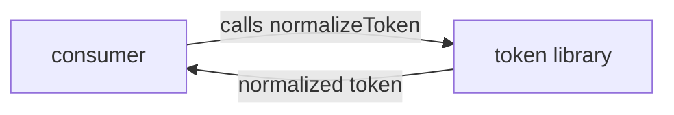
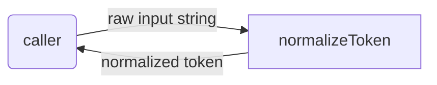

# token: Library Specification

<!--SECTION:SPEC_ID-->
TOKEN
<!--/SECTION:SPEC_ID-->

<!--SECTION:SCOPE_TYPE-->
## scope-type
library
<!--/SECTION:SCOPE_TYPE-->

<!--SECTION:VISION-->
## Vision & Primary Goal
`token` provides one deterministic, local string operation: turning a caller-supplied token into a canonical hyphenated form. It removes the need for consumers to duplicate whitespace, case, and separator handling when they need a stable identifier.
<!--/SECTION:VISION-->

<!--SECTION:OVERVIEW-->
## Overview

_Потребитель передаёт строку в локальную библиотеку и получает нормализованный токен._
<!--/SECTION:OVERVIEW-->

<!--SECTION:GOLDEN_DX-->
## Target Experience
```ts
import { normalizeToken } from "token";

// A token with surrounding spaces, mixed case, and repeated separators.
const slug = normalizeToken("  Foo__BAR  ");
// slug === "foo-bar"
```

```ts
import { normalizeToken } from "token";

try {
  // Empty, separator-only, and non-ASCII inputs are rejected at the boundary.
  normalizeToken("");
} catch (error) {
  // The library reports the rejected input as a TypeError and performs no I/O.
  if (error instanceof TypeError) {
    // Caller handles the rejected token.
  }
}
```
<!--/SECTION:GOLDEN_DX-->

<!--SECTION:SCOPE_DEPENDENCIES-->
## Scope Dependencies
- **Depends on:** None
- **Provides to:** None
<!--/SECTION:SCOPE_DEPENDENCIES-->

<!--SECTION:REQUIREMENTS_AND_CONSTRAINTS-->
## Requirements & Constraints

### Requirements

### TOK-REQ-1 [должен]
**Когда** библиотека получает строку, **библиотека должна** удалить ведущие и замыкающие ASCII-пробелы из результата.

> Граничные пробелы не являются частью токена и делают сравнение идентификаторов нестабильным.

### TOK-REQ-2 [должен]
**Когда** в строке есть буквы ASCII, **библиотека должна** привести их к нижнему регистру.

> Единый регистр нужен для того, чтобы один и тот же токен сравнивался одинаково независимо от написания.

### TOK-REQ-3 [должен]
**Когда** в строке встречается последовательность, состоящая из ASCII-пробелов, символов подчёркивания и/или дефисов, **библиотека должна** заменить всю последовательность одним дефисом.

> Разные разделители в исходной строке должны давать один канонический разделитель, а не несколько подряд.

### TOK-REQ-4 [должен · нештатная]
**Если** входная строка пуста или состоит только из ASCII-пробелов, символов подчёркивания и дефисов, **то библиотека должна** выбросить TypeError.

> У такой строки нет содержательной части токена; молчаливое возвращение пустой строки скрыло бы ошибку вызывающего кода.

### TOK-REQ-5 [должен · нештатная]
**Если** входная строка содержит хотя бы один не-ASCII символ, **то библиотека должна** выбросить TypeError.

> Библиотека не выполняет Unicode-нормализацию и не должна выдавать результат, который зависит от неподдержанного преобразования.

### TOK-REQ-6 [должен]
**Библиотека должна** выполнять нормализацию без файлового, сетевого и иного ввода-вывода.

> Детерминированная локальная операция не должна зависеть от внешнего состояния или побочных эффектов.

**Input / Outcome examples**

| Input | Outcome |
|---|---|
| `"  Foo__BAR  "` | `"foo-bar"` |
| `""` | `TypeError` |

### Out-of-Scope
- Implementation of `normalizeToken` or any runtime code.
- File, network, database, or other I/O.
- Unicode normalization, transliteration, locale-aware case mapping, and configurable separators or options.

### Runtime & Deferred Scope
The capability is a pure in-memory string transformation with no runtime service or storage backing. Implementation and module decomposition are deferred to later phases.

### Rules
| Rule | Category | Source |
|---|---|---|
| No additional activated rules | — | — |
<!--/SECTION:REQUIREMENTS_AND_CONSTRAINTS-->

<!--SECTION:DATA_FLOW-->
## Data Flow

_Преобразование входной строки в нормализованный токен — TOK-REQ-1, TOK-REQ-2, TOK-REQ-3._
<!--/SECTION:DATA_FLOW-->

<!--SECTION:PUBLIC_API_SURFACE-->
## Public API Surface
- **normalizeToken** — normalize a single string into a canonical hyphenated token or throw `TypeError` for rejected input. The owning module is pending decomposition (see Module Map); no module spec link exists yet.
<!--/SECTION:PUBLIC_API_SURFACE-->

<!--SECTION:ARCHITECTURE-->
## Architecture
The library is one stateless pure-function pipeline: trim, lowercase, collapse. It needs no dependency injection, configuration, or adapter layer. Rejected alternatives: configurable separator and case options (the brief fixes one behavior), Unicode-aware normalization (non-ASCII input is rejected), and an asynchronous or service-backed API (the operation is local and deterministic).
<!--/SECTION:ARCHITECTURE-->

<!--SECTION:MODULE_MAP-->
## Module Map
Modules not yet decomposed — run `module-decomposition token`
<!--/SECTION:MODULE_MAP-->

<!--SECTION:RESEARCH-->
## Research
No research documents; the brief is the only input for this bounded draft.
<!--/SECTION:RESEARCH-->

<!--SECTION:DECISION_LOG-->
## Decision Log
No entries: the brief fixes all observable behavior and no disputed autonomous choice was made.

<details>
<summary>Полные записи Decision Log</summary>

No entries.

</details>
<!--/SECTION:DECISION_LOG-->

<!--SECTION:BOOTSTRAP_REQUIREMENTS-->
## Prerequisites
No external bootstrap required.

<details>
<summary>Таблица предусловий</summary>

| Requirement | Kind | Owner | Resolution | Readiness Gates | Gate Artifacts |
|---|---|---|---|---|---|

</details>
<!--/SECTION:BOOTSTRAP_REQUIREMENTS-->

<!--SECTION:HANDOFF-->
## Handoff to Modules
- **Areas requiring decomposition:** the single `normalizeToken` capability.
- **Named abstractions:** `normalizeToken`.
- **Bootstrap tickets ready for cascade:** none; see Prerequisites.
- **Open risks:** edge-case validation for empty, separator-only, and non-ASCII inputs belongs to the owning module.
- **Operator handoff:** pending — no approval has been given and no tickets were created.
<!--/SECTION:HANDOFF-->
