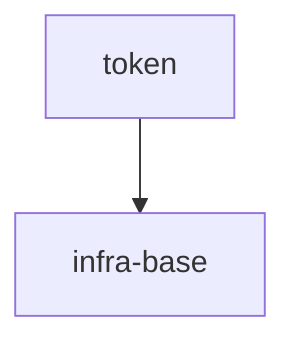

# token-authoring-benchmark

## Vision

A local, deterministic token normalizer shipped as a library and CLI primitive. `normalizeToken(input: string): string` trims leading and trailing ASCII spaces, lowercases ASCII letters, and collapses runs of spaces, underscores and hyphens into a single hyphen; empty, separator-only and non-ASCII input throws `TypeError` without I/O. The normalizer runs entirely in-process with no network, persistence or configuration.

- **Для кого:** CLI and library consumers in this repository that need stable token keys.
- **Боль:** ad-hoc handling of spaces, underscores and hyphens produces inconsistent token strings.
- **Успех:** one fixed normalization rule set, repeatable results for valid input, and a clear `TypeError` for invalid input.
- **Принципы:** local and deterministic behavior, no I/O, fail fast on invalid input, no speculative scope.

## Scope Graph

## Scopes

| Scope | Type | Spec | Description |
|---|---|---|---|
| [`token`](./token/token.spec.md) | library | 🚧 | Deterministic `normalizeToken` transformation with no I/O |
| [`infra-base`](./infra-base/infra-base.spec.md) | infrastructure | 🚧 | Local CLI and Node.js authoring environment |
