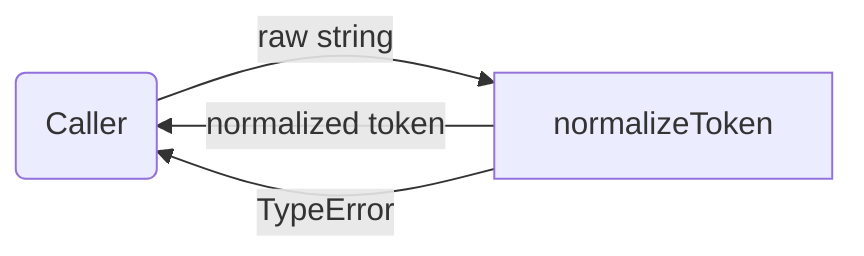
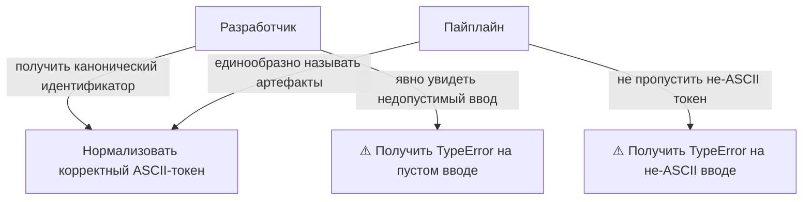
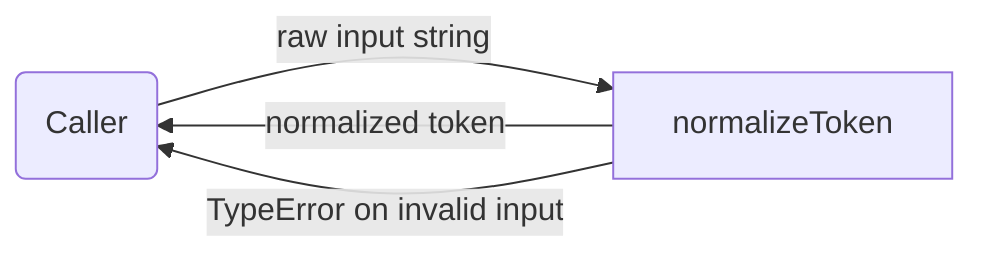
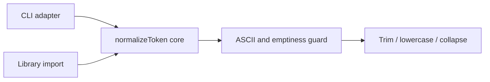

# token: Scope Specification

<!--SECTION:SPEC_ID-->
TOKEN
<!--/SECTION:SPEC_ID-->

<!--SECTION:SCOPE_TYPE-->
## scope-type
product
<!--/SECTION:SCOPE_TYPE-->

<!--SECTION:VISION-->
## Vision & Primary Goal
Provide one deterministic, local token normalizer for CLI and library consumers: a pure function that turns a permitted ASCII string into a canonical lowercase token separated by single hyphens, and rejects unusable input with TypeError. The scope owns the contract only; implementation and packaging are not requested here.
<!--/SECTION:VISION-->

<!--SECTION:OVERVIEW-->
## Overview
The normalizer sits between a caller and a canonical token value. A caller supplies one string; the function returns the normalized token or throws TypeError, without reading or writing any external resource.

_Место нормализатора между вызывающей стороной и каноническим токеном._
<!--/SECTION:OVERVIEW-->

<!--SECTION:PROJECT_TYPE-->
## Project Type
- **Type:** cli-utility
- **Why this type:** the same pure string transformation is consumed both from a local command line and as an imported library function, with no service or persistence layer.
<!--/SECTION:PROJECT_TYPE-->

<!--SECTION:GOLDEN_DX-->
## Target Experience

**Setup.** A consumer imports `normalizeToken` from the local package or invokes it from the command line with one input string. There is no server to start, no configuration file, no credentials and no network access.

**Happy path.** Calling `normalizeToken("  Foo__BAR  ")` returns `"foo-bar"`: leading and trailing ASCII spaces are trimmed, ASCII letters are lowercased, and the run of underscore characters collapses into one hyphen. The result is available synchronously and can be used directly as an identifier or key.

**Error path.** Calling `normalizeToken("")`, a separator-only value such as `"_-_"`, or a value containing a non-ASCII character throws `TypeError`. The caller receives one explicit, early failure instead of an empty or partially normalized token, and no external resource is touched.
<!--/SECTION:GOLDEN_DX-->

<!--SECTION:SCOPE_DEPENDENCIES-->
## Scope Dependencies
- **Depends on:** `infra-base` for the local Node.js/npm authoring environment; the normalizer itself has no runtime service or network dependency.
- **Provides to:** consumer scopes that need canonical ASCII token spellings.
<!--/SECTION:SCOPE_DEPENDENCIES-->

<!--SECTION:REQUIREMENTS_AND_CONSTRAINTS-->
## Requirements & Constraints

### Requirements

### TOK-REQ-1 [должен]
**Когда** `normalizeToken` получает строку с ведущими или завершающими пробелами ASCII, **функция должна** удалить эти пробелы перед остальным преобразованием.

> Пробелы по краям не несут смысла токена; без их удаления одинаковый токен давал бы разные результаты.

### TOK-REQ-2 [должен]
**Когда** `normalizeToken` получает строку с буквами ASCII в верхнем регистре, **функция должна** привести эти буквы к нижнему регистру.

> Единый регистр убирает зависимость результата от исходного написания токена.

### TOK-REQ-3 [должен]
**Когда** `normalizeToken` встречает последовательность из двух и более символов пробел, подчёркивание или дефис, **функция должна** заменить всю последовательность одним дефисом.

> Схлопывание разделителей даёт один канонический разделитель и убирает вариативность написания.

### TOK-REQ-4 [должен · нештатная]
**Если** входная строка пуста, **то функция должна** выбросить `TypeError`, не выполняя ввода-вывода.

> Пустой ввод не содержит токена; явная ошибка типа отделяет недопустимый ввод от допустимого результата.

### TOK-REQ-5 [должен · нештатная]
**Если** входная строка состоит только из пробелов, подчёркиваний или дефисов, **то функция должна** выбросить `TypeError`, не выполняя ввода-вывода.

> После нормализации такая строка не содержала бы токена, поэтому она равноценна пустому вводу.

### TOK-REQ-6 [должен · нештатная]
**Если** входная строка содержит символы вне ASCII, **то функция должна** выбросить `TypeError`, не выполняя ввода-вывода.

> Область определена как ASCII-токен; молчаливое преобразование не-ASCII символов сделало бы контракт неоднозначным.

### TOK-REQ-7 [должен]
**Когда** `normalizeToken` завершает преобразование, **функция должна** вернуть результат, определяемый только входной строкой, без чтения или записи внешних ресурсов.

> Чистая детерминированная функция пригодна и для CLI, и для библиотеки без скрытого состояния и побочных эффектов.

### Input/Outcome Examples

| Input | Outcome |
|---|---|
| `"  Foo__BAR  "` | `"foo-bar"` |
| `""` | `TypeError` |

### Out-of-Scope
- Product implementation, packaging, publishing and CLI argument parsing.
- Unicode-aware case folding, transliteration or normalization of non-ASCII letters.
- Network, filesystem, environment or database access.

### Runtime & Deferred Scope
The whole capability is a pure in-process string transformation; it requires no runtime service, storage or network backing. Deferred: package distribution and any CLI adapter that would shape arguments around the function. The only trust boundary is the caller's input string: empty, separator-only and non-ASCII values are rejected there with `TypeError`.

### Rules
| Rule | Category | Source |
|---|---|---|
| ASCII-only input domain; non-ASCII values raise `TypeError` | Scope constraint | TOK-REQ-6 |
<!--/SECTION:REQUIREMENTS_AND_CONSTRAINTS-->

<!--SECTION:USE_CASES-->
## Use Cases
Actors ask for canonical spellings or deliberately need a visible rejection of unusable input. The worst case is an invalid value that must fail loudly rather than become an empty token.

_Сценарии использования нормализатора и худшие случаи — TOK-REQ-1, TOK-REQ-4, TOK-REQ-6._
<!--/SECTION:USE_CASES-->

<!--SECTION:DATA_FLOW-->
## Data Flow
One external entity supplies a string, one process performs the normalization, and the result or the error returns to the same caller. There is no store because the contract forbids external I/O.

_Поток данных через normalizeToken без внешних хранилищ — TOK-REQ-1, TOK-REQ-4, TOK-REQ-6, TOK-REQ-7._
<!--/SECTION:DATA_FLOW-->

<!--SECTION:ARCHITECTURE-->
## High-Level Architecture
A pure normalization core is wrapped by thin CLI and library adapters. The core validates the ASCII-only input domain first, then applies trimming, lowercasing and separator collapsing in one deterministic pass. No adapter owns state, retries or I/O; they only pass the input through and surface the result or `TypeError`.

_Слои адаптеров вокруг чистой функции нормализации — TOK-REQ-7._

### Rejected Alternatives
- **Unicode-aware normalization:** would extend the input domain beyond the agreed ASCII token contract and introduce locale-dependent results.
- **Hosted normalization service:** would add network I/O, availability concerns and hidden state where the contract requires a local deterministic function.
- **Separator-by-separator public API:** would expose implementation detail instead of the single agreed `normalizeToken` entry point.
<!--/SECTION:ARCHITECTURE-->

<!--SECTION:MODULE_MAP-->
## Module Map
Modules not yet decomposed — run `module-decomposition token`.
<!--/SECTION:MODULE_MAP-->

<!--SECTION:RESEARCH-->
## Research
Not applicable: this bounded deterministic scope is fully specified by the supplied intent, so no research document was needed or registered.
<!--/SECTION:RESEARCH-->

<!--SECTION:DECISION_LOG-->
## Decision Log
One decision recorded: the runtime boundary is a pure in-process function, with packaging deferred; operator approval remains pending.

Полные записи Decision Log

TOK-DL-1 2026-10-23 — Runtime backing is a pure in-process function; packaging and a CLI argument layer stay deferred; где: `specs/token/token.spec.md#runtime--deferred-scope` (почему: the brief asks for a deterministic library/CLI token normalizer with explicit no-I/O behavior, so no service or storage is owned here) [verdict: pending-operator].

<!--/SECTION:DECISION_LOG-->

<!--SECTION:BOOTSTRAP_REQUIREMENTS-->
## Prerequisites
No external bootstrap required.

Таблица предусловий

| Requirement | Kind | Owner | Resolution | Readiness Gates | Gate Artifacts |
|---|---|---|---|---|---|
| — | — | — | No external bootstrap required; the scope has no external assumptions. | — | — |

<!--/SECTION:BOOTSTRAP_REQUIREMENTS-->

<!--SECTION:HANDOFF-->
## Handoff to Modules
- **Primary input:** `specs/token/token.spec.md`
- **Areas requiring decomposition:** the single normalization capability and its input-domain validation.
- **Named abstractions:** `normalizeToken`.
- **Bootstrap tickets ready for cascade:** see Prerequisites.
- **Open risks:** packaging and any CLI adapter remain deferred; no implementation or runtime behavior is verified by this draft.
- **Status:** pending-operator; no tickets created and no execution approved.
<!--/SECTION:HANDOFF-->
