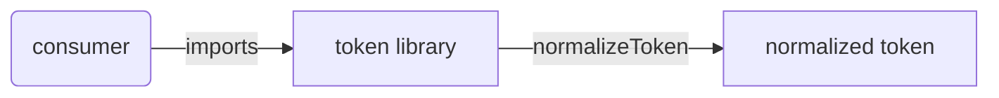
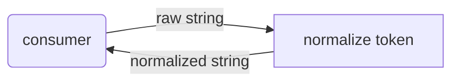

# token: Library Specification

<!--SECTION:SPEC_ID-->
TOKEN
<!--/SECTION:SPEC_ID-->

<!--SECTION:SCOPE_TYPE-->
## scope-type
library
<!--/SECTION:SCOPE_TYPE-->

<!--SECTION:VISION-->
## Vision & Primary Goal
Provide one local, deterministic token normalizer so CLI and library consumers turn ASCII input into a stable lowercase hyphenated token instead of reimplementing inconsistent trimming, casing, and separator rules. The scope is a single pure transformation contract with no I/O.

<!--/SECTION:VISION-->

<!--SECTION:OVERVIEW-->
## Overview


_Подключение consumer к локальной библиотеке нормализации токена._

<!--/SECTION:OVERVIEW-->

<!--SECTION:GOLDEN_DX-->
## Target Experience
No initialization or setup is required: a consumer imports `normalizeToken` and calls it with a string.

Happy path:
```ts
normalizeToken("  Foo__BAR  "); // "foo-bar"
```
Error path:
```ts
normalizeToken(""); // throws TypeError
```
The function stays local and deterministic: the same input yields the same output, and invalid input fails explicitly instead of returning a guessed value or touching external state.

<!--/SECTION:GOLDEN_DX-->

<!--SECTION:SCOPE_DEPENDENCIES-->
## Scope Dependencies
- **Depends on:** [infra-base](../infra-base/infra-base.spec.md) for the local authoring and runtime tooling reference.
- **Provides to:** local CLI and library consumers of `normalizeToken`.
<!--/SECTION:SCOPE_DEPENDENCIES-->

<!--SECTION:REQUIREMENTS_AND_CONSTRAINTS-->
## Requirements & Constraints

### Requirements

### TOK-REQ-1 [должен]
**Когда** consumer вызывает `normalizeToken` с ASCII-строкой, **library должна** обрезать ведущие и завершающие ASCII-пробелы и привести ASCII-буквы к нижнему регистру.

> Единая обрезка и регистр убирают расхождения между потребителями одного и того же токена.

### TOK-REQ-2 [должен]
**Когда** после обрезки в строке встречаются последовательности ASCII-пробелов, подчёркиваний или дефисов, **library должна** заменить каждую такую последовательность одним дефисом.

> Один разделитель делает результат каноническим независимо от исходного написания.

### TOK-REQ-3 [должен · нештатная]
**Если** входная строка пустая, состоит только из разделителей или содержит не-ASCII символы, **то library должна** выбросить `TypeError`.

> Явный отказ не даёт молча нормализовать вход, который контракт не поддерживает; I/O при этом не выполняется.

### TOK-REQ-4 [должен]
**Library должна** выполнять нормализацию без файлового, сетевого и иного I/O и без изменения внешнего состояния.

> Чистая локальная функция воспроизводима и не создаёт скрытых зависимостей у потребителей.

### TOK-REQ-5 [должен]
**Когда** `normalizeToken` вызывается повторно с одинаковым входом, **library должна** вернуть одинаковый результат.

> Детерминированный результат позволяет потребителям полагаться на нормализованный токен как на стабильный ключ.

**Input/Outcome examples**

| Input | Outcome |
|---|---|
| `"  Foo__BAR  "` | `"foo-bar"` |
| `""` | `TypeError` |

### Out-of-Scope
- Product implementation, package publishing, CLI wrapper, persistence, and configuration.
- Unicode normalization, transliteration, and locale-dependent case mapping.
- Any network, filesystem, or other external I/O.

### Runtime & Deferred Scope
The runtime is a pure in-process library function with no service or store backing. CLI packaging and Unicode handling are explicitly deferred beyond this contract.

### Rules
| Rule | Category | Source |
|---|---|---|
| ASCII-only input, with empty, separator-only, and non-ASCII input rejected as `TypeError`. | Validation | [token contract](../../docs/token-contract.md) |
| No I/O and no external state; repeated calls are deterministic. | Boundary | [token contract](../../docs/token-contract.md) |

<!--/SECTION:REQUIREMENTS_AND_CONSTRAINTS-->

<!--SECTION:DATA_FLOW-->
## Data Flow


_Путь входной строки через нормализацию к результату — TOK-REQ-1, TOK-REQ-2._

<!--/SECTION:DATA_FLOW-->

<!--SECTION:PUBLIC_API_SURFACE-->
## Public API Surface
- `normalizeToken` — consumer-facing capability that returns a normalized lowercase hyphenated token or throws `TypeError`. The owning module will be materialized by module-decomposition; exact signatures and DbC contracts stay in that module spec.

<!--/SECTION:PUBLIC_API_SURFACE-->

<!--SECTION:ARCHITECTURE-->
## Architecture
A pure function is the whole design: input string in, normalized string or `TypeError` out, with no internal state and no adapters. Rejected alternatives: a stateful normalizer class (unnecessary lifecycle and hidden state), a configurable separator pipeline (not requested and would widen the contract), and a CLI-first adapter (I/O is explicitly out of scope).

<!--/SECTION:ARCHITECTURE-->

<!--SECTION:MODULE_MAP-->
## Module Map
Modules not yet decomposed — run `module-decomposition token`.

<!--/SECTION:MODULE_MAP-->

<!--SECTION:RESEARCH-->
## Research
Not applicable: no research documents feed this bounded deterministic contract; the source of truth is the local token contract.

<!--/SECTION:RESEARCH-->

<!--SECTION:DECISION_LOG-->
## Decision Log
One authoring decision: keep the scope to a single pure `normalizeToken` capability and leave decomposition pending.

<details>
<summary>Полные записи Decision Log</summary>

TOK-DL-1 2026-10-23 — Scope holds one pure `normalizeToken` capability with no I/O; где: specs/token/token.spec.md#architecture (почему: the contract names one function and excludes external effects) [verdict: pending-operator].

</details>

<!--/SECTION:DECISION_LOG-->

<!--SECTION:BOOTSTRAP_REQUIREMENTS-->
## Prerequisites
No external bootstrap required.

<details>
<summary>Таблица предусловий</summary>

No external bootstrap required: the capability is a pure in-process function with no package, service, or infrastructure prerequisite.

| Requirement | Kind | Owner | Resolution | Readiness Gates | Gate Artifacts |
|---|---|---|---|---|---|

</details>

<!--/SECTION:BOOTSTRAP_REQUIREMENTS-->

<!--SECTION:HANDOFF-->
## Handoff to Modules
- **Areas requiring decomposition:** the single `normalizeToken` capability, pending `module-decomposition token`.
- **Named abstractions:** `normalizeToken`.
- **Bootstrap tickets ready for cascade:** none; see Prerequisites.
- **Open risks:** the ASCII-only boundary and exact separator semantics need validation by the owning module.
- **Status:** pending-operator.

No tickets created and no execution approved by this draft.

<!--/SECTION:HANDOFF-->
