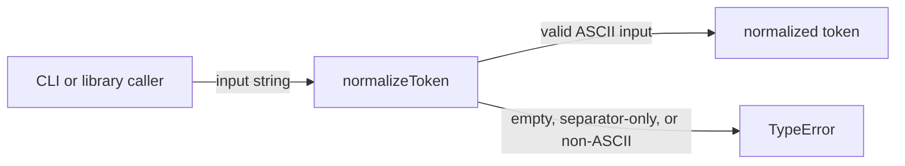

# token-api: Interface Specification

<!--SECTION:SPEC_ID-->
TOKEN-API
<!--/SECTION:SPEC_ID-->

<!--SECTION:SCOPE_TYPE-->
## scope-type
interface
<!--/SECTION:SCOPE_TYPE-->

<!--SECTION:VISION-->
## Vision
Define the local, deterministic `normalizeToken(input: string): string` contract used by CLI and library callers to turn an ASCII token into one canonical hyphen-separated form. The contract covers trimming, ASCII lowercasing, separator collapsing, and explicit rejection of empty, separator-only, and non-ASCII input.
<!--/SECTION:VISION-->

<!--SECTION:OVERVIEW-->
## Overview

_Кто вызывает normalizeToken и какие два исхода возвращает контракт._

The contract is in-process and pure: it reads only the argument, performs no I/O, and returns either a normalized string or throws `TypeError`.
<!--/SECTION:OVERVIEW-->

<!--SECTION:SCOPE_DEPENDENCIES-->
## Scope Dependencies
- **Depends on:** `infra-base` — local Node.js and installed Gennady CLI for authoring and verification only; the runtime contract has no dependency on infrastructure at call time.
- **Provides interface to:** local CLI and library consumers; no product or library scope is declared as a consumer yet.
<!--/SECTION:SCOPE_DEPENDENCIES-->

<!--SECTION:REQUIREMENTS_AND_CONSTRAINTS-->
## Requirements & Constraints

### TA-REQ-1 [должен]
**Когда** вызывающий передаёт строку, **функция normalizeToken должна** вернуть строку, в которой удалены ведущие и замыкающие ASCII-пробелы, ASCII-буквы приведены к нижнему регистру, а каждая непрерывная последовательность ASCII-пробелов, подчёркиваний и дефисов заменена одним дефисом.

> Это единственное наблюдаемое поведение контракта; без него разные написания одного токена остаются разными.

### TA-REQ-2 [должен]
**Функция normalizeToken должна** обрабатывать вход детерминированно и не выполнять ввод-вывод, сетевые вызовы или изменение внешнего состояния.

> Чистая локальная трансформация позволяет использовать контракт и в CLI, и в библиотеке без побочных эффектов.

### TA-REQ-3 [должен · нештатная]
**Если** вход пуст или состоит только из ASCII-пробелов, подчёркиваний и дефисов, **то функция normalizeToken должна** выбросить TypeError, не возвращая строку.

> Пустой токен не имеет осмысленной нормализованной формы; явный TypeError не даёт молча получить пустой идентификатор.

### TA-REQ-4 [должен · нештатная]
**Если** вход содержит хотя бы один символ вне ASCII, **то функция normalizeToken должна** выбросить TypeError без нормализации и без ввода-вывода.

> Контракт ограничен ASCII; молчаливое удаление или транслитерация исказили бы токен незаметно для вызывающего.

| Input | Outcome |
|---|---|
| `"  Foo__BAR  "` | `"foo-bar"` |
| `""` | `TypeError` |

<!--/SECTION:REQUIREMENTS_AND_CONSTRAINTS-->

<!--SECTION:INTERFACE_DECLARATION-->
## Interface Declaration
- **Schema format:** TypeScript function signature (in-process library API; no wire schema)
- **Versioning scheme:** semver
- **Namespace:** `token-api` package/module namespace; single exported operation `normalizeToken`
- **Interfaces:** `normalizeToken(input: string): string`
<!--/SECTION:INTERFACE_DECLARATION-->

<!--SECTION:VERSIONING_POLICY-->
## Versioning Policy
The initial contract version is `0.1.0`. Versions follow semver. A major bump is required for any change to the accepted input domain, the returned string shape, or the rejected-input error type, including newly rejecting input that was previously accepted. A minor bump covers only changes that leave every previously accepted input's result and every previously rejected input's error unchanged. A patch covers behavior-preserving corrections and documentation. Breaking changes require a major bump, a changelog entry, and notification of every consumer named in the Compatibility Matrix before release; where feasible, the replaced behavior is deprecated for at least one minor version. No deprecation is currently scheduled.
<!--/SECTION:VERSIONING_POLICY-->

<!--SECTION:COMPATIBILITY_MATRIX-->
## Compatibility Matrix
No consumer scope is declared yet; no breaking change is pending against the initial `0.1.0` contract.

Матрица совместимости

| Consumer scope | Min compatible version | Breaking change protocol |
|---|---|---|
| None declared | `0.1.0` | Major bump plus consumer notification |

<!--/SECTION:COMPATIBILITY_MATRIX-->

<!--SECTION:RESEARCH-->
## Research
No research documents support this bounded draft; the requirements come from the operator brief.
<!--/SECTION:RESEARCH-->

<!--SECTION:DECISION_LOG-->
## Decision Log
Three decisions: the contract representation, the ASCII-only input domain, and the semver breaking-change policy.

Полные записи Decision Log

TA-DL-1 2026-10-23 — Lock semver with major-only breaking changes for the input domain, results, or error type (почему: CLI and library consumers need a predictable upgrade signal; отвергнуто: unversioned contract — no way to announce a changed domain; риск: consumers must track major versions).
TA-DL-2 2026-10-23 — Define the contract as an in-process TypeScript function signature rather than a wire schema (почему: the intent is a local deterministic normalizer with no I/O; отвергнуто: OpenAPI or JSON Schema — would imply a transport and serialization layer that does not exist; риск: non-TypeScript consumers need their own binding).
TA-DL-3 2026-10-23 — Restrict the input domain to ASCII and reject any non-ASCII character with TypeError (почему: the brief names non-ASCII as invalid input and requests no transliteration; отвергнуто: Unicode case folding and transliteration — behavior would exceed the requested contract; риск: Unicode tokens are rejected until a later major version).

### Approval #1 — current specification set
- **Status:** pending
- **Reviewed set:** `specs/token-api/token-api.spec.md`
- **Independent review:** pending
- **Operator decision:** pending
- **Recorded:** 2026-10-23

<!--/SECTION:DECISION_LOG-->

<!--SECTION:BOOTSTRAP_REQUIREMENTS-->
## Prerequisites
No external bootstrap required.

Таблица предусловий

The bounded inventory audit found no new package, schema file, service, or credential to provision. Node.js and the installed Gennady CLI are supplied by `infra-base`; the runtime contract itself needs no package beyond the language runtime. No readiness gate is outstanding.

<!--/SECTION:BOOTSTRAP_REQUIREMENTS-->

<!--SECTION:HANDOFF-->
## Handoff
- **Contract files to scaffold:** None — there is no wire schema or codegen config; the contract is the TypeScript function signature.
- **Bootstrap tickets ready for cascade:** None — see Prerequisites.
- **Open risks:** No consumer scope is declared yet; the contract is at unreleased `0.1.0`.
- **Status:** pending-operator
- **Operator decision:** pending

No tickets were created and no implementation or execution is approved by this draft.
<!--/SECTION:HANDOFF-->
