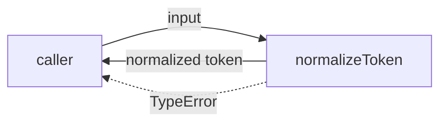
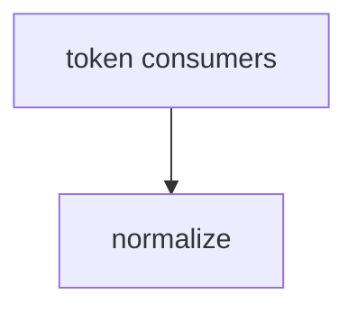

# Module: normalize

<!--SECTION:SPEC_ID-->
TOKEN-NORMALIZE
<!--/SECTION:SPEC_ID-->

<!--SECTION:MODULE_VISION-->
## Module Vision
`normalizeToken` owns the single deterministic ASCII-token normalization inside the `token` scope: trim leading and trailing ASCII spaces, lowercase ASCII letters, collapse runs of spaces, underscores, and hyphens into one hyphen, and reject invalid input with `TypeError` without I/O. Parent scope: [token](../token.spec.md). This draft has no sibling, child, or nested parent modules.
<!--/SECTION:MODULE_VISION-->

<!--SECTION:OVERVIEW-->
## Overview


_Один вызов нормализует ASCII-токен или завершается TypeError без ввода-вывода — NOR-REQ-1, NOR-REQ-2._
<!--/SECTION:OVERVIEW-->

<!--SECTION:MODULE_USAGE_EXAMPLE-->
## Module Usage Example
```ts
import { normalizeToken } from "./normalize.js";

const token = normalizeToken("  Foo__BAR  ");
console.log(token);

try {
  normalizeToken("");
} catch (error) {
  if (error instanceof TypeError) {
    console.error("invalid token");
  }
}
```
<!--/SECTION:MODULE_USAGE_EXAMPLE-->

<!--SECTION:MODULE_REQUIREMENTS-->
## Requirements
### NOR-REQ-1 [должен]
**Когда** нормализатор получает строку из ASCII-символов, содержащую хотя бы один символ, отличный от пробела, underscore и hyphen, **нормализатор должен** обрезать крайние ASCII-пробелы, привести ASCII-буквы к lower-case и свернуть каждый ряд пробелов, underscore и hyphen в один hyphen.

> Уточняет TOK-REQ-1: модуль фиксирует единственный детерминированный формат токена для CLI и библиотечных потребителей.

### NOR-REQ-2 [должен · нештатная]
**Если** входная строка пустая, состоит только из разделителей (пробел, underscore, hyphen) или содержит не-ASCII символ, **то нормализатор должен** выбросить `TypeError`, не выполняя ввода-вывода.

> Уточняет TOK-REQ-2: ошибочный вход нельзя маскировать пустым или частично нормализованным токеном.

| Input | Outcome |
|---|---|
| `"  Foo__BAR  "` | `"foo-bar"` |
| `""` | `TypeError` |
<!--/SECTION:MODULE_REQUIREMENTS-->

<!--SECTION:INTER_MODULE_DEPENDENCIES-->
## Inter-Module Dependencies
- **Depends on:** None — no sibling module exists in the `token` scope.
- **Scope Reference (cross-scope):** None — the module uses no interface-type scope contract.
- **Provides to:** [token](../token.spec.md) scope consumers (CLI and library callers).


_Межмодульных рёбер нет: модуль вызывают потребители скоупа token._
<!--/SECTION:INTER_MODULE_DEPENDENCIES-->

<!--SECTION:ENTITY_INVENTORY-->
## Entity Inventory
_Это полный список сущностей модуля. Любое введение сущности execution-агентом помимо этого списка считается drift'ом и требует обновления spec._

| Name | Type | Purpose |
|------|------|---------|
| `normalizeToken` | Function | Pure ASCII token normalization with explicit invalid-input rejection |

Ошибки: throw TypeError → normalizeToken

ER sketch not drawn: the inventory has a single entity and no relations.
<!--/SECTION:ENTITY_INVENTORY-->

<!--SECTION:ENTITY_SURFACES-->
## Entity Surfaces
One public function: `normalizeToken`, the sole entity and error owner.

<details>
<summary>Полные поверхности сущностей</summary>

### `normalizeToken`
- **Type:** Function
- **Purpose:** Convert a valid ASCII token into its canonical hyphenated form or reject invalid input.
- **Public Properties:** N/A
- **Public Operations:** Normalize one input token; throw `TypeError` when the input is empty, separator-only, or non-ASCII.
- **Lifecycle:** Created by the caller per invocation; no retained state; terminated on return or throw.
- **Events Emitted:** N/A
- **Errors & Degradation:** `TypeError` via throw; owned by `normalizeToken`; no I/O and no fallback result.
- **Consumers:**
  - Internal: `normalize.ts`
  - External: local CLI and library consumers in the `token` scope.
- **Usage Waiver (external: token scope CLI and library consumers):** The function is the module's single public entry point; its production usage count is below two only because implementation is deferred.

</details>
<!--/SECTION:ENTITY_SURFACES-->

<!--SECTION:MODULE_CONTRACTS-->
## Module Contracts
One pure function, `normalizeToken`; no Ports or Adapters are defined.

Граф не рисуется: в модуле нет Port/Adapter, только Service `normalizeToken`.
Call Chain не рисуется: в инвентаре одна абстракция `normalizeToken`, вызовов между абстракциями нет.

<details>
<summary>Контракты DbC</summary>

### Services

#### Service: `normalizeToken`
- **Purpose:** Normalize one ASCII token deterministically.
- **Consumers:** `normalize.ts`; local CLI and library consumers in the `token` scope.
- **Runtime Backing:** `not-implemented`
- **Verification Levels:** `contract`, `unit`
- **Deferred Runtime Scope:** All declared behavior; no product code exists in this authoring draft.

**Contract (DbC)**
- `normalizeToken`:
  - Pre: The input is a string containing only ASCII characters and at least one character other than ASCII space, underscore, or hyphen.
  - Post: Leading and trailing ASCII spaces are removed, ASCII letters are lowercased, each run of one or more spaces, underscores, or hyphens becomes a single hyphen, and no I/O occurs.
  - On pre-violation: A `TypeError` is thrown; no I/O occurs and no token is returned.

**Invariants:** The operation is pure and deterministic; it reads no external state and performs no I/O over the entity's lifetime.

</details>
<!--/SECTION:MODULE_CONTRACTS-->

<!--SECTION:PUBLIC_OPTIONS-->
## Public Options & Policies
No public options or policies: `normalizeToken` exposes no flags, environment switches, or configuration.

<details>
<summary>Опции и политики</summary>

None. The only observable policy is the requirement-defined rejection of empty, separator-only, and non-ASCII input.

</details>
<!--/SECTION:PUBLIC_OPTIONS-->

<!--SECTION:FILE_STRUCTURE-->
## File Structure
```text
normalize/
├── normalize.ts
└── normalize.test.ts
```

**File Mapping:**
- `normalize.ts`: pure `normalizeToken` implementation
- `normalize.test.ts`: unit tests for NOR-REQ-1 and NOR-REQ-2
<!--/SECTION:FILE_STRUCTURE-->

<!--SECTION:RESEARCH-->
## Research
No research documents are registered for this module. Source references: [token](../token.spec.md) and the [token contract](../../../docs/token-contract.md).
<!--/SECTION:RESEARCH-->

<!--SECTION:MODULE_DECISION_LOG-->
## Module Decision Log
One decision: a direct pure function without a Port/Adapter layer.

<details>
<summary>Полные записи Decision Log</summary>

NOR-DL-1 2026-10-23 — use a pure `normalizeToken` function with no Port or Adapter (почему: one implementation and no confirmed variability or test seam; отвергнуто: Port/Adapter layer — adds indirection without a real substitution point; риск: a future normalization-policy replacement requires a contract change).

</details>
<!--/SECTION:MODULE_DECISION_LOG-->

<!--SECTION:HANDOFF-->
## Handoff to Tasks
- **Implementation files to be created:** `normalize.ts`
- **Test files to be created:** `normalize.test.ts`
- **Stack dependencies:**
  - Language: `typescript` (resolves to `ai/directives/coding/typescript-rules.xml`)
  - Test framework: `node-test` (resolves to `ai/directives/testing/node-test.xml`)
- **Module Rules Additions:** None.
- **Open risks & validation needs:** Operator approval is pending; no tickets are created and no implementation or runtime verification is claimed. The `typescript` plus `node-test` stack is an authoring default, not an operator-confirmed choice.
<!--/SECTION:HANDOFF-->

<!--SECTION:IMPLEMENTATION_INSIGHTS-->
## Implementation Insights
Not applicable: the module is not implemented, so there are no post-implementation learnings.
<!--/SECTION:IMPLEMENTATION_INSIGHTS-->
