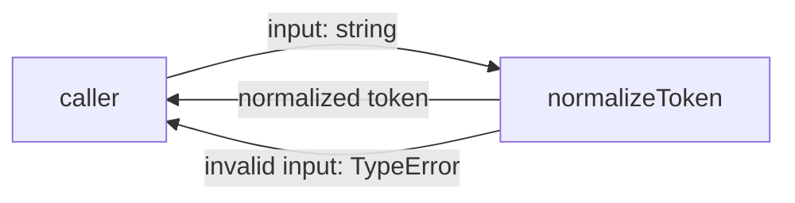
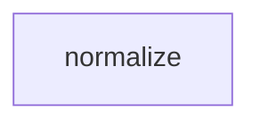

# Module: normalize

<!--SECTION:SPEC_ID-->
TOKEN-PIPELINE-NORMALIZE
<!--/SECTION:SPEC_ID-->

<!--SECTION:MODULE_VISION-->
## Module Vision
Модуль `normalize` владеет единственной чистой операцией нормализации токена внутри скоупа [token](../../token.spec.md). Он не владеет CLI, вводом-выводом или конфигурацией; соседних модулей у скоупа нет. Контракт уточняет [docs/token-contract.md](../../../../docs/token-contract.md).
<!--/SECTION:MODULE_VISION-->

<!--SECTION:OVERVIEW-->
## Overview

_Главный поток нормализации и единственный путь ошибки — NOR-REQ-1, NOR-REQ-2._
<!--/SECTION:OVERVIEW-->

<!--SECTION:MODULE_USAGE_EXAMPLE-->
## Module Usage Example
```ts
import { normalizeToken } from "./normalize.js";

const token = normalizeToken("  Foo__BAR  ");
if (token !== "foo-bar") {
  throw new Error("unexpected normalized token");
}

try {
  normalizeToken("");
} catch (error) {
  if (!(error instanceof TypeError)) {
    throw error;
  }
}
```
<!--/SECTION:MODULE_USAGE_EXAMPLE-->

<!--SECTION:MODULE_REQUIREMENTS-->
## Requirements
### NOR-REQ-1 [должен]
**Когда** на вход передана непустая ASCII-строка, содержащая хотя бы один символ, отличный от ASCII-пробела, underscore и hyphen, **нормализатор должен** обрезать ведущие и хвостовые ASCII-пробелы, привести ASCII-буквы к нижнему регистру и свернуть каждую непрерывную последовательность ASCII-пробелов, underscore и hyphen в один hyphen.

> Уточняет TOK-REQ-1 для модуля normalize: фиксирует конкретный результат нормализации, на который опираются CLI и библиотечные потребители.

### NOR-REQ-2 [должен · нештатная]
**Если** входная строка пустая, состоит только из ASCII-пробелов, underscore и hyphen или содержит хотя бы один не-ASCII символ, **то нормализатор должен** выбросить TypeError, не выполняя ввод-вывод.

> Уточняет TOK-REQ-2 для модуля normalize: ошибка входа остаётся наблюдаемой и не маскируется пустым или частично нормализованным токеном.

| Input | Outcome |
|---|---|
| `"  Foo__BAR  "` | `"foo-bar"` |
| `""` | `TypeError` |
<!--/SECTION:MODULE_REQUIREMENTS-->

<!--SECTION:INTER_MODULE_DEPENDENCIES-->
## Inter-Module Dependencies
- **Depends on:** нет модулей — у скоупа token только один модуль.
- **Scope Reference (cross-scope):** нет.
- **Provides to:** нет соседних модулей внутри скоупа.


_Модуль normalize не имеет межмодульных зависимостей._
<!--/SECTION:INTER_MODULE_DEPENDENCIES-->

<!--SECTION:ENTITY_INVENTORY-->
## Entity Inventory
_Это полный список сущностей модуля. Любое введение сущности execution-агентом помимо этого списка считается drift'ом и требует обновления spec._

| Name | Type | Purpose |
|------|------|---------|
| `normalizeToken` | Function | Чистая нормализация входной строки в токен |

Ошибки: throw (TypeError) → `normalizeToken`

ER-скетч не рисуется: в инвентаре одна сущность, связывать нечего.
<!--/SECTION:ENTITY_INVENTORY-->

<!--SECTION:ENTITY_SURFACES-->
## Entity Surfaces
Одна сущность `normalizeToken`: вход, результат и TypeError без ввода-вывода.

<details>
<summary>Полные поверхности сущностей</summary>

### `normalizeToken`
- **Type:** Function
- **Purpose:** Нормализует строку в детерминированный токен или сообщает о недопустимом входе.
- **Public Properties:** N/A
- **Public Operations:** нормализовать входную строку; выбросить TypeError на недопустимом входе.
- **Lifecycle:** Чистая функция без состояния: каждый вызов начинается и завершается независимо.
- **Events Emitted:** N/A
- **Errors & Degradation:** `TypeError` через throw; владелец — `normalizeToken`; ввод-вывод не выполняется.
- **Consumers:**
  - Internal: `src/token/pipeline/normalize/normalize.ts`
  - External: CLI и библиотечные потребители
- **Usage Waiver (external: CLI и библиотечные потребители):** Единственная экспортируемая операция модуля и есть его публичный контракт; альтернативных операций не требуется.

</details>
<!--/SECTION:ENTITY_SURFACES-->

<!--SECTION:MODULE_CONTRACTS-->
## Module Contracts
Модуль определяет один чистый Service `normalizeToken`; Port и Adapter не вводятся.

Граф зависимостей не рисуется: в модуле нет Port/Adapter, только Service `normalizeToken`.

Call Chain не рисуется: в инвентаре одна абстракция — Service `normalizeToken`; последовательность из одного участника не даёт отношения.

<details>
<summary>Контракты DbC</summary>

### Services

#### Service: `normalizeToken`
- **Purpose:** Детерминированно нормализовать входную строку или отклонить недопустимый вход.
- **Consumers:** internal `src/token/pipeline/normalize/normalize.ts`; external CLI и библиотечные потребители.
- **Runtime Backing:** `not-implemented`
- **Verification Levels:** `contract`, `unit`
- **Deferred Runtime Scope:** Реализация и проверка реального runtime отложены за пределы этой authoring-фазы.

**Contract (DbC)** — one block per operation:
- `normalizeToken`:
  - Pre: Вход — строка, все символы которой ASCII; после удаления крайних ASCII-пробелов она содержит хотя бы один символ, отличный от ASCII-пробела, underscore и hyphen.
  - Post: Возвращается строка без ведущих и хвостовых ASCII-пробелов, с ASCII-буквами в нижнем регистре и с каждой непрерывной последовательностью ASCII-пробелов, underscore и hyphen, заменённой одним hyphen; ввод-вывод не выполняется.
  - On pre-violation: Выбрасывается TypeError; ввод-вывод не выполняется.

**Invariants:** Функция чистая: одинаковый вход даёт одинаковый выход, глобальное состояние не изменяется.

</details>
<!--/SECTION:MODULE_CONTRACTS-->

<!--SECTION:PUBLIC_OPTIONS-->
## Public Options & Policies
Публичных опций и политик нет: контракт фиксирован, конфигурация не читается.

<details>
<summary>Опции и политики</summary>

Публичных флагов и опций нет; отложенных опций также нет. Конфигурация и ввод-вывод отсутствуют по NOR-REQ-2.

</details>
<!--/SECTION:PUBLIC_OPTIONS-->

<!--SECTION:FILE_STRUCTURE-->
## File Structure
```
normalize/
├── normalize.ts
└── normalize.test.ts
```

**File Mapping:**
- `normalize.ts`: реализация чистой функции `normalizeToken`.
- `normalize.test.ts`: модульные проверки нормализации и TypeError.
<!--/SECTION:FILE_STRUCTURE-->

<!--SECTION:RESEARCH-->
## Research
Ресёрчи не использовались. Раздел неприменим: контракт полностью задан TOK-REQ-1, TOK-REQ-2 и [docs/token-contract.md](../../../../docs/token-contract.md); внешних исследований не требуется.
<!--/SECTION:RESEARCH-->

<!--SECTION:MODULE_DECISION_LOG-->
## Module Decision Log
Записано одно решение: чистая функция без Port/Adapter.

<details>
<summary>Полные записи Decision Log</summary>

NOR-DL-1 2026-10-23 — `normalizeToken` оформлен как чистый Service без Port и Adapter (почему: нет подтверждённой вариативности или тестового шва, а чистая функция — минимальная форма контракта; отвергнуто: Port с Adapter — добавил бы слой абстракции без альтернативной реализации).

</details>
<!--/SECTION:MODULE_DECISION_LOG-->

<!--SECTION:HANDOFF-->
## Handoff to Tasks
- **Authoring status:** pending-operator — операторское одобрение не получено, задачи не создавались.
- **Implementation files to be created:** `src/token/pipeline/normalize/normalize.ts`
- **Test files to be created:** `src/token/pipeline/normalize/normalize.test.ts`
- **Stack dependencies:**
  - Language: `TypeScript` (resolves to `ai/directives/coding/typescript-rules.xml`)
  - Test framework: `node-test` (resolves to `ai/directives/testing/node-test.xml`)
- **Module Rules Additions:** None — применяется scope-wide baseline.

- **Open risks & validation needs:** Реализация и runtime-проверка не создавались; поведение и граничные случаи не подтверждены исполнением. Требуется операторское одобрение перед scaffold и реализацией.
<!--/SECTION:HANDOFF-->

<!--SECTION:IMPLEMENTATION_INSIGHTS-->
## Implementation Insights
Неприменимо: реализация в этой фазе не создавалась, post-implementation наблюдений нет.

<details>
<summary>Заметки по реализации</summary>

Неприменимо: артефакт охватывает только authoring; реализация, тесты и полученные на них наблюдения отсутствуют.

</details>
<!--/SECTION:IMPLEMENTATION_INSIGHTS-->
