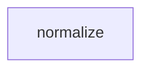

# Tasks: token

## Scope Spec
- [Scope spec](./token.spec.md)

## Cascade Table
| Tier | coding | testing | architecture | infra |
|---|---|---|---|---|
| infra-base (traversed) | — | — | — | — |
| token (target) | — | — | — | — |

## Inter-Module DAG

## Tracker
| Task-ID | Title | Module | Dependencies | Status | Reopens |
|---|---|---|---|---|---|
| NOR-normalize | Normalize ASCII token | normalize | — | [ ] TODO | — |
| NOR-reject | Reject empty token | normalize | NOR-normalize | [ ] TODO | — |

## Decision Log (scope task level)
No decisions or approvals recorded.
