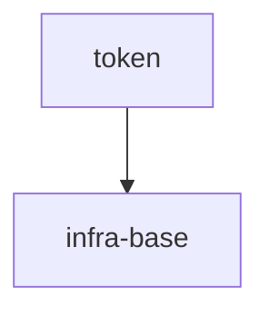

# Project Tasks

## Entry Points
- [Specs Portal](./README.md) — Scope Graph + all scope specs.
- Tickets execute ONLY via the `/sdd-execute` flow (one ticket) or its batch form; the orchestrator dispatches phase-workers then audit — the operator does not invoke audit by hand.

## Project-Wide Conventions (declared once, inherited)
- **V2 File-header:** canonical order `@file` / `@spec` / `@consumers`; `@spec` is one stable canonical Spec ID, while task relations come from `gennady orient --file <path> --json`. New or migrated V2 headers never carry legacy `@tasks`.
- **Baseline Completion Rule:** a Round cannot go `[x] DONE` until — every phase `[x]` with a current CLI-owned verification receipt; every BDD scenario mapped to a test or `Deferred Test Ownership`; every entity beyond the Inventory logged `intro …`; a semantic Handoff line closes each phase.
- **Execution-Log token vocabulary:** `intro <Entity> ← <reason>` · `decision <key>=<value> ← <reason>` · `tried <approach> → <result>` · `discovery <fact>` · `insight <observation> → <spec-section>` · `verified <tool>@<version> 
` · `CLI-owned SDD_PHASE_RECEIPT:<PhaseID>` · `BLOCKED <cause>` · `DONE` · `ver <cmd> → <result> — human note only, never closes a phase alone (L-1)` · `yagni <name> ← <reason>` · `fix <target> ← <reason>` · `env-fix <file> ← <operator decision ref> (AX_ENV_FIX_CHANNEL)` · `correction[:] <round>/<phase> <field>: <old> → <new> ← <reason>`. A `[x]` line with an unreplaced `<…>` placeholder is fabricated (BLOCKER); a token outside this vocabulary is `EXECUTION_LOG_INCOMPLETE` (MINOR, padding).
- **Post-task hook:** after a Round closes the orchestrator runs audit; until PASS the round is closed-but-unverified and dependents are blocked.

## Cross-Scope DAG
Cross-scope edges + integration tickets only; intra-scope edges live in each scope index. Order follows the Portal Scope Graph.

## Scope Tracker
| Scope | Type | Index | Tasks | Done |
|---|---|---|---|---|
| token | library | [3-tasks](./token/token.3-tasks.md) | 2 | 0/2 |
| infra-base | infrastructure | [3-tasks](./infra-base/infra-base.3-tasks.md) | 0 | 0/0 |

## Decision Log (project task level)
No project-level cross-scope decision is applicable: the portal fixes the single edge `token --> infra-base`, and no operator-made non-default cross-scope choice exists. Owner handoff remains pending; no operator approval has been given.
