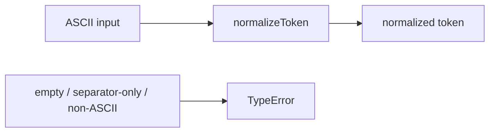

# infra-token: Infrastructure Specification

<!--SECTION:SPEC_ID-->
INFRA-TOKEN
<!--/SECTION:SPEC_ID-->

<!--SECTION:SCOPE_TYPE-->
## scope-type
infrastructure
<!--/SECTION:SCOPE_TYPE-->

<!--SECTION:VISION-->
## Vision
Provide a predictable, local-only token normalization contract for CLI and library consumers: the same ASCII input always yields the same normalized token, and invalid input fails loudly. This scope owns the contract and its verification, not an implementation.
<!--/SECTION:VISION-->

<!--SECTION:OVERVIEW-->
## Overview

_Каждый вход либо даёт один нормализованный токен, либо завершается TypeError — IT-REQ-1, IT-REQ-2._
<!--/SECTION:OVERVIEW-->

<!--SECTION:SCOPE_DEPENDENCIES-->
## Scope Dependencies
- **Depends on:** [`infra-base`](../infra-base/infra-base.spec.md) — Node.js 22 runtime and the local authoring CLI.
- **Provides rules to:** No product or library scope consumes this contract yet; consumers are added here when their scopes exist.
<!--/SECTION:SCOPE_DEPENDENCIES-->

<!--SECTION:REQUIREMENTS_AND_CONSTRAINTS-->
## Requirements & Constraints

### Requirements

### IT-REQ-1 [должен]
**Когда** вызывается `normalizeToken(input)`, **функция должна** вернуть строку: обрезать ведущие и завершающие ASCII-пробелы (U+0020), привести ASCII-буквы (A–Z, a–z) к нижнему регистру и заменить каждую непрерывную последовательность ASCII-пробелов, подчёркиваний и дефисов одним дефисом.

> Единая нормализация делает сравнение токенов воспроизводимым для CLI и библиотечных потребителей.

### IT-REQ-2 [должен · нештатная]
**Если** вход пуст, состоит только из ASCII-пробелов, подчёркиваний и дефисов или содержит любой код вне диапазона U+0000–U+007F, **то функция должна** выбросить TypeError, не выполняя ввод-вывод.

> Недопустимый вход нельзя молча превращать в другой токен; явный отказ защищает потребителей от скрытой подмены данных.

### IT-REQ-3 [должен]
**Функция должна** быть детерминированной и не обращаться к сети, файлам, переменным окружения или изменяемому состоянию.

> Чистая локальная трансформация — основа воспроизводимых результатов и отсутствия побочных эффектов.

Input and outcome examples:

| Input | Outcome |
|---|---|
| "  Foo__BAR  " | "foo-bar" |
| "" | TypeError |
<!--/SECTION:REQUIREMENTS_AND_CONSTRAINTS-->

<!--SECTION:TOOL_STACK-->
## Tool Stack

### Categories Covered
Mandatory categories: vcs, package-management, git-hooks. Included optional category: test-unit, using the runner built into the Node.js runtime.
Excluded optional categories: type-check, linting, formatting, bundler, ci, monorepo-tool, docs — no implementation or delivery pipeline is requested, and one pure ASCII transform needs no build, bundle, type-checker or browser surface.
`test-e2e` is not applicable because the contract has no live runtime, server or UI to exercise; unit tests cover the contract, and the waiver is recorded as IT-DL-5 with its risk.

### Tool Choices
| Category | Tool | Rationale |
|---|---|---|
| vcs | git | IT-DL-1 |
| package-management | npm | IT-DL-2 |
| git-hooks | git native hooks via `core.hooksPath` | IT-DL-3 |
| test-unit | `node:test` | IT-DL-4 |

### Integration Detail

- **git**
  - Версия/API: system git with `core.hooksPath` support; no version pin in this scope.
  - Нужные методы: `git config core.hooksPath .githooks`, `git commit`.
  - Эскиз интеграции: repo-local hook directory wired once per clone; no server-side component.
  - Ограничения: the hook needs its executable bit; a commit can bypass hooks with `--no-verify`.

- **npm**
  - Версия/API: npm bundled with the Node.js 22 runtime owned by `infra-base`.
  - Нужные методы: `npm ci` only if a lock file is introduced; the current stack has zero package dependencies.
  - Эскиз интеграции: `package.json` already declares a private ESM project; no install step is required for this contract.
  - Ограничения: no registry installation is part of this authoring task.

- **git native hooks**
  - Версия/API: git's built-in hook mechanism through `core.hooksPath`.
  - Нужные методы: `pre-commit` hook at `.githooks/pre-commit`.
  - Эскиз интеграции: POSIX shell script that runs `node --test` and exits non-zero on failure.
  - Ограничения: hook files are repo-local and must remain executable; hook policy is per-clone configuration.

- **`node:test`**
  - Версия/API: built-in test runner of Node.js 22, with assertions from `node:assert/strict`.
  - Нужные методы: `test()`, `assert.equal()`, `assert.throws()`.
  - Эскиз интеграции: run with `node --test`; no package install and no test config file.
  - Ограничения: no coverage provider or coverage threshold is declared in this stack.
<!--/SECTION:TOOL_STACK-->

<!--SECTION:WORKFLOW_EXAMPLE-->
## Developer Workflow Example

```bash
# setup: clone and attach the repo-local hooks
git clone https://example.com/token-tools.git
cd token-tools
git config core.hooksPath .githooks

# daily flow: run the contract tests
node --test

# commit flow: the pre-commit hook runs the same test command
git add .
git commit -m "describe the change"

# debug flow: isolate one contract case
node --test --test-name-pattern "normalizeToken"
```
<!--/SECTION:WORKFLOW_EXAMPLE-->

<!--SECTION:FILE_STRUCTURE-->
## File Structure
```text
.
├── package.json                         # npm manifest, private ESM project
├── .gitignore                           # ignored generated and scratch paths (planned)
├── .githooks/
│   └── pre-commit                       # runs node --test (planned)
├── docs/
│   └── token-contract.md                # canonical behavior contract
├── specs/
│   ├── README.md                        # project portal
│   ├── infra-base/
│   │   └── infra-base.spec.md           # runtime and authoring tooling
│   └── infra-token/
│       └── infra-token.spec.md          # this specification
└── test/
    └── normalize-token.test.js          # contract tests (planned)
```

| Path | Role |
|---|---|
| `package.json` | npm manifest and ESM module declaration |
| `.gitignore` | ignores `node_modules/`, `dist/`, `coverage/` and `.claude/tmp/` (planned) |
| `.githooks/pre-commit` | repo-local hook that blocks a commit when `node --test` fails (planned) |
| `docs/token-contract.md` | source contract for `normalizeToken` |
| `test/normalize-token.test.js` | contract tests; no implementation is requested by this spec (planned) |
| `specs/infra-token/infra-token.spec.md` | this specification |
<!--/SECTION:FILE_STRUCTURE-->

<!--SECTION:EFFECTIVE_RULES-->
## Effective Rules (for cascade)
Two infra rules activate: `nodejs-npm-setup` and `git-setup`. The `.gitignore` baseline includes `node_modules/`, `dist/`, `coverage/` and `.claude/tmp/`. No formatter is selected, so the `specs/` formatter exclusion is not applicable.

<details>
<summary>Таблица правил</summary>

| Rule | Category | Source |
|---|---|---|
| nodejs-npm-setup | infra | `ai/directives/infra/nodejs-npm-setup.xml` (IT-DL-2) |
| git-setup | infra | `ai/directives/infra/git-setup.xml` (IT-DL-1) |

</details>
<!--/SECTION:EFFECTIVE_RULES-->

<!--SECTION:VERIFICATION_COMMANDS-->
## Verification Commands

| Command Name | Invocation |
|---|---|
| test-command | `node --test` |

`typecheck-command`, `lint-command`, `format-command`, `coverage-command`, `check-command` and `fix-command` are not applicable: no type-checker, linter, formatter, coverage threshold or project verify/repair wrapper is in the declared stack. Coverage is not gated, so no coverage provider is declared.
<!--/SECTION:VERIFICATION_COMMANDS-->

<!--SECTION:RESEARCH-->
## Research
No external research was performed for this bounded authoring task; no research document exists.
<!--/SECTION:RESEARCH-->

<!--SECTION:DECISION_LOG-->
## Decision Log
Five decisions cover the tool stack and the excluded categories; all remain pending operator approval #1.

<details>
<summary>Полные записи Decision Log</summary>

IT-DL-1 2026-10-23 — Use git for version control (почему: the repository is already a git working tree and every authored artifact is versioned; отвергнуто: Mercurial and Jujutsu — extra tooling with no operator request; риск: none material for this scope).

IT-DL-2 2026-10-23 — Use npm for package management (почему: `package.json` already declares the project and infra-base standardizes npm; отвергнуто: pnpm and yarn — a second lock file and an extra tool without approval; риск: none).

IT-DL-3 2026-10-23 — Use git's native hooks through `core.hooksPath` (почему: the mandatory git-hooks category needs no package install; отвергнуто: husky and lefthook — dependency bootstrap was not requested; риск: the hook must keep its executable bit and can be bypassed with `--no-verify`).

IT-DL-4 2026-10-23 — Use Node's built-in `node:test` runner (почему: it verifies a pure function with zero dependencies on Node.js 22; отвергнуто: vitest and jest — an unrequested package install; риск: no coverage reporter is configured by default).

IT-DL-5 2026-10-23 — Exclude type-check, linting, formatting, test-e2e, bundler, ci, monorepo-tool and docs (почему: no implementation or delivery pipeline is requested and the contract is one pure ASCII transform; отвергнуто: preinstalling the typical stack — unreviewed bootstrap and tool decisions; риск: style, type and integration drift stay unchecked until a later scope owns them, and test-e2e has no live runtime, pending operator confirmation).

</details>
<!--/SECTION:DECISION_LOG-->

<!--SECTION:BOOTSTRAP_REQUIREMENTS-->
## Prerequisites
One outstanding external prerequisite: the Node.js 22 runtime, owned by `infra-base`. No package install or file bootstrap is required.

<details>
<summary>Таблица предусловий</summary>

| Requirement | Kind | Owner | Resolution | Readiness Gates | Gate Artifacts |
|---|---|---|---|---|---|
| Node.js 22 runtime | tool | external-prereq-scope | Provided by [`infra-base`](../infra-base/infra-base.spec.md) | — | — |

</details>
<!--/SECTION:BOOTSTRAP_REQUIREMENTS-->

<!--SECTION:HANDOFF-->
## Handoff
- **Setup tasks to scaffold:** create `.githooks/pre-commit` that runs `node --test`; add `.gitignore` entries for `node_modules/`, `dist/`, `coverage/` and `.claude/tmp/`. No tickets are created here.
- **Effective rules ready for cascade:** see Effective Rules
- **Verification Commands ready for cascade:** see Verification Commands
- **Bootstrap tickets ready for cascade:** see Prerequisites
- **Open risks:** implementation and contract tests are not written; the `test-e2e` waiver in IT-DL-5 needs operator confirmation; operator approval #1 is pending and no execution is claimed.
- **Status:** pending operator approval #1.
<!--/SECTION:HANDOFF-->
