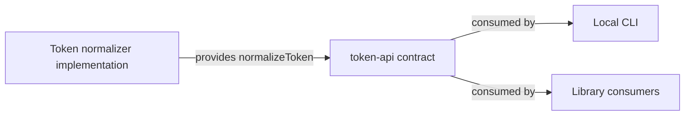

# token-api: Interface Specification

<!--SECTION:SPEC_ID-->
TOKEN-API
<!--/SECTION:SPEC_ID-->

<!--SECTION:SCOPE_TYPE-->
## scope-type
interface
<!--/SECTION:SCOPE_TYPE-->

<!--SECTION:VISION-->
## Vision
Define the local deterministic `normalizeToken(input: string): string` contract for local CLI and library consumers: ASCII-only normalization into one lowercase hyphen-separated token, with `TypeError` for empty, separator-only or non-ASCII input and no I/O.
<!--/SECTION:VISION-->

<!--SECTION:OVERVIEW-->
## Overview

_Кто реализует и кто потребляет контракт normalizeToken._
<!--/SECTION:OVERVIEW-->

<!--SECTION:SCOPE_DEPENDENCIES-->
## Scope Dependencies
- **Depends on:** `infra-base` — local authoring runtime only; the contract itself has no runtime dependency.
- **Provides interface to:** local CLI and library consumers; no sibling product or library scope specs are declared yet.
<!--/SECTION:SCOPE_DEPENDENCIES-->

<!--SECTION:REQUIREMENTS_AND_CONSTRAINTS-->
## Requirements & Constraints

### TA-REQ-1 [должен]
**Когда** `normalizeToken` получает непустую строку, **функция должна** удалить все ведущие и замыкающие ASCII-пробелы перед дальнейшей обработкой.

> Обрезка отделяет значимый токен от случайного обрамления; без неё результат зависит от форматирования ввода.

### TA-REQ-2 [должен]
**Когда** после обрезки строка содержит ASCII-буквы, **функция должна** заменить каждую ASCII-букву её строчной формой.

> Приведение регистра делает представление токена независимым от регистра ввода.

### TA-REQ-3 [должен]
**Когда** после обрезки строка содержит последовательность ASCII-пробелов, подчёркиваний или дефисов, **функция должна** заменить всю последовательность одним дефисом.

> Единый разделитель устраняет неоднозначность написания токена.

### TA-REQ-4 [должен · нештатная]
**Если** входная строка пуста, **то функция должна** выбросить `TypeError`, не выполняя ввод-вывод.

> Пустой токен не имеет допустимого представления; явный отказ предотвращает подмену ошибки пустой строкой.

### TA-REQ-5 [должен · нештатная]
**Если** после обрезки строка состоит только из ASCII-пробелов, подчёркиваний или дефисов, **то функция должна** выбросить `TypeError`, не выполняя ввод-вывод.

> Строка из одних разделителей схлопнулась бы в один дефис и не несла бы токена; отказ сохраняет различие между валидным и пустым результатом.

### TA-REQ-6 [должен · нештатная]
**Если** входная строка содержит хотя бы один символ вне ASCII, **то функция должна** выбросить `TypeError`, не выполняя ввод-вывод.

> Контракт ограничен ASCII; молчаливое искажение не-ASCII символов нарушило бы детерминированность ожиданий потребителей.

### TA-REQ-7 [должен]
**Функция должна** возвращать одинаковый результат для одинакового входа и не выполнять сетевой, файловый или иной ввод-вывод.

> Детерминированность и локальность — основа доверия к нормализатору в CLI и библиотеке.

Проверочные примеры:

| Input | Outcome |
|---|---|
| `"  Foo__BAR  "` | `"foo-bar"` |
| `""` | `TypeError` |
<!--/SECTION:REQUIREMENTS_AND_CONSTRAINTS-->

<!--SECTION:INTERFACE_DECLARATION-->
## Interface Declaration
- **Schema format:** TypeScript function signature for a local library API; no wire schema.
- **Versioning scheme:** semver.
- **Namespace:** `token-api` — exported function name `normalizeToken`.
- **Interfaces:** `normalizeToken(input: string): string`; invalid input raises `TypeError`.
<!--/SECTION:INTERFACE_DECLARATION-->

<!--SECTION:VERSIONING_POLICY-->
## Versioning Policy
- **Scheme:** semver applies to the exported library API and its package.
- **Backward-compatible change:** a patch or minor release keeps every specified `Input`/`Outcome` pair unchanged; adding an optional operation or overload that does not alter `normalizeToken` behavior is minor.
- **Breaking change:** removing or renaming `normalizeToken`, changing its signature, narrowing the accepted input set, changing the result for a previously accepted input, or changing the error class for a previously rejected input requires a new major version.
- **Deprecation window:** a breaking change is announced in release notes at least one minor release before the next major; a pure function has no separate runtime deprecation signal.
- **Consumer notification:** no consumer scopes are declared yet. When one is declared, its minimum compatible version is recorded in the Compatibility Matrix and major-version announcements name that consumer scope.
<!--/SECTION:VERSIONING_POLICY-->

<!--SECTION:COMPATIBILITY_MATRIX-->
## Compatibility Matrix
No consumer scope specs are declared yet; no breaking changes are pending.

Матрица совместимости

| Consumer scope | Min compatible version | Breaking change protocol |
|---|---|---|
| — (пока не объявлен) | — | Новая мажорная версия после минорного объявления |

<!--/SECTION:COMPATIBILITY_MATRIX-->

<!--SECTION:RESEARCH-->
## Research
No research documents were used for this bounded deterministic draft.
<!--/SECTION:RESEARCH-->

<!--SECTION:DECISION_LOG-->
## Decision Log
Three decisions: contract schema, versioning scheme and breaking-change protocol.

Полные записи Decision Log

TA-DL-1 2026-10-23 — Объявить контрактом сигнатуру TypeScript-функции без wire-схемы (почему: нормализатор вызывается локально в том же процессе; отвергнуто: OpenAPI/JSON Schema как отдельный wire-контракт — транспорта и сериализации нет; риск: контракт придётся расширить при появлении удалённого вызова).

TA-DL-2 2026-10-23 — Версионировать библиотечный API по semver (почему: потребитель может закрепить совместимую мажорную версию; отвергнуто: date-based — не отражает совместимость сигнатуры; риск: до появления потребителей дисциплина версий остаётся декларативной).

TA-DL-3 2026-10-23 — Допускать breaking changes только в новой мажорной версии после объявления в минорном релизе (почему: у потребителя есть окно для миграции; отвергнуто: немедленная замена в минорной версии — ломает закреплённых потребителей; риск: объявление зависит от будущего процесса релизов).

<!--/SECTION:DECISION_LOG-->

<!--SECTION:BOOTSTRAP_REQUIREMENTS-->
## Prerequisites
No external bootstrap required.

Таблица предусловий

| Requirement | Kind | Owner | Resolution | Readiness Gates | Gate Artifacts |
|---|---|---|---|---|---|
| — | — | — | No external bootstrap required. | — | — |

<!--/SECTION:BOOTSTRAP_REQUIREMENTS-->

<!--SECTION:HANDOFF-->
## Handoff
- **Contract files to scaffold:** None in this authoring; an owning implementation scope may add the TypeScript declaration and package metadata.
- **Bootstrap tickets ready for cascade:** see Prerequisites (none).
- **Open risks:** no consumer scopes are declared; the versioning policy is declarative until a package exists.
- **Status:** pending-operator
- **Operator decision:** pending
No tickets were created and no execution or approval is claimed by this draft.
<!--/SECTION:HANDOFF-->
