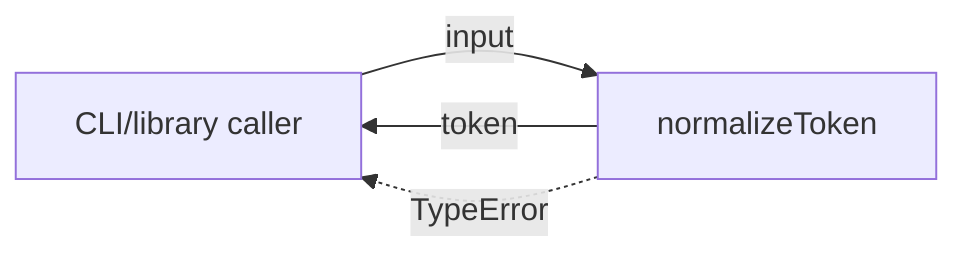
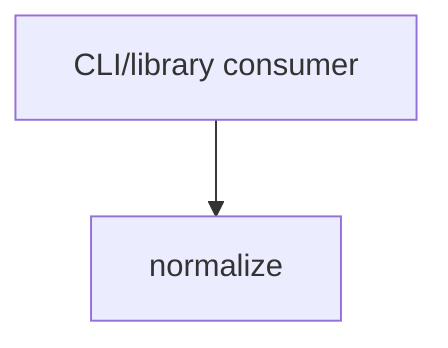

# Module: normalize

<!--SECTION:SPEC_ID-->
TOKEN-NORMALIZE
<!--/SECTION:SPEC_ID-->

<!--SECTION:MODULE_VISION-->
## Module Vision

`normalize` owns the single deterministic token-normalization operation of the
[token scope](../token.spec.md): it turns a valid ASCII input string into a lowercase,
hyphen-separated token and rejects invalid input without I/O.

The module is the only module in the `token` scope. It has no parent, child or sibling
modules; the scope's CLI and library consumers call `normalizeToken` directly.
<!--/SECTION:MODULE_VISION-->

<!--SECTION:OVERVIEW-->
## Overview


_Путь входа через normalizeToken к нормализованному токену или TypeError — NOR-REQ-1, NOR-REQ-2._
<!--/SECTION:OVERVIEW-->

<!--SECTION:MODULE_USAGE_EXAMPLE-->
## Module Usage Example

```ts
import { normalizeToken } from './normalize.js'

const token = normalizeToken('  Foo__BAR  ')
console.log(token)

try {
  normalizeToken('')
} catch (error) {
  if (error instanceof TypeError) {
    console.error('invalid token input')
  }
}
```

The happy path returns `foo-bar`; invalid input such as `""` throws `TypeError` and produces
no output of its own.
<!--/SECTION:MODULE_USAGE_EXAMPLE-->

<!--SECTION:MODULE_REQUIREMENTS-->
## Requirements

### NOR-REQ-1 [должен]
**Когда** на вход передана ASCII-строка, содержащая хотя бы один символ, отличный от ASCII-пробела, underscore и hyphen, **normalizeToken должен** убрать ведущие и хвостовые ASCII-пробелы, привести ASCII-буквы к нижнему регистру и свернуть каждую серию ASCII-пробелов, underscore и hyphen в один hyphen.

> Refines TOK-REQ-1: модуль фиксирует единственный детерминированный формат токена, которым пользуются CLI и библиотечные потребители.

### NOR-REQ-2 [должен · нештатная]
**Если** входная строка пуста, состоит только из ASCII-пробелов, underscore и hyphen или содержит не-ASCII символ, **то normalizeToken должен** выбросить TypeError, не выполняя ввод-вывод.

> Refines TOK-REQ-2: ошибочный вход нельзя маскировать пустым или частично нормализованным токеном; вызывающая сторона должна получить явный отказ.

| Input | Outcome |
|---|---|
| `"  Foo__BAR  "` | `"foo-bar"` |
| `""` | `TypeError` |
<!--/SECTION:MODULE_REQUIREMENTS-->

<!--SECTION:INTER_MODULE_DEPENDENCIES-->
## Inter-Module Dependencies

- **Depends on:** None — в scope `token` нет sibling-модулей.
- **Scope Reference (cross-scope):** [infra-base](../../infra-base/infra-base.spec.md) — только авторский harness, не runtime-интерфейс.
- **Provides to:** CLI и библиотечные потребители вне scope; sibling-модулей нет.


_Внешние потребители вызывают normalize; sibling-модулей и runtime cross-scope-зависимостей нет._
<!--/SECTION:INTER_MODULE_DEPENDENCIES-->

<!--SECTION:ENTITY_INVENTORY-->
## Entity Inventory

_Это полный список сущностей модуля. Любое введение сущности execution-агентом помимо этого списка считается drift'ом и требует обновления spec._

| Name | Type | Purpose |
|------|------|---------|
| `normalizeToken` | Function | Детерминированно нормализует допустимый ASCII-вход в токен |

Ошибки: throw `TypeError` → `normalizeToken`

ER-набросок не рисуется: в инвентаре одна сущность без связей.
<!--/SECTION:ENTITY_INVENTORY-->

<!--SECTION:ENTITY_SURFACES-->
## Entity Surfaces

Публичная поверхность модуля — одна функция `normalizeToken`; полное описание ниже.

<details>
<summary>Полные поверхности сущностей</summary>

### `normalizeToken`
- **Type:** Function
- **Purpose:** Преобразует допустимую ASCII-строку в нижний регистр с одиночными hyphen между фрагментами.
- **Public Properties:** N/A
- **Public Operations:** нормализовать строку в токен
- **Lifecycle:** Чистая функция без создания ресурсов; вызывающий код владеет временем вызова, завершение совпадает с возвратом.
- **Events Emitted:** N/A
- **Errors & Degradation:** `TypeError` via throw для пустого, разделительного или не-ASCII входа; ошибку обрабатывает вызывающая сторона. Ввод-вывод отсутствует.
- **Consumers:**
  - Internal: нет внутренних вызывающих; sibling-модулей нет
  - External: CLI и библиотечные потребители
- **Usage Waiver (external: CLI and library consumers):** Единственная публичная операция модуля; ради неё модуль существует.

</details>
<!--/SECTION:ENTITY_SURFACES-->

<!--SECTION:MODULE_CONTRACTS-->
## Module Contracts

Модуль определяет один Service `normalizeToken`; Port и Adapter отсутствуют.

Граф не рисуется: в модуле нет Port/Adapter, только Service `normalizeToken`.

Call Chain не рисуется: в инвентаре одна абстракция (`normalizeToken`), порог ≥2 не достигнут.

<details>
<summary>Контракты DbC</summary>

### Services

#### Service: `normalizeToken`
- **Purpose:** Детерминированно нормализовать допустимый ASCII-вход в токен.
- **Consumers:** CLI и библиотечные потребители
- **Runtime Backing:** `not-implemented`
- **Verification Levels:** `contract`, `unit`
- **Deferred Runtime Scope:** Вся объявленная операция: реализация не создаётся в этой авторской задаче.

**Contract (DbC)** — one block per operation:
- `normalizeToken`:
  - Pre: вход — строка ASCII, содержащая хотя бы один символ, отличный от ASCII-пробела, underscore и hyphen.
  - Post: возвращается строка без ведущих и хвостовых ASCII-пробелов, с ASCII-буквами в нижнем регистре и с одиночными hyphen вместо каждой серии ASCII-пробелов, underscore и hyphen.
  - On pre-violation: выбрасывается `TypeError`; ввод-вывод не выполняется.

**Invariants:** Функция не хранит состояние, не выполняет ввод-вывод и возвращает одинаковый результат для одинакового входа.

</details>
<!--/SECTION:MODULE_CONTRACTS-->

<!--SECTION:PUBLIC_OPTIONS-->
## Public Options & Policies

Публичных опций и политик нет: операция принимает только входную строку, без флагов и конфигурации.

<details>
<summary>Опции и политики</summary>

Нет публично наблюдаемых опций. Политика отказа задана в `NOR-REQ-2` и в контракте `normalizeToken`; отложенных опций v1 нет.

</details>
<!--/SECTION:PUBLIC_OPTIONS-->

<!--SECTION:FILE_STRUCTURE-->
## File Structure

```text
src/token/normalize/
├── normalize.ts
└── normalize.test.ts
```

**File Mapping:**
- `src/token/normalize/normalize.ts`: реализация `normalizeToken` (план; файла ещё нет)
- `src/token/normalize/normalize.test.ts`: модульные тесты нормализации и отказа (план; файла ещё нет)
<!--/SECTION:FILE_STRUCTURE-->

<!--SECTION:RESEARCH-->
## Research

Ресёрч-документов нет: это ограниченное детерминированное преобразование, отдельного исследования не проводилось. Строки реестра отсутствуют.
<!--/SECTION:RESEARCH-->

<!--SECTION:MODULE_DECISION_LOG-->
## Module Decision Log

Записано одно решение — отсутствие Port/Adapter у единственной чистой операции; полная запись ниже.

<details>
<summary>Полные записи Decision Log</summary>

NOR-DL-1 2026-10-23 — нормализация реализуется одной чистой функцией без Port/Adapter; где: specs/token/normalize/normalize.spec.md#module-contracts (почему: единственная реализация, подтверждённой вариативности или тестового шва нет) [verdict: pending-operator]

</details>
<!--/SECTION:MODULE_DECISION_LOG-->

<!--SECTION:HANDOFF-->
## Handoff to Tasks

- **Implementation files to be created:** `src/token/normalize/normalize.ts`
- **Test files to be created:** `src/token/normalize/normalize.test.ts`
- **Stack dependencies:**
  - Language: `TypeScript` (resolves to `ai/directives/coding/typescript-rules.xml`)
  - Test framework: `node:test` (resolves to `ai/directives/testing/node-test.xml`)
- **Module Rules Additions:** None.
- **Open risks & validation needs:** `normalizeToken` и тесты ещё не созданы; границы допустимого ASCII-входа и сворачивание разделителей должны быть подтверждены модульными тестами после одобрения оператором.
- **Owner handoff:** pending-operator — операторского одобрения, тикетов и исполнения нет.
<!--/SECTION:HANDOFF-->

<!--SECTION:IMPLEMENTATION_INSIGHTS-->
## Implementation Insights

Not applicable: реализация в этой авторской задаче не создаётся, поэтому пост-реализационных наблюдений нет.

<details>
<summary>Заметки по реализации</summary>

Нет заметок: раздел применим только после реализации и audit-cycle compaction.

</details>
<!--/SECTION:IMPLEMENTATION_INSIGHTS-->
