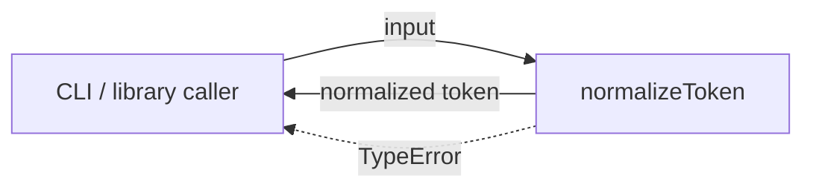
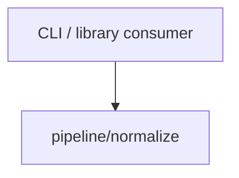

# Module: normalize

<!--SECTION:SPEC_ID-->
TOKEN-PIPELINE-NORMALIZE
<!--/SECTION:SPEC_ID-->

<!--SECTION:MODULE_VISION-->
## Module Vision

Модуль владеет единственной чистой функцией `normalizeToken`, которая приводит один входной токен к детерминированному виду и отклоняет непригодный вход. Скоуп: [token](../../token.spec.md). Родительских, дочерних и соседних модулей в скоупе нет.
<!--/SECTION:MODULE_VISION-->

<!--SECTION:OVERVIEW-->
## Overview


_Один чистый вызов нормализации токена с отдельной веткой ошибки ввода — NOR-REQ-1, NOR-REQ-2._
<!--/SECTION:OVERVIEW-->

<!--SECTION:MODULE_USAGE_EXAMPLE-->
## Module Usage Example

```ts
import { normalizeToken } from "./pipeline/normalize/normalize.js";

const token = normalizeToken("  Foo__BAR  ");
console.log(token);

try {
  normalizeToken("");
} catch (error) {
  if (!(error instanceof TypeError)) {
    throw error;
  }
  console.error(error.message);
}
```
<!--/SECTION:MODULE_USAGE_EXAMPLE-->

<!--SECTION:MODULE_REQUIREMENTS-->
## Requirements

### NOR-REQ-1 [должен]
**Когда** передана строка, содержащая хотя бы один символ, отличный от ASCII-пробела, underscore и hyphen, **нормализатор должен** обрезать крайние ASCII-пробелы, привести ASCII-буквы к нижнему регистру и свернуть каждую серию ASCII-пробелов, underscore и hyphen в один hyphen.

> Уточняет TOK-REQ-1 для модуля normalize: фиксирует единственный формат токена, который получают CLI и библиотечные потребители.

### NOR-REQ-2 [должен · нештатная]
**Если** строка пустая, состоит только из ASCII-пробелов, underscore и hyphen или содержит хотя бы один не-ASCII символ, **то нормализатор должен** выбросить TypeError без выполнения ввода-вывода.

> Уточняет TOK-REQ-2 для модуля normalize: непригодный вход нельзя маскировать пустым корректным токеном.

| Input | Outcome |
|---|---|
| `"  Foo__BAR  "` | `"foo-bar"` |
| `""` | `TypeError` |
<!--/SECTION:MODULE_REQUIREMENTS-->

<!--SECTION:INTER_MODULE_DEPENDENCIES-->
## Inter-Module Dependencies

- **Depends on:** None.
- **Scope Reference (cross-scope):** None.
- **Provides to:** CLI and library consumers (external); внутри скоупа token зависимых модулей нет.


_Модуль вызывается только извне скоупа token; исходящих зависимостей нет._
<!--/SECTION:INTER_MODULE_DEPENDENCIES-->

<!--SECTION:ENTITY_INVENTORY-->
## Entity Inventory

_Это полный список сущностей модуля. Любое введение сущности execution-агентом помимо этого списка считается drift'ом и требует обновления spec._

| Name | Type | Purpose |
|------|------|---------|
| `normalizeToken` | Function | Чистая нормализация одного входного токена. |

Ошибки: throw → `normalizeToken`

ER-скетч не рисуется: в инвентаре одна сущность, связывать нечего.
<!--/SECTION:ENTITY_INVENTORY-->

<!--SECTION:ENTITY_SURFACES-->
## Entity Surfaces

Одна публичная функция `normalizeToken` с единственной операцией нормализации и ошибкой TypeError.

<details>
<summary>Полные поверхности сущностей</summary>

### `normalizeToken`
- **Type:** Function
- **Purpose:** Приводит допустимый входной токен к детерминированному виду и отклоняет непригодный вход.
- **Public Properties:** N/A
- **Public Operations:** Normalize a token.
- **Lifecycle:** Не хранит состояние; существует как чистый экспорт модуля без жизненного цикла.
- **Events Emitted:** N/A
- **Errors & Degradation:** `TypeError` via throw, владелец `normalizeToken`; без ввода-вывода и без деградации.
- **Consumers:**
  - Internal: `pipeline/normalize/normalize.ts`
  - External: CLI and library consumers
- **Usage Waiver (external: CLI/library consumer):** Единственная публичная операция модуля; без неё у скоупа token нет точки входа.

</details>
<!--/SECTION:ENTITY_SURFACES-->

<!--SECTION:MODULE_CONTRACTS-->
## Module Contracts

Модуль определяет только функцию-сервис `normalizeToken`; Port и Adapter отсутствуют.

Граф не рисуется: в модуле нет Port/Adapter, только Service `normalizeToken`.

Цепочка вызовов не рисуется: в инвентаре одна абстракция (`normalizeToken`), последовательность вызовов отсутствует.

<details>
<summary>Контракты DbC</summary>

### Services

#### Service: `normalizeToken`
- **Purpose:** Детерминированно нормализовать один токен или отклонить непригодный вход.
- **Consumers:** `pipeline/normalize/normalize.ts`; CLI and library consumers.
- **Runtime Backing:** `not-implemented`
- **Verification Levels:** `contract`, `unit`
- **Deferred Runtime Scope:** Вся реализация отложена; код не создан и не запрошен.

**Contract (DbC)**
- `normalizeToken`:
  - Pre: Вход — строка, содержащая хотя бы один символ, отличный от ASCII-пробела, underscore и hyphen, и не содержащая не-ASCII символов.
  - Post: Возвращается строка без крайних ASCII-пробелов, с ASCII-буквами в нижнем регистре и каждой серией ASCII-пробелов, underscore и hyphen, заменённой одним hyphen.
  - On pre-violation: Выбрасывается TypeError без выполнения ввода-вывода.

**Invariants:** Функция не сохраняет состояние между вызовами и возвращает одинаковый результат для одинакового входа.
</details>
<!--/SECTION:MODULE_CONTRACTS-->

<!--SECTION:PUBLIC_OPTIONS-->
## Public Options & Policies

Публичных опций нет: сигнатура `normalizeToken` и политика ошибок фиксированы.

<details>
<summary>Опции и политики</summary>

Настраиваемых флагов, параметров и политик нет; наблюдаемое поведение задано NOR-REQ-1 и NOR-REQ-2.
</details>
<!--/SECTION:PUBLIC_OPTIONS-->

<!--SECTION:FILE_STRUCTURE-->
## File Structure

```
pipeline/normalize/
└── normalize.ts
```

**File Mapping:**
- `pipeline/normalize/normalize.ts`: функция `normalizeToken`.
<!--/SECTION:FILE_STRUCTURE-->

<!--SECTION:RESEARCH-->
## Research

Ресёрч-документов нет: поведение модуля полностью определено требованиями скоупа token.
<!--/SECTION:RESEARCH-->

<!--SECTION:MODULE_DECISION_LOG-->
## Module Decision Log

Записей нет.

<details>
<summary>Полные записи Decision Log</summary>

Записей нет.
</details>
<!--/SECTION:MODULE_DECISION_LOG-->

<!--SECTION:HANDOFF-->
## Handoff to Tasks

- **Status:** pending-operator
- **Operator decision:** pending
- **Implementation files to be created:** `pipeline/normalize/normalize.ts`
- **Test files to be created:** `pipeline/normalize/normalize.test.ts`
- **Stack dependencies:**
  - Language: `TypeScript` (resolves to `ai/directives/coding/typescript-rules.xml`)
  - Test framework: `vitest` (resolves to `ai/directives/testing/vitest-rules.xml`)
- **Module Rules Additions:** None.
- **Open risks & validation needs:** Операторское одобрение не получено; реализация и тесты не созданы. Валидации требуют входы только из разделителей и входы с не-ASCII символами.
<!--/SECTION:HANDOFF-->

<!--SECTION:IMPLEMENTATION_INSIGHTS-->
## Implementation Insights

Не применимо: реализации ещё нет, post-implementation выводы отсутствуют.

<details>
<summary>Заметки по реализации</summary>

Записей нет.
</details>
<!--/SECTION:IMPLEMENTATION_INSIGHTS-->
