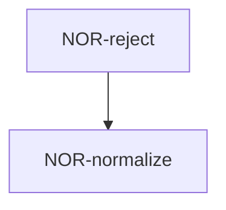

# normalize — Tasks

## Tracker Index
| Task-ID | Title | Dependencies | Status | Reopens |
|---------|-------|--------------|--------|---------|
| NOR-normalize | Normalize ASCII token | — | [ ] TODO | — |
| NOR-reject | Reject empty token | NOR-normalize | [ ] TODO | — |

## Slug Registry
- normalize
- reject

## Intra-Module DAG

## Decision Log (module-task level)
No module-level decomposition or planning decisions recorded.

## Conventions
Project-wide conventions are declared once in [specs/3-tasks.md](../../3-tasks.md) and inherited here; no module-specific conventions are added.

## Approval #2 — decomposition and test plan
- **Status:** pending
- **Reviewed tickets:** `specs/token/normalize/normalize.task.NOR-normalize.md`, `specs/token/normalize/normalize.task.NOR-reject.md`
- **Independent review:** pending
- **Operator decision:** pending
- **Recorded:** 2026-10-23
