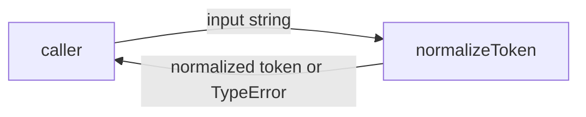
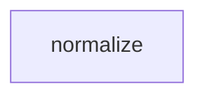

# Module: normalize

<!--SECTION:SPEC_ID-->
TOKEN-NORMALIZE
<!--/SECTION:SPEC_ID-->

<!--SECTION:MODULE_VISION-->
## Module Vision
This module owns the single pure token-normalization operation inside the `token` scope: it turns a valid ASCII input string into its canonical hyphenated form and rejects invalid input before any processing. The module is defined by its parent scope, [token](../token.spec.md); this is the only module in that scope, so there are no sibling, parent or child modules.
<!--/SECTION:MODULE_VISION-->

<!--SECTION:OVERVIEW-->
## Overview

_Путь нормализации токена от входа до результата — NOR-REQ-1, NOR-REQ-2._
<!--/SECTION:OVERVIEW-->

<!--SECTION:MODULE_USAGE_EXAMPLE-->
## Module Usage Example
```ts
import { normalizeToken } from "./normalize.js";

const token = normalizeToken("  Foo__BAR  ");
console.log(token); // "foo-bar"

try {
  normalizeToken("");
} catch (error) {
  console.error(error instanceof TypeError); // true
}
```
<!--/SECTION:MODULE_USAGE_EXAMPLE-->

<!--SECTION:MODULE_REQUIREMENTS-->
## Requirements
### NOR-REQ-1 [должен]
**Когда** на вход подана непустая ASCII-строка, содержащая хотя бы один символ, отличный от пробела, underscore и hyphen, **нормализатор должен** обрезать крайние ASCII-пробелы, привести ASCII-буквы к lower-case и свернуть любые серии пробелов, underscore и hyphen в один hyphen.

> Уточняет TOK-REQ-1 для единственного модуля скоупа: без этого модуля у потребителя нет канонической формы токена.

### NOR-REQ-2 [должен · нештатная]
**Если** входная строка пустая, состоит только из разделителей (пробелы, underscore, hyphen) или содержит не-ASCII символы, **то нормализатор должен** выбросить TypeError без операций ввода-вывода.

> Уточняет TOK-REQ-2: ошибку недопустимого входа нельзя маскировать пустым или искажённым токеном.

| Input | Outcome |
|---|---|
| `"  Foo__BAR  "` | `"foo-bar"` |
| `""` | `TypeError` |
<!--/SECTION:MODULE_REQUIREMENTS-->

<!--SECTION:INTER_MODULE_DEPENDENCIES-->
## Inter-Module Dependencies
- **Depends on:** None — this is the only module in the `token` scope; there are no sibling modules.
- **Scope Reference (cross-scope):** None; the module has no cross-scope interface dependency.
- **Provides to:** Local CLI and library callers consume `normalizeToken` through the parent scope.


_Зависимости модуля: внешние потребители вызывают normalize напрямую, sibling-модулей нет._
<!--/SECTION:INTER_MODULE_DEPENDENCIES-->

<!--SECTION:ENTITY_INVENTORY-->
## Entity Inventory
_Это полный список сущностей модуля. Любое введение сущности execution-агентом помимо этого списка считается drift'ом и требует обновления spec._

| Name | Type | Purpose |
|------|------|---------|
| `normalizeToken` | Function | Нормализует ASCII-токен и отклоняет недопустимый вход. |

Ошибки: throw → `normalizeToken`

_Одна сущность; ER-скетч не рисуется — связывать нечего._
<!--/SECTION:ENTITY_INVENTORY-->

<!--SECTION:ENTITY_SURFACES-->
## Entity Surfaces
The module exposes one public function, `normalizeToken`; its full surface is folded below.

<details>
<summary>Полные поверхности сущностей</summary>

### `normalizeToken`
- **Type:** Function
- **Purpose:** Преобразует допустимый ASCII-токен в каноническую hyphenated-форму и отклоняет недопустимый вход.
- **Public Properties:** N/A
- **Public Operations:** Normalize an input token and return its canonical form; reject invalid input with TypeError.
- **Lifecycle:** Pure function; the caller invokes it per call, with no retained state and no termination step.
- **Events Emitted:** N/A
- **Errors & Degradation:** `TypeError` via throw for empty, separator-only or non-ASCII input; owned by `normalizeToken`, with no fallback and no I/O.
- **Consumers:**
  - Internal: none (single module; no sibling consumers).
  - External: local CLI and library callers.
- **Usage Waiver (external: local CLI and library callers):** Public entry point of the `token` scope; every consumer calls this function directly.

</details>
<!--/SECTION:ENTITY_SURFACES-->

<!--SECTION:MODULE_CONTRACTS-->
## Module Contracts
The module defines one pure Service/function, `normalizeToken`; it has no Port and no Adapter.

Граф не рисуется: в модуле нет Port/Adapter, только Service `normalizeToken`.

Call Chain не рисуется: в модуле одна абстракция (`normalizeToken`), порог ≥2 не достигнут.

<details>
<summary>Контракты DbC</summary>

### Services

#### Service: `normalizeToken`
- **Purpose:** Нормализует допустимый ASCII-токен в канонический формат и отклоняет недопустимый вход.
- **Consumers:** Local CLI and library callers.
- **Runtime Backing:** `not-implemented`
- **Verification Levels:** `contract`, `unit`
- **Deferred Runtime Scope:** Implementation and tests are owned by later scaffold tasks; no runtime is claimed here.

**Contract (DbC)** — one block per operation:
- `normalizeToken`:
  - Pre: input is a non-empty ASCII string containing at least one character other than space, underscore and hyphen.
  - Post: returns the input with leading and trailing ASCII spaces removed, ASCII letters lowercased, and every run of spaces, underscores and hyphens replaced by one hyphen.
  - On pre-violation: throws `TypeError` without performing I/O.

**Invariants** (omit when none): A successful result contains no spaces, no underscores, no uppercase ASCII letters and no repeated hyphens.

</details>
<!--/SECTION:MODULE_CONTRACTS-->

<!--SECTION:PUBLIC_OPTIONS-->
## Public Options & Policies
`normalizeToken` exposes no options or policies; its contract is fixed.

<details>
<summary>Опции и политики</summary>

No publicly observable flags, options or policies exist in v1.

</details>
<!--/SECTION:PUBLIC_OPTIONS-->

<!--SECTION:FILE_STRUCTURE-->
## File Structure
```
normalize/
├── normalize.ts
└── normalize.test.ts
```

**File Mapping:**
- `normalize/normalize.ts`: pure `normalizeToken` implementation.
- `normalize/normalize.test.ts`: unit tests for the canonical result and the rejected-input path.
<!--/SECTION:FILE_STRUCTURE-->

<!--SECTION:RESEARCH-->
## Research
No research documents. Not applicable: this bounded deterministic module derives from the operator brief and the parent scope spec; no research was commissioned.
<!--/SECTION:RESEARCH-->

<!--SECTION:MODULE_DECISION_LOG-->
## Module Decision Log
One decision records the direct Service/function shape: no Port and no Adapter.

<details>
<summary>Полные записи Decision Log</summary>

NOR-DL-1 2026-10-24 — `normalizeToken` остаётся чистым Service/function без Port и Adapter; где: specs/token/normalize/normalize.spec.md#module-contracts (почему: одна реализация, нет подтверждённой вариативности или test seam; отвергнуто: Port ради одной реализации) [verdict: pending-operator]

</details>
<!--/SECTION:MODULE_DECISION_LOG-->

<!--SECTION:HANDOFF-->
## Handoff to Tasks
- **Implementation files to be created:** `normalize/normalize.ts`
- **Test files to be created:** `normalize/normalize.test.ts`
- **Stack dependencies:**
  - Language: `typescript` (resolves to `ai/directives/coding/typescript-rules.xml`)
  - Test framework: `node-test` (resolves to `ai/directives/testing/node-test.xml`)
- **Module Rules Additions:** None; the scope-wide baseline applies unchanged.
- **Open risks & validation needs:** Implementation and tests are not created; the exact code root and package wiring are deferred to scaffold. Non-ASCII detection must reject every code point outside ASCII. No operator approval exists.
- **Status:** pending-operator
- **Operator decision:** pending (Approval #1 not granted; no tickets created)
<!--/SECTION:HANDOFF-->

<!--SECTION:IMPLEMENTATION_INSIGHTS-->
## Implementation Insights
Not applicable: no implementation exists yet; this appendix is populated after audit-cycle compaction.

<details>
<summary>Заметки по реализации</summary>

No post-implementation notes exist for this authoring-only draft.

</details>
<!--/SECTION:IMPLEMENTATION_INSIGHTS-->
